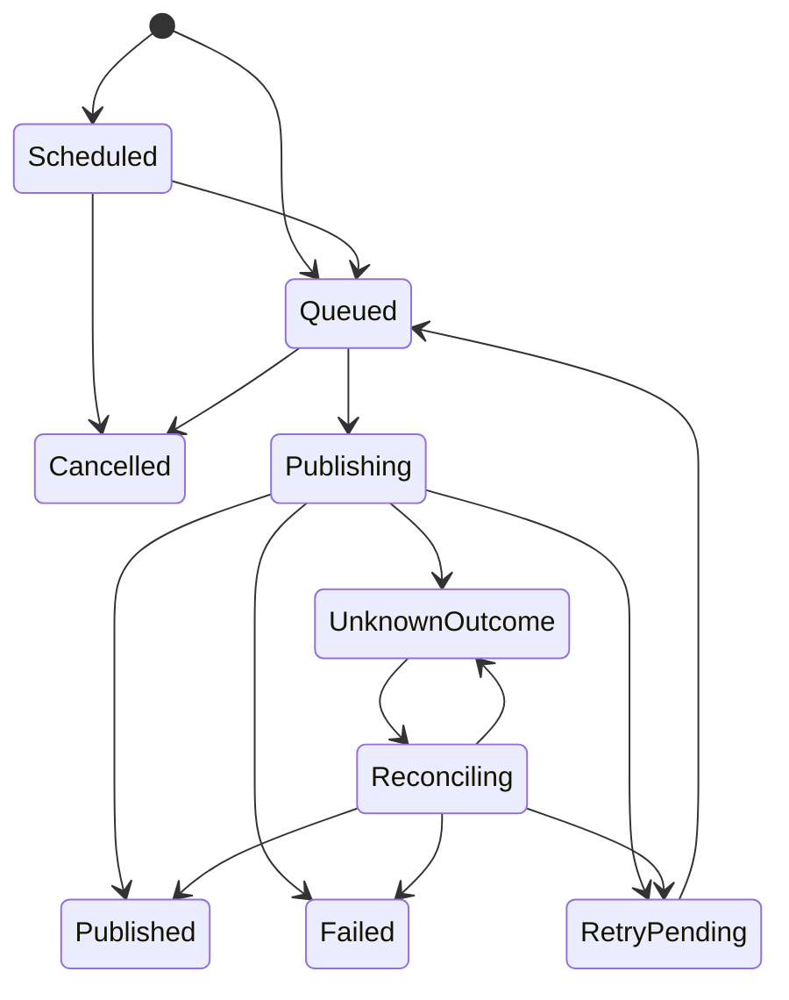

# PostFlow - API Specification

**Document:** `API_SPECIFICATION.md`  
**Product:** PostFlow  
**Version:** 1.0  
**Status:** Proposed API Contract  
**API Style:** REST  
**Base Path:** `/api/v1`  
**Backend:** Python + FastAPI  
**Validation:** Pydantic v2  
**Initial Deployment:** Local-first desktop application  
**Future Deployment:** SaaS API profile

---

## 1. Purpose

This document defines the PostFlow backend API contract.

It specifies:

- API conventions and versioning.
- Request and response formats.
- Authentication and local API protection.
- Resource ownership and workspace scope.
- Validation schemas.
- Endpoint definitions.
- Content and variant revision operations.
- AI provider operations.
- Media upload and management.
- Social account and OAuth operations.
- Approval and publishing workflows.
- Scheduling and calendar operations.
- Analytics, settings, and audit endpoints.
- Error codes and HTTP status behavior.
- Idempotency, pagination, filtering, and concurrency.
- API security and contract-testing requirements.

The API is consumed by the React frontend through the local FastAPI backend. The frontend must not directly call social platform publishing APIs.

## 2. API Design Principles

1. REST endpoints use nouns for resources and explicit commands for state transitions.
2. All endpoints are versioned under `/api/v1`.
3. Request and response payloads use JSON except for binary upload and download operations.
4. Pydantic schemas validate all external input.
5. Domain rules are enforced in application services, not only in request schemas.
6. Responses use consistent envelopes.
7. All timestamps use ISO-8601 UTC unless explicitly identified as local wall-clock input.
8. Collection endpoints support pagination.
9. Mutating commands support idempotency where duplicate execution would be harmful.
10. API errors use stable machine-readable error codes.
11. Sensitive values must never be returned to the frontend.
12. Publishing jobs are independent per destination account.
13. External platform failures must be normalized into stable PostFlow error categories.
14. AI provider failures must not silently trigger a different provider.
15. The API must accurately report unsupported or unverified platform capabilities.

## 3. API Base URL and Versioning

Development:

```text
http://127.0.0.1:<assigned-port>/api/v1
```

Production desktop:

- Bind only to `127.0.0.1`.
- Use a controlled local port.
- Provision a per-installation API secret to the trusted desktop runtime.
- Do not expose the local backend on `0.0.0.0`.
- Do not hardcode the API secret into frontend source code.
- Apply origin restrictions and request authentication.

Versioning:

```text
/api/v1
```

Breaking contract changes require a new API version or an explicitly versioned compatibility strategy.

Additive optional fields may be introduced without breaking existing consumers, provided the documented compatibility rules are followed.

## 4. Authentication and Authorization

### 4.1 Desktop local API authentication

All non-public local API endpoints must require the per-installation authentication mechanism.

Recommended request header:

```http
Authorization: Bearer <local-installation-token>
```

The token must:

- Be generated securely during installation or first-run initialization.
- Be stored using OS-backed secure storage.
- Be provisioned to the trusted Tauri runtime through a protected mechanism.
- Never be included in frontend source code, persistent browser storage, logs, crash reports, or API error responses.
- Be rotated through a controlled lifecycle.

Loopback binding is not sufficient authentication by itself.

### 4.2 Public local endpoints

The following may be unauthenticated only if they reveal no sensitive configuration or user data:

- `GET /health/live`
- `GET /health/ready`

The readiness endpoint must not reveal credentials, file paths, internal environment variables, or provider configuration secrets.

### 4.3 Workspace authorization

For every workspace-owned resource:

1. Resolve the requested workspace.
2. Verify that the resource belongs to that workspace.
3. Reject cross-workspace access.
4. Enforce role permissions in the future SaaS profile.
5. Never rely on frontend filtering as an authorization boundary.

The desktop profile may use a single local-user authorization model, but it must retain explicit workspace ownership checks.

## 5. Common API Conventions

### 5.1 Request headers

```http
Authorization: Bearer <token>
Content-Type: application/json
X-Correlation-ID: <uuid>
Idempotency-Key: <unique-operation-key>
If-Match: "<resource-version>"
```

Headers are required only where applicable.

| Header | Purpose |
|---|---|
| `Authorization` | Local API authentication |
| `Content-Type` | Request content type |
| `X-Correlation-ID` | Request tracing |
| `Idempotency-Key` | Safe replay of mutating commands |
| `If-Match` | Optimistic concurrency control |

The server may generate a correlation ID if the client does not provide one. If a client supplies one, validate its format and length.

### 5.2 Success response envelope

```json
{
  "success": true,
  "data": {
    "id": "0192f000-0000-7000-8000-000000000001",
    "status": "active"
  },
  "meta": {
    "correlation_id": "0192f000-0000-7000-8000-000000000002"
  }
}
```

### 5.3 Collection response envelope

```json
{
  "success": true,
  "data": [],
  "meta": {
    "correlation_id": "0192f000-0000-7000-8000-000000000002",
    "pagination": {
      "limit": 20,
      "next_cursor": null,
      "has_more": false
    }
  }
}
```

### 5.4 Error response envelope

```json
{
  "success": false,
  "error": {
    "code": "VALIDATION_ERROR",
    "message": "The request contains invalid fields.",
    "details": [
      {
        "field": "name",
        "code": "REQUIRED",
        "message": "A workspace name is required."
      }
    ],
    "retryable": false
  },
  "meta": {
    "correlation_id": "0192f000-0000-7000-8000-000000000002"
  }
}
```

Error messages must be useful without exposing internal stack traces, tokens, secrets, raw authorization headers, or sensitive provider response bodies.

## 6. Common Data Schemas

The following are API-level schemas. They are not database models. ORM models and Pydantic request/response schemas must remain separate.

### 6.1 Shared field types

| Field | Type | Rule |
|---|---|---|
| `id` | UUID string | Valid UUID |
| `created_at` | ISO-8601 datetime | UTC |
| `updated_at` | ISO-8601 datetime | UTC |
| `workspace_id` | UUID string | Must reference accessible workspace |
| `status` | Enum string | Must be an allowed state |
| `limit` | Integer | Default 20; maximum 100 |
| `cursor` | String | Opaque pagination cursor |

### 6.2 Workspace schemas

Create request:

```json
{
  "name": "DevSpireHub",
  "description": "Technical content workspace"
}
```

Validation:

- `name`: required, trimmed, 1–120 characters.
- `description`: optional, maximum 2,000 characters.
- Reject control characters and whitespace-only names.

Response:

```json
{
  "id": "0192f000-0000-7000-8000-000000000001",
  "name": "DevSpireHub",
  "description": "Technical content workspace",
  "status": "active",
  "created_at": "2026-11-08T16:00:00Z",
  "updated_at": "2026-11-08T16:00:00Z"
}
```

### 6.3 Brand schemas

```json
{
  "name": "DevSpireHub",
  "description": "Technical education brand",
  "voice": "Clear, technical and practical",
  "tone_guidelines": {
    "style": ["educational", "direct"],
    "avoid": ["unsupported claims", "excessive hype"]
  },
  "audience_profile": {
    "audience": "Developers and technology learners"
  },
  "content_guidelines": {
    "language": "en",
    "include_examples": true
  },
  "default_language": "en"
}
```

Validation:

- Brand name: 1–120 characters.
- JSON objects must match defined schemas.
- Reject unsupported or oversized JSON payloads.
- `default_language` must be a valid supported language identifier.

### 6.4 AI provider schemas

Create/update request:

```json
{
  "provider_key": "openai",
  "display_name": "OpenAI",
  "model_id": "selected-model",
  "credential_input": {
    "action": "replace"
  },
  "capabilities": [
    "text_generation",
    "structured_output"
  ],
  "is_enabled": true,
  "is_default": false,
  "configuration": {
    "timeout_seconds": 60
  }
}
```

Important:

- The example's `credential_input` is a command to the secure credential service, not a field for storing a token in SQLite.
- A real credential submission must be handled through a dedicated secure operation.
- Responses must never return raw credential values.
- Model and capability validation must use the provider adapter registry.
- Provider-specific settings must not be accepted blindly.

Provider response:

```json
{
  "id": "0192f000-0000-7000-8000-000000000010",
  "provider_key": "openai",
  "display_name": "OpenAI",
  "model_id": "selected-model",
  "credential_configured": true,
  "capabilities": [
    "text_generation",
    "structured_output"
  ],
  "is_enabled": true,
  "is_default": false,
  "last_test_status": "success",
  "last_tested_at": "2026-11-08T16:10:00Z"
}
```

### 6.5 Content schemas

Create request:

```json
{
  "workspace_id": "0192f000-0000-7000-8000-000000000001",
  "brand_id": "0192f000-0000-7000-8000-000000000020",
  "campaign_id": null,
  "title": "Introduction to Python Automation",
  "source_content": "Source content goes here.",
  "content_type": "text",
  "language": "en"
}
```

Validation:

- `title`: 1–250 characters.
- `source_content`: optional, subject to configured maximum length.
- `content_type`: supported enum.
- Brand and campaign must belong to the requested workspace.
- Reject invalid language identifiers.
- Enforce content-size limits before AI processing.

Content response:

```json
{
  "id": "0192f000-0000-7000-8000-000000000030",
  "workspace_id": "0192f000-0000-7000-8000-000000000001",
  "brand_id": "0192f000-0000-7000-8000-000000000020",
  "title": "Introduction to Python Automation",
  "content_type": "text",
  "status": "draft",
  "current_revision_number": 1,
  "created_at": "2026-11-08T16:20:00Z",
  "updated_at": "2026-11-08T16:20:00Z"
}
```

### 6.6 Variant schemas

Example variant payload:

```json
{
  "text": "A platform-specific caption.",
  "title": null,
  "description": null,
  "hashtags": ["#python", "#automation"],
  "call_to_action": "Learn more",
  "alt_text": "A screenshot showing a Python automation workflow.",
  "link_url": null,
  "platform_options": {}
}
```

Validation:

- Platform must be supported by the adapter registry.
- Payload must pass the platform-specific schema.
- URL fields must use allowed URL schemes.
- Hashtags must be normalized and length-limited.
- Text and media must satisfy platform-specific limits.
- Unsupported platform options must be rejected or explicitly ignored according to the contract. Silent dropping is not acceptable.
- The variant revision must be created when the payload changes.

### 6.7 Media schemas

Media upload uses `multipart/form-data`.

Metadata response:

```json
{
  "id": "0192f000-0000-7000-8000-000000000040",
  "original_filename": "campaign-image.png",
  "media_type": "image",
  "mime_type": "image/png",
  "file_size_bytes": 245760,
  "width": 1200,
  "height": 630,
  "status": "ready",
  "created_at": "2026-11-08T16:30:00Z"
}
```

The server must generate the stored filename and storage key.

### 6.8 Social account schemas

Account response:

```json
{
  "id": "0192f000-0000-7000-8000-000000000050",
  "workspace_id": "0192f000-0000-7000-8000-000000000001",
  "platform": "linkedin",
  "external_account_id": "platform-account-id",
  "account_name": "Example Page",
  "account_type": "organization",
  "status": "connected",
  "permissions": [
    "verified-scope"
  ],
  "capabilities": {
    "publish_text": true,
    "publish_image": true,
    "publish_video": false
  },
  "last_verified_at": "2026-11-08T16:35:00Z"
}
```

Capability values must come from verified adapter behavior and current authorization. Do not return a capability as supported merely because the platform name exists in the UI.

### 6.9 Approval schemas

Approval request:

```json
{
  "variant_revision_id": "0192f000-0000-7000-8000-000000000060",
  "comment": "Reviewed and approved."
}
```

The server must verify that:

- The revision belongs to the specified variant.
- The revision is still the intended revision.
- The caller is authorized to approve.
- The approval policy permits the action.

### 6.10 Publishing schemas

Create publishing request:

```json
{
  "variant_id": "0192f000-0000-7000-8000-000000000070",
  "variant_revision_id": "0192f000-0000-7000-8000-000000000071",
  "destination_account_ids": [
    "0192f000-0000-7000-8000-000000000050"
  ],
  "mode": "immediate"
}
```

Scheduled publishing request:

```json
{
  "variant_id": "0192f000-0000-7000-8000-000000000070",
  "variant_revision_id": "0192f000-0000-7000-8000-000000000071",
  "destination_account_ids": [
    "0192f000-0000-7000-8000-000000000050"
  ],
  "mode": "scheduled",
  "scheduled_local_time": "2026-11-10T18:30:00",
  "timezone": "Asia/Kolkata"
}
```

The API must resolve the local wall-clock time using the supplied IANA timezone and persist the resulting UTC instant.

Reject ambiguous or nonexistent local times around daylight-saving transitions unless the API contract explicitly defines how they are resolved.

Each destination account produces an independent job.

### 6.11 Pagination schema

Query:

```text
?limit=20&cursor=<opaque-cursor>
```

Rules:

- Default limit: 20.
- Maximum limit: 100.
- Cursor is opaque and server-generated.
- Use stable ordering with a unique tie-breaker.
- Do not use offset pagination for high-volume worker or audit queries when cursor pagination is more appropriate.

## 7. Endpoint Catalogue

Base path: `/api/v1`

### 7.1 System and health

| Method | Endpoint | Purpose |
|---|---|---|
| GET | `/health/live` | Process liveness |
| GET | `/health/ready` | Dependency readiness |
| GET | `/system/status` | Application runtime status |
| GET | `/system/version` | Application and API versions |

`GET /health/ready` must check required local dependencies without exposing secrets.

`GET /system/status` may report:

- Backend status.
- Database connectivity.
- Migration revision.
- Worker status.
- Media directory availability.
- AI provider connection status without credentials.
- Scheduler status.

### 7.2 Workspaces

| Method | Endpoint | Purpose |
|---|---|---|
| GET | `/workspaces` | List workspaces |
| POST | `/workspaces` | Create workspace |
| GET | `/workspaces/{workspace_id}` | Get workspace |
| PATCH | `/workspaces/{workspace_id}` | Update workspace |
| POST | `/workspaces/{workspace_id}/archive` | Archive workspace |
| POST | `/workspaces/{workspace_id}/activate` | Set active workspace |

### 7.3 Brands

| Method | Endpoint | Purpose |
|---|---|---|
| GET | `/workspaces/{workspace_id}/brands` | List brands |
| POST | `/workspaces/{workspace_id}/brands` | Create brand |
| GET | `/brands/{brand_id}` | Get brand |
| PATCH | `/brands/{brand_id}` | Update brand |
| DELETE | `/brands/{brand_id}` | Delete brand, subject to reference rules |

### 7.4 AI providers

| Method | Endpoint | Purpose |
|---|---|---|
| GET | `/ai/providers` | List supported provider adapters |
| GET | `/ai/provider-configs` | List configured providers |
| POST | `/ai/provider-configs` | Create provider configuration |
| PATCH | `/ai/provider-configs/{config_id}` | Update configuration |
| DELETE | `/ai/provider-configs/{config_id}` | Remove configuration |
| POST | `/ai/provider-configs/{config_id}/credentials` | Store or replace credential securely |
| DELETE | `/ai/provider-configs/{config_id}/credentials` | Remove stored credential |
| POST | `/ai/provider-configs/{config_id}/test` | Test provider connectivity |
| POST | `/ai/provider-configs/{config_id}/set-default` | Set default provider |
| GET | `/ai/provider-configs/{config_id}/usage` | Get usage metadata |

`GET /ai/providers` returns adapter metadata and supported capabilities. It does not imply that the user has configured or authorized the provider.

### 7.5 Content

| Method | Endpoint | Purpose |
|---|---|---|
| GET | `/workspaces/{workspace_id}/content` | List content |
| POST | `/workspaces/{workspace_id}/content` | Create content |
| GET | `/content/{content_id}` | Get content |
| PATCH | `/content/{content_id}` | Create a new source revision from edits |
| DELETE | `/content/{content_id}` | Delete or archive content according to policy |
| GET | `/content/{content_id}/revisions` | List source revisions |
| GET | `/content/{content_id}/revisions/{revision_id}` | Get source revision |

A content update must create a new revision. Do not mutate a historical revision.

### 7.6 AI generation and research

| Method | Endpoint | Purpose |
|---|---|---|
| POST | `/content/{content_id}/generate` | Generate content |
| POST | `/content/{content_id}/research` | Research a topic |
| POST | `/content/{content_id}/refine` | Refine source content |
| POST | `/content/{content_id}/compare` | Compare selected providers |
| GET | `/ai/generation-runs` | List generation history |
| GET | `/ai/generation-runs/{run_id}` | Get generation details |
| POST | `/ai/generation-runs/{run_id}/cancel` | Cancel a cancellable generation |

Generation requests must disclose the data categories and provider destination before transmitting user content where required by product policy.

Provider fallback must be explicit and user-authorized. Never silently send the same data to another provider after a failure.

### 7.7 Variants and revisions

| Method | Endpoint | Purpose |
|---|---|---|
| GET | `/content/{content_id}/variants` | List variants |
| POST | `/content/{content_id}/variants` | Create variant |
| GET | `/variants/{variant_id}` | Get variant |
| PATCH | `/variants/{variant_id}` | Create a new variant revision |
| GET | `/variants/{variant_id}/revisions` | List revisions |
| GET | `/variants/{variant_id}/revisions/{revision_id}` | Get revision |
| POST | `/variants/{variant_id}/adapt` | Generate platform-specific adaptation |
| POST | `/variants/{variant_id}/validate` | Validate variant |
| POST | `/variants/{variant_id}/preview` | Generate platform preview |

Editing a variant creates a new revision and invalidates approval for the prior revision as a basis for publishing the new revision.

### 7.8 Media

| Method | Endpoint | Purpose |
|---|---|---|
| GET | `/workspaces/{workspace_id}/media` | List media |
| POST | `/workspaces/{workspace_id}/media` | Upload media |
| GET | `/media/{media_id}` | Get media metadata |
| GET | `/media/{media_id}/preview` | Retrieve preview |
| POST | `/media/{media_id}/transform` | Transform media |
| DELETE | `/media/{media_id}` | Delete media safely |
| GET | `/media/{media_id}/transformations` | List transformations |

Upload rules:

- Enforce maximum file size.
- Validate file signatures and MIME type.
- Generate safe filenames.
- Prevent path traversal.
- Store files only inside the managed media directory.
- Process media in bounded background tasks.
- Do not execute uploaded content.
- Return a processing status if transformation is asynchronous.

### 7.9 Social account and OAuth

| Method | Endpoint | Purpose |
|---|---|---|
| GET | `/workspaces/{workspace_id}/accounts` | List connected accounts |
| GET | `/accounts/{account_id}` | Get account |
| POST | `/integrations/{platform}/connect` | Start OAuth flow |
| GET | `/integrations/{platform}/callback` | Handle OAuth callback |
| POST | `/accounts/{account_id}/refresh` | Refresh account metadata/token |
| POST | `/accounts/{account_id}/verify` | Verify permissions and capabilities |
| DELETE | `/accounts/{account_id}` | Disconnect account |

OAuth requirements:

- Validate state.
- Use PKCE where supported.
- Validate callback parameters.
- Prevent callback replay.
- Never log authorization codes or tokens.
- Store credentials in OS-backed secure storage.
- Persist only credential references and non-secret metadata.
- Remove credentials when an account is disconnected, subject to platform revocation behavior.
- Revalidate permissions before publishing.

### 7.10 Approval

| Method | Endpoint | Purpose |
|---|---|---|
| GET | `/variants/{variant_id}/approvals` | List approval history |
| POST | `/variants/{variant_id}/approve` | Approve exact revision |
| POST | `/variants/{variant_id}/reject` | Reject exact revision |
| POST | `/approvals/{approval_id}/revoke` | Revoke approval where permitted |

Approval request:

```json
{
  "variant_revision_id": "0192f000-0000-7000-8000-000000000071",
  "comment": "Approved for publication."
}
```

The API must reject approval requests that do not reference a valid revision belonging to the requested variant.

### 7.11 Publishing

| Method | Endpoint | Purpose |
|---|---|---|
| POST | `/publish` | Create immediate publishing jobs |
| POST | `/publish/validate` | Validate publication readiness |
| GET | `/publish/jobs` | List publishing jobs |
| GET | `/publish/jobs/{job_id}` | Get job details |
| POST | `/publish/jobs/{job_id}/retry` | Request eligible retry |
| POST | `/publish/jobs/{job_id}/cancel` | Cancel eligible job |
| POST | `/publish/jobs/{job_id}/reconcile` | Reconcile unknown outcome |
| GET | `/publish/history` | List confirmed publication history |
| GET | `/publish/attempts/{attempt_id}` | Get attempt details |

A multi-destination request creates one job per destination. The response must report each job independently.

Example:

```json
{
  "success": true,
  "data": {
    "jobs": [
      {
        "job_id": "0192f000-0000-7000-8000-000000000080",
        "destination_account_id": "0192f000-0000-7000-8000-000000000050",
        "status": "queued"
      }
    ]
  },
  "meta": {
    "correlation_id": "0192f000-0000-7000-8000-000000000002"
  }
}
```

The endpoint must not report a publication as successful merely because a job was queued.

### 7.12 Scheduling and calendar

| Method | Endpoint | Purpose |
|---|---|---|
| POST | `/schedule` | Create scheduled jobs |
| GET | `/schedule` | List schedules |
| GET | `/schedule/{schedule_id}` | Get schedule |
| PATCH | `/schedule/{schedule_id}` | Modify schedule if still eligible |
| POST | `/schedule/{schedule_id}/pause` | Pause schedule |
| POST | `/schedule/{schedule_id}/resume` | Resume schedule |
| POST | `/schedule/{schedule_id}/cancel` | Cancel schedule |
| GET | `/calendar` | Retrieve calendar entries |

Calendar query:

```text
GET /calendar?from=2026-11-01T00:00:00Z&to=2026-11-30T23:59:59Z&timezone=Asia/Kolkata
```

Validate the date range and timezone. Do not interpret timezone-less UTC query parameters ambiguously.

Desktop limitation: scheduled execution requires the application or its background worker to be operational, with the machine powered on and network connectivity available.

### 7.13 Campaigns

| Method | Endpoint | Purpose |
|---|---|---|
| GET | `/workspaces/{workspace_id}/campaigns` | List campaigns |
| POST | `/workspaces/{workspace_id}/campaigns` | Create campaign |
| GET | `/campaigns/{campaign_id}` | Get campaign |
| PATCH | `/campaigns/{campaign_id}` | Update campaign |
| DELETE | `/campaigns/{campaign_id}` | Archive or delete according to references |

### 7.14 Analytics

| Method | Endpoint | Purpose |
|---|---|---|
| GET | `/analytics/overview` | Workspace overview |
| GET | `/analytics/platforms` | Platform metrics |
| GET | `/analytics/posts/{published_post_id}` | Published post metrics |
| GET | `/analytics/campaigns/{campaign_id}` | Campaign metrics |
| POST | `/analytics/sync` | Request supported analytics synchronization |

Only display metrics retrieved from actual platform APIs or explicitly imported data. Missing analytics must be represented as unavailable, not zero or fabricated.

### 7.15 Audit and activity

| Method | Endpoint | Purpose |
|---|---|---|
| GET | `/activity` | List activity events |
| GET | `/audit-logs` | List audit events |
| GET | `/audit-logs/{event_id}` | Get audit event |

Sensitive values must be redacted before audit persistence.

### 7.16 Settings and data management

| Method | Endpoint | Purpose |
|---|---|---|
| GET | `/settings` | Read non-secret settings |
| PATCH | `/settings` | Update settings |
| POST | `/system/backup` | Create backup |
| GET | `/system/backups` | List backups |
| POST | `/system/restore` | Restore verified backup |
| POST | `/system/export` | Export user data |
| DELETE | `/system/data` | Execute explicit data-deletion workflow |

Backup and restore operations must be staged and verified. Do not overwrite active application data before the restore package has passed validation.

## 8. Important Command Contracts

### 8.1 Create publishing jobs

```http
POST /api/v1/publish
Idempotency-Key: 7c4c1b80-...
```

Request:

```json
{
  "variant_id": "0192f000-0000-7000-8000-000000000070",
  "variant_revision_id": "0192f000-0000-7000-8000-000000000071",
  "destination_account_ids": [
    "0192f000-0000-7000-8000-000000000050",
    "0192f000-0000-7000-8000-000000000051"
  ],
  "mode": "immediate"
}
```

Processing:

1. Authenticate request.
2. Resolve workspace ownership.
3. Validate variant and revision relationship.
4. Validate approval for the exact revision.
5. Validate each destination account independently.
6. Validate platform capabilities and media constraints.
7. Create one publishing job per valid destination within a transaction.
8. Apply idempotency checks.
9. Commit jobs.
10. Return job identifiers and initial states.

If one destination is invalid, the API must follow a documented partial-success policy. The recommended behavior is to return per-destination results and avoid creating jobs for invalid destinations. Valid destinations may proceed only if the request explicitly allows partial acceptance.

### 8.2 Publish job response

```json
{
  "id": "0192f000-0000-7000-8000-000000000080",
  "status": "queued",
  "variant_id": "0192f000-0000-7000-8000-000000000070",
  "variant_revision_id": "0192f000-0000-7000-8000-000000000071",
  "social_account_id": "0192f000-0000-7000-8000-000000000050",
  "scheduled_at": null,
  "attempt_count": 0,
  "created_at": "2026-11-08T17:00:00Z"
}
```

### 8.3 Retry contract

Retry is a command, not a generic status update.

The server must:

- Verify the job is in an eligible state.
- Reject retry if the outcome is unknown.
- Verify the latest attempt and failure classification.
- Revalidate account authorization.
- Revalidate the exact approved revision.
- Revalidate media and platform constraints.
- Enforce maximum attempts.
- Create a new attempt record when execution begins.
- Preserve the historical failure record.

A client must not be able to set a job's status directly to `queued`.

### 8.4 Reconciliation contract

```http
POST /api/v1/publish/jobs/{job_id}/reconcile
```

Request:

```json
{
  "resolution": "check_platform"
}
```

Allowed resolutions must be constrained by adapter capability.

Possible outcomes:

- `published`: external publication confirmed.
- `not_published`: platform evidence establishes that publication did not occur.
- `unknown`: outcome remains uncertain.
- `manual_review_required`: automatic reconciliation is unsupported.

A platform that does not expose reliable reconciliation must not be represented as supporting automatic reconciliation.

## 9. Publishing State Machine



Approval state is managed separately.

Rules:

- A job must reference an exact variant revision.
- The worker must claim a job atomically.
- External network calls must occur outside database transactions.
- Attempt history must be persisted.
- An uncertain external result must enter `unknown_outcome`.
- Retry is allowed only when safe.
- A completed job cannot be silently re-executed.
- A deliberate repost must use a new operation identity.

## 10. Pydantic Validation Strategy

### 10.1 Schema organization

Recommended structure:

```text
backend/app/
├── api/
│   ├── routes/
│   ├── dependencies/
│   └── exception_handlers.py
├── schemas/
│   ├── common.py
│   ├── workspace.py
│   ├── brand.py
│   ├── ai_provider.py
│   ├── content.py
│   ├── variant.py
│   ├── media.py
│   ├── account.py
│   ├── approval.py
│   ├── publishing.py
│   ├── scheduling.py
│   ├── analytics.py
│   └── errors.py
├── domain/
├── services/
├── repositories/
└── integrations/
```

### 10.2 Example shared Pydantic schema

```python
from datetime import datetime, timezone
from uuid import UUID

from pydantic import BaseModel, ConfigDict, Field, field_validator


class APIModel(BaseModel):
    model_config = ConfigDict(
        extra="forbid",
        str_strip_whitespace=True,
        validate_assignment=True,
    )


class WorkspaceCreate(APIModel):
    name: str = Field(min_length=1, max_length=120)
    description: str | None = Field(default=None, max_length=2000)


class WorkspaceResponse(APIModel):
    id: UUID
    name: str
    description: str | None
    status: str
    created_at: datetime
    updated_at: datetime

    @field_validator("created_at", "updated_at")
    @classmethod
    def require_timezone(cls, value: datetime) -> datetime:
        if value.tzinfo is None or value.utcoffset() is None:
            raise ValueError("Timestamp must include timezone information")
        return value.astimezone(timezone.utc)
```

### 10.3 Validation layers

Validation must occur at multiple levels:

**Layer 1 - Request schema validation**

- Field types.
- Required fields.
- Length limits.
- Enum values.
- JSON shape.
- Timestamp format.

**Layer 2 - Resource validation**

- Resource exists.
- Resource belongs to the workspace.
- Account is connected.
- Media is available.
- Revision belongs to variant.

**Layer 3 - Domain validation**

- Approval required.
- State transition permitted.
- Publishing operation is idempotent.
- Retry is safe.
- Schedule is valid.

**Layer 4 - Integration validation**

- Platform capability exists.
- OAuth permissions are sufficient.
- Media requirements are satisfied.
- Provider supports requested capability.
- API-specific restrictions are satisfied.

Pydantic validation alone does not establish authorization or business-rule correctness.

## 11. Error Handling

### 11.1 HTTP status mapping

| HTTP status | Meaning | Typical use |
|---|---|---|
| `400` | Bad request | Invalid command or malformed request |
| `401` | Unauthorized | Missing or invalid local API authentication |
| `403` | Forbidden | Authenticated but not permitted |
| `404` | Not found | Resource does not exist or is not accessible |
| `409` | Conflict | State conflict, duplicate operation, stale revision |
| `413` | Payload too large | Media upload exceeds limit |
| `415` | Unsupported media type | Unsupported upload format |
| `422` | Validation error | Schema or semantic validation failure |
| `423` | Locked | Resource temporarily locked, if used consistently |
| `429` | Too many requests | Local or provider rate limit |
| `500` | Internal server error | Unexpected internal failure |
| `502` | Bad gateway | Invalid upstream provider response |
| `503` | Service unavailable | Required local or external service unavailable |
| `504` | Gateway timeout | Upstream request timed out |

Use `409` for business-state conflicts. Use `422` for invalid request data or semantic input that cannot be accepted.

### 11.2 Error code catalogue

#### General

| Code | HTTP | Description |
|---|---:|---|
| `VALIDATION_ERROR` | 422 | Invalid request data |
| `RESOURCE_NOT_FOUND` | 404 | Resource not found |
| `RESOURCE_CONFLICT` | 409 | Resource state conflict |
| `UNAUTHORIZED` | 401 | Authentication required |
| `FORBIDDEN` | 403 | Permission denied |
| `INTERNAL_ERROR` | 500 | Unexpected server error |
| `SERVICE_UNAVAILABLE` | 503 | Dependency unavailable |
| `RATE_LIMITED` | 429 | Request rate limit reached |
| `STALE_RESOURCE_VERSION` | 409 | Concurrent modification detected |

#### Workspace and content

| Code | HTTP | Description |
|---|---:|---|
| `WORKSPACE_NOT_FOUND` | 404 | Workspace does not exist |
| `WORKSPACE_ACCESS_DENIED` | 403 | Workspace not accessible |
| `CONTENT_NOT_FOUND` | 404 | Content not found |
| `CONTENT_REVISION_NOT_FOUND` | 404 | Revision not found |
| `VARIANT_NOT_FOUND` | 404 | Variant not found |
| `VARIANT_REVISION_MISMATCH` | 409 | Revision does not belong to variant |
| `PLATFORM_VALIDATION_FAILED` | 422 | Platform content validation failed |

#### AI provider

| Code | HTTP | Description |
|---|---:|---|
| `AI_PROVIDER_NOT_CONFIGURED` | 409 | Provider configuration missing |
| `AI_CREDENTIAL_MISSING` | 409 | Credential not configured |
| `AI_AUTHENTICATION_FAILED` | 502 | Provider rejected credentials |
| `AI_RATE_LIMITED` | 429 | Provider rate limit |
| `AI_PROVIDER_UNAVAILABLE` | 503 | Provider unavailable |
| `AI_REQUEST_TIMEOUT` | 504 | Provider request timed out |
| `AI_OUTPUT_INVALID` | 502 | Provider output failed validation |
| `AI_CAPABILITY_UNSUPPORTED` | 422 | Provider lacks requested capability |
| `AI_FALLBACK_NOT_AUTHORIZED` | 403 | Fallback not authorized |

#### Media

| Code | HTTP | Description |
|---|---:|---|
| `MEDIA_NOT_FOUND` | 404 | Media record missing |
| `MEDIA_TOO_LARGE` | 413 | File exceeds configured limit |
| `MEDIA_TYPE_UNSUPPORTED` | 415 | Unsupported media type |
| `MEDIA_SIGNATURE_INVALID` | 422 | File signature does not match |
| `MEDIA_PROCESSING_FAILED` | 422 | Transformation failed |
| `MEDIA_IN_USE` | 409 | Asset cannot be safely deleted |
| `MEDIA_STORAGE_UNAVAILABLE` | 503 | Media storage unavailable |

#### Social accounts and OAuth

| Code | HTTP | Description |
|---|---:|---|
| `ACCOUNT_NOT_FOUND` | 404 | Social account missing |
| `ACCOUNT_DISCONNECTED` | 409 | Account disconnected |
| `ACCOUNT_TOKEN_EXPIRED` | 409 | Authorization expired |
| `ACCOUNT_PERMISSION_INSUFFICIENT` | 403 | Required scope missing |
| `OAUTH_STATE_INVALID` | 400 | Invalid OAuth state |
| `OAUTH_CALLBACK_REJECTED` | 400 | Callback validation failed |
| `PLATFORM_UNAVAILABLE` | 503 | Platform unavailable |
| `PLATFORM_CAPABILITY_UNSUPPORTED` | 422 | Requested action unsupported |

#### Approval and publishing

| Code | HTTP | Description |
|---|---:|---|
| `APPROVAL_REQUIRED` | 409 | Exact revision not approved |
| `APPROVAL_REVISION_STALE` | 409 | Approval references older revision |
| `APPROVAL_INVALID` | 409 | Approval cannot be used |
| `PUBLISH_JOB_NOT_FOUND` | 404 | Job missing |
| `PUBLISH_STATE_INVALID` | 409 | Invalid state transition |
| `PUBLISH_DUPLICATE_OPERATION` | 409 | Operation already exists |
| `PUBLISH_RETRY_NOT_ALLOWED` | 409 | Retry is unsafe or not permitted |
| `PUBLISH_OUTCOME_UNKNOWN` | 409 | External result uncertain |
| `PUBLISH_RECONCILIATION_UNSUPPORTED` | 422 | Platform cannot reconcile automatically |
| `PUBLISH_MEDIA_INVALID` | 422 | Media does not satisfy platform constraints |
| `PUBLISH_VALIDATION_FAILED` | 422 | Publication preflight failed |

#### Scheduling and system

| Code | HTTP | Description |
|---|---:|---|
| `SCHEDULE_INVALID` | 422 | Invalid scheduled time |
| `SCHEDULE_IN_PAST` | 422 | Scheduled time is in the past |
| `SCHEDULE_NOT_FOUND` | 404 | Schedule missing |
| `SCHEDULE_STATE_INVALID` | 409 | Schedule cannot transition |
| `WORKER_UNAVAILABLE` | 503 | Background worker unavailable |
| `BACKUP_VALIDATION_FAILED` | 422 | Backup failed validation |
| `RESTORE_FAILED` | 500 | Restore could not complete safely |
| `DATABASE_MIGRATION_FAILED` | 503 | Database migration failed |

### 11.3 Exception handling architecture

Recommended structure:

```text
api/
├── exception_handlers.py
├── error_mapping.py
└── dependencies.py

domain/
└── exceptions.py

services/
└── exceptions.py
```

Use domain exceptions for business failures. Map them to HTTP errors at the API boundary.

Do not raise `HTTPException` from deep domain or repository layers.

Example:

```python
class DomainError(Exception):
    code = "DOMAIN_ERROR"
    message = "A domain operation failed."
    retryable = False


class ApprovalRequiredError(DomainError):
    code = "APPROVAL_REQUIRED"
    message = "The current content revision has not been approved."
```

API handler:

```python
from fastapi import Request
from fastapi.responses import JSONResponse


async def domain_exception_handler(
    request: Request,
    exc: DomainError,
) -> JSONResponse:
    status_code = map_domain_error_to_http_status(exc)

    return JSONResponse(
        status_code=status_code,
        content={
            "success": False,
            "error": {
                "code": exc.code,
                "message": exc.message,
                "details": [],
                "retryable": exc.retryable,
            },
            "meta": {
                "correlation_id": get_correlation_id(request),
            },
        },
    )
```

This is a structural example. The implementation must include safe serialization, logging, and a complete domain-error mapping.

### 11.4 Internal error handling

Unexpected exceptions must:

- Be logged with a correlation ID.
- Include a sanitized stack trace only in protected developer logs.
- Return a generic `INTERNAL_ERROR` response.
- Never return raw tracebacks to the frontend.
- Never expose local API secrets, OAuth tokens, API keys, or sensitive provider payloads.

### 11.5 External provider error normalization

Each AI and social adapter must translate provider-specific failures into PostFlow's normalized error categories.

Example categories:

- Authentication.
- Authorization.
- Rate limit.
- Temporary outage.
- Timeout.
- Invalid request.
- Unsupported capability.
- Unknown outcome.

Do not expose provider-specific response formats as the application's public API contract.

## 12. Idempotency and Concurrency

### 12.1 Idempotency requirements

Use idempotency keys for operations such as:

- Creating publishing jobs.
- Scheduling publishing.
- Creating OAuth connection transactions.
- Starting media transformations where duplicate execution is costly.
- Other commands where a repeated request could create duplicate side effects.

Rules:

1. Client supplies a unique key for one logical operation.
2. Server records the key and operation result.
3. A repeated request with the same key and equivalent payload returns the original result.
4. Reusing the same key with a different payload returns `409`.
5. Keys must be scoped to the authenticated installation/workspace and operation.
6. Key retention must be long enough to cover retries and recovery.
7. A new intentional publication must use a new logical operation key.

### 12.2 Optimistic concurrency

Use `If-Match` or a revision number for mutable resources.

Example:

```http
PATCH /api/v1/variants/{variant_id}
If-Match: "revision-4"
```

If the stored revision has changed, return:

```json
{
  "success": false,
  "error": {
    "code": "STALE_RESOURCE_VERSION",
    "message": "The resource changed after it was loaded.",
    "details": [],
    "retryable": false
  },
  "meta": {
    "correlation_id": "0192f000-0000-7000-8000-000000000002"
  }
}
```

Do not silently overwrite a newer revision.

### 12.3 Job claiming

Worker job claiming must use a short atomic database transaction.

The worker must:

1. Find an eligible job.
2. Atomically claim it.
3. Set worker identity and claim expiry.
4. Commit the claim.
5. Execute external work outside the transaction.
6. Persist attempt and outcome.

Two workers must not claim the same job concurrently.

## 13. Rate Limiting and Timeouts

### 13.1 Local API

Apply sensible request limits to expensive operations:

- AI generation.
- Media upload.
- Media transformation.
- Analytics synchronization.
- OAuth connection initiation.
- Backup and restore.

### 13.2 External integrations

Each adapter must define:

- Connection timeout.
- Read timeout.
- Maximum response size.
- Retry policy.
- Rate-limit interpretation.
- Retry-after behavior.
- Supported cancellation behavior.

Do not use a single global retry policy for all external APIs.

### 13.3 AI request timeouts

AI generation should have configurable timeouts and cancellation behavior.

A timeout does not prove the provider did not process the request. Record the execution result as uncertain where appropriate, particularly when usage billing or duplicate generation matters.

## 14. Security Requirements

- Bind the local API to loopback only.
- Require local API authentication.
- Use strict request validation.
- Restrict CORS/origins to the trusted desktop application.
- Protect OAuth state and PKCE.
- Store credentials through OS-backed secure storage.
- Redact secrets from logs and errors.
- Validate uploaded media signatures.
- Prevent path traversal.
- Enforce workspace ownership.
- Treat AI output as untrusted.
- Require explicit approval before publishing when approval policy requires it.
- Never silently route data to an alternate AI provider.
- Do not provide browser automation or scraping as a workaround for unavailable platform APIs.
- Respect platform API permissions, terms, rate limits, and commercial restrictions.

## 15. API Documentation and OpenAPI

FastAPI should generate OpenAPI documentation from the actual Pydantic schemas and route definitions.

Recommended local documentation endpoints:

```text
/docs
/redoc
/openapi.json
```

Production desktop packaging may disable interactive documentation by default or make it accessible only in developer mode.

OpenAPI must include:

- Request schemas.
- Response schemas.
- Error schemas.
- Authentication scheme.
- Pagination parameters.
- Idempotency headers.
- Relevant HTTP status codes.
- Endpoint descriptions.
- Deprecated endpoint metadata where applicable.

Do not maintain a hand-written OpenAPI file that drifts from the actual implementation.

## 16. API Testing Strategy

### 16.1 Schema tests

- Required and optional fields.
- Length boundaries.
- Enum rejection.
- UUID validation.
- Timestamp timezone validation.
- Extra-field rejection.
- JSON schema validation.
- File metadata validation.

### 16.2 Contract tests

- Response envelope consistency.
- Error envelope consistency.
- OpenAPI generation.
- Pagination behavior.
- Idempotency behavior.
- Optimistic concurrency.
- Authentication behavior.
- Workspace access isolation.

### 16.3 Integration tests

- Database persistence.
- Alembic migration compatibility.
- OAuth callback validation.
- Secure credential reference behavior.
- AI adapter normalization.
- Social adapter normalization.
- Media upload and transformation.
- Approval and publishing revision integrity.

### 16.4 Publishing reliability tests

- One job per destination account.
- Duplicate request returns the original job.
- Same idempotency key with a different payload is rejected.
- Worker claim is atomic.
- Job survives application restart.
- Retry is denied for unknown outcome.
- Reconciliation can confirm publication.
- One destination failure does not erase another destination's result.
- Platform API timeout is not automatically classified as a definite failure.

## 17. Acceptance Criteria Mapping

| Acceptance criterion | API responsibility |
|---|---|
| `AC-APP-002` | Local API authentication and security |
| `AC-APP-003` to `AC-APP-005` | Workspace and system operations |
| `AC-BRAND-001` to `AC-BRAND-002` | Brand contracts |
| `AC-AI-001` to `AC-AI-008` | Provider configuration, disclosure, generation and fallback |
| `AC-CONTENT-001` to `AC-CONTENT-006` | Content generation, revision and research |
| `AC-MEDIA-001` to `AC-MEDIA-005` | Media upload, preview, transformation and validation |
| `AC-COMPOSER-001` to `AC-COMPOSER-005` | Variant creation, adaptation and validation |
| `AC-ACCOUNT-001` to `AC-ACCOUNT-005` | OAuth, account and permission management |
| `AC-APPROVAL-001` to `AC-APPROVAL-004` | Approval commands and revision checks |
| `AC-PUBLISH-001` to `AC-PUBLISH-009` | Preflight, idempotency, attempts, reconciliation and platform adapters |
| `AC-SCHEDULE-001` to `AC-SCHEDULE-005` | Scheduling and recovery |
| `AC-CALENDAR-001` to `AC-CALENDAR-003` | Calendar query and actions |
| `AC-ANALYTICS-001` to `AC-ANALYTICS-003` | Actual platform metric retrieval |
| `AC-SETTINGS-001` to `AC-SETTINGS-005` | Settings, backup, restore, deletion and export |
| `AC-SEC-001` to `AC-SEC-007` | Authentication, secret handling, OAuth, file security and audit |

## 18. Implementation Order

| Phase | API implementation | Dependencies |
|---|---|---|
| 1 | Health, authentication, workspaces, settings | Local runtime |
| 2 | Brands and AI provider configuration | Secure storage |
| 3 | Content, revisions, variants | Database schema |
| 4 | AI generation and provider adapters | AI credentials |
| 5 | Media upload and transformation | Filesystem |
| 6 | Social accounts and OAuth | Platform developer access |
| 7 | Approval workflow | Variant revisions |
| 8 | Publishing preflight and jobs | Platform adapters |
| 9 | Worker, retry and reconciliation | Persistent job storage |
| 10 | Scheduling and calendar | Worker |
| 11 | Audit and analytics | Platform capabilities |
| 12 | SaaS API extensions | Authentication and tenant model |

## 19. Release Gates

The API is not release-ready until:

- OpenAPI matches the implemented routes and schemas.
- All mutating endpoints enforce authorization.
- All workspace-owned resources enforce workspace boundaries.
- Error responses are consistent.
- No endpoint returns credentials or sensitive provider payloads.
- Idempotency works for publishing operations.
- Optimistic concurrency prevents silent overwrites.
- Approval is revision-bound.
- Publishing jobs reference exact revisions and destination accounts.
- Unknown outcomes cannot be blindly retried.
- Platform capability checks are evidence-based.
- API contract tests pass.
- Security tests pass.
- No unresolved critical or high-severity API security issue remains.

**Final recommendation:** Keep the PostFlow API as a versioned REST interface over the modular monolith. Separate resource CRUD from business commands, use Pydantic schemas at the boundary, enforce domain invariants in application services, and make publishing idempotency and error normalization first-class API requirements.

## M0 Reconciliation — API Contract Constraints

**Authority:** `docs/IMPLEMENTATION_BASELINE.md` and `docs/BUILD_READINESS_REPORT.md`. This addendum supersedes conflicting MVP scope and design assumptions in this document. The target is a single-user, local-first Windows desktop MVP. Windows 11 is the production support baseline; Windows 10 is best-effort development only. P0 includes Tauri 2/Rust, React/TypeScript, supervised FastAPI, SQLite/SQLAlchemy/Alembic, local media, source content and independent revisioned variants, one AI provider, exact human approval, durable per-destination publishing jobs, idempotency/immutable attempts/unknown-outcome reconciliation, one-time local scheduling, privacy, backup and restore. At most one official social-platform integration may be enabled, and only after a documented PASS feasibility gate. Scheduling requires the app/worker active, device awake and internet available. Campaigns, team membership/roles, collaboration, billing, SaaS, cloud scheduling, public API, cloud media relay, additional AI providers/platforms, multi-provider comparison/fallback and advanced social analytics are P1/Future, not MVP requirements.

FastAPI desktop mode binds to 127.0.0.1 only. React reaches protected API operations through narrow Tauri/Rust IPC; Rust owns and injects the per-installation secret. No raw secret, API key or OAuth token is returned to frontend. CORS/Origin checks are defense-in-depth, not authentication. Implement only health, content/variant/revision, local media, one AI provider, approval, durable job, one-time scheduling, local operational status and backup/export operations required by P0. Account/OAuth/publishing routes remain disabled until platform PASS. Use typed versioned DTOs; enforce revision, ownership, capability and approval in backend. Approval binds exact revision/destination/media/payload. Ambiguous publish outcomes transition to reconciliation-required and cannot be blindly retried. Schedule is part of canonical publish job (UTC instant + IANA timezone). Credential configuration is write-only and returns masked status/opaque reference only.
