# PostFlow - System Architecture

**Document:** `ARCHITECTURE.md`  
**Product:** PostFlow  
**Version:** 1.0  
**Status:** Proposed Technical Architecture  
**Architecture Style:** Modular Monolith + Ports and Adapters  
**Initial Deployment:** Local-First Windows Desktop Application  
**Future Deployment:** Multi-Tenant SaaS Platform  
**Last Updated:** 8 November 2026

---

## 1. Executive Summary

### 1.1 Architecture Objective

This document defines the application architecture, software layers, backend services, integration boundaries, data flows, deployment topology, and engineering constraints for PostFlow.

PostFlow is an AI-powered social media content management and publishing platform. It centralizes:

- AI-assisted content research and generation.
- Multi-provider AI orchestration.
- Brand and workspace management.
- Platform-specific content adaptation.
- Media asset management and processing.
- Social account authorization.
- Content review and approval.
- Multi-platform publishing.
- Persistent scheduling and calendar management.
- Publishing history and analytics.

The initial implementation will operate as a local-first desktop application. Its application and domain layers must remain sufficiently independent of the desktop runtime to support a future SaaS deployment.

### 1.2 Architecture Decision

Adopt a **modular monolith with explicit domain boundaries and adapter-based external integrations**.

This means:

- One primary FastAPI application.
- One React frontend hosted by Tauri.
- One local SQLite database.
- Separate logical modules for content, AI, media, accounts, publishing, and scheduling.
- Independent adapters for each AI provider and social platform.
- A persistent background execution process.
- Explicit interfaces for database, credential storage, media storage, and job execution.

Do not introduce microservices into the desktop MVP.

Microservices would add networking, deployment, monitoring, and failure-management overhead without providing meaningful benefits for the initial single-user workload.

### 1.3 Architectural Principles

| Principle | Implementation |
|---|---|
| Local-first | Application data and media remain on the user's device by default |
| Modular | Business capabilities are separated into bounded modules |
| Provider-independent | AI and social integrations use adapter interfaces |
| Human-controlled | Manual approval is the default publishing policy |
| Secure by default | Credentials use operating-system-backed secure storage |
| Persistent | Jobs, content, and publishing attempts survive restarts |
| Idempotent | Repeated execution must not create unintended duplicate publications |
| Resource-efficient | Bounded concurrency and lightweight desktop infrastructure |
| Observable | Important operations produce structured logs and audit events |
| SaaS-ready | Domain logic is independent of desktop-specific infrastructure |

---

## 2. System Context

### 2.1 System Boundary

PostFlow owns the complete content-management workflow, but it does not own the infrastructure or policies of external social networks and AI providers.

**PostFlow responsibilities:**

- Workspace and brand management.
- Content creation and revision.
- AI request orchestration.
- Media organization and processing.
- Account connection management.
- Platform-specific validation.
- Approval and publishing authorization.
- Scheduling and job execution.
- Publication tracking.
- Available analytics collection.

**External responsibilities:**

- AI providers execute model inference and research requests.
- Social platforms authorize accounts and process publication requests.
- Operating-system services protect local credentials and support desktop execution.
- Optional media hosting provides publicly accessible media URLs when a platform requires them.

### 2.2 External Actors

| Actor | Interaction |
|---|---|
| Desktop user | Creates content, manages accounts, approves and publishes |
| AI provider | Generates or analyzes content |
| Social platform | Authorizes accounts and accepts publication requests |
| Windows operating system | Hosts application, protects credentials, manages startup |
| Optional media host | Provides media delivery to social-platform APIs |
| Future SaaS user | Accesses PostFlow through a hosted web application |

### 2.3 System Context Diagram

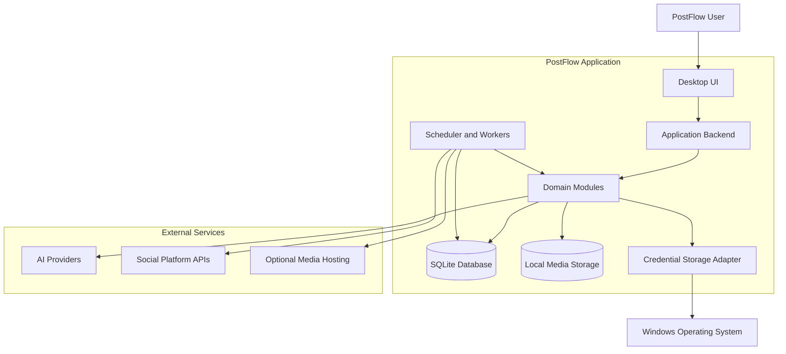

### 2.4 External Integration Targets

**AI providers**

- OpenAI
- Google Gemini
- Anthropic Claude
- Perplexity

**Social platforms**

- LinkedIn
- Facebook Pages
- Instagram
- Threads
- Pinterest
- X
- Reddit

The presence of an adapter does not imply that an account can use every feature. Access depends on platform API permissions, account eligibility, application approval, rate limits, and applicable commercial terms.

---

## 3. High-Level Application Architecture

### 3.1 Logical Architecture

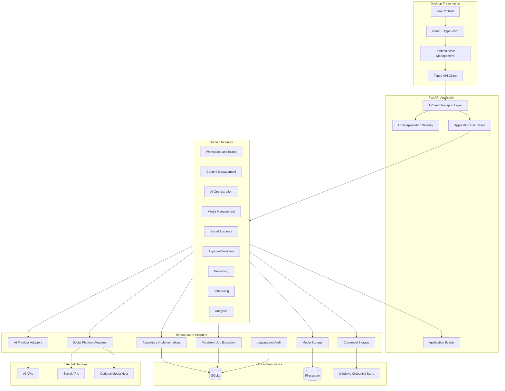

### 3.2 Architectural Layers

| Layer | Primary responsibility | Must not own |
|---|---|---|
| Desktop shell | Window lifecycle, native capabilities, packaging | Business rules |
| Presentation | UI state, navigation, user interaction | Database access or provider secrets |
| API/transport | HTTP contracts, validation, request security | Core business policy |
| Application | Use-case orchestration and transaction boundaries | Vendor-specific implementation |
| Domain | Business rules, entities, state transitions | Framework and infrastructure dependencies |
| Infrastructure | Database, filesystem, credentials, external APIs | Product-level workflow decisions |
| Background execution | Persistent job execution and recovery | Independent business rules duplicated from application services |

### 3.3 Dependency Direction

The dependency direction must remain inward:

```text
Presentation
     |
     v
API / Transport
     |
     v
Application Services
     |
     v
Domain Models and Contracts
     ^
     |
Infrastructure Adapters
```

Domain modules must not import FastAPI, React, Tauri, provider SDKs, or concrete database implementations.

Infrastructure implements interfaces defined by the application or domain layers.

This prevents external technology choices from becoming embedded in business rules.

---

## 4. Desktop Application Layer

### 4.1 Tauri 2 Shell

**Technology:** Tauri 2 + Rust

Responsibilities:

- Create and manage the desktop window.
- Load the React frontend.
- Manage application startup and shutdown.
- Start and supervise the packaged Python backend.
- Manage native application permissions.
- Handle approved filesystem interactions.
- Support secure desktop-specific operations.
- Package the application and bundled resources.

The Tauri layer must remain thin.

It should not implement:

- AI generation.
- Social publishing.
- Database business logic.
- Approval rules.
- Scheduling decisions.
- Platform-specific API workflows.

### 4.2 Backend Process Lifecycle

The Python backend should be packaged as a sidecar executable or an equivalent controlled runtime.

Recommended lifecycle:

1. Tauri starts.
2. The desktop application creates or retrieves an installation-specific local API secret.
3. Tauri launches the backend process.
4. The backend initializes configuration, database connections, and migrations.
5. The backend binds to `127.0.0.1`.
6. The frontend waits for a successful readiness response.
7. The frontend establishes an authenticated API session.
8. The application becomes available.

Shutdown:

1. Tauri requests a graceful backend shutdown.
2. The backend stops accepting new operations.
3. Active short-lived operations are allowed to finish or are cancelled safely.
4. Workers stop claiming new jobs.
5. Database connections close.
6. The backend process exits.
7. Tauri completes application shutdown.

Use a bounded startup timeout and explicit failure handling. The UI must not silently assume the backend is available.

### 4.3 Local API Security

The local backend must:

- Bind only to loopback.
- Reject requests without valid local application authentication.
- Validate the request origin where applicable.
- Use an installation-specific random secret.
- Avoid exposing secrets in frontend logs or application URLs.
- Restrict CORS to the expected desktop origin.
- Apply request size limits.
- Validate all incoming payloads.

A loopback address is not an authentication mechanism. Other local processes may be able to reach it.

### 4.4 React Presentation Layer

**Technology:** React + TypeScript + Vite

Responsibilities:

- Application navigation.
- Dashboard rendering.
- Forms and editors.
- Content composer.
- Platform previews.
- Media library interface.
- Calendar and publishing queue.
- Approval interactions.
- Account connection interface.
- Analytics visualization.
- API request and error presentation.

Recommended frontend module structure:

```text
frontend/src/
├── app/
│   ├── App.tsx
│   ├── routes/
│   ├── providers/
│   └── layout/
│
├── modules/
│   ├── dashboard/
│   ├── workspace/
│   ├── brands/
│   ├── ai-studio/
│   ├── content/
│   ├── media/
│   ├── composer/
│   ├── accounts/
│   ├── approvals/
│   ├── publishing/
│   ├── calendar/
│   ├── analytics/
│   └── settings/
│
├── components/
│   ├── common/
│   ├── forms/
│   ├── feedback/
│   └── platform/
│
├── services/
│   ├── api/
│   ├── events/
│   └── formatting/
│
├── hooks/
├── types/
├── styles/
└── utils/
```

Frontend rules:

- Use typed API contracts.
- Keep API calls in service modules.
- Keep reusable UI components independent of business workflows.
- Avoid direct calls to AI and social APIs.
- Never store provider access tokens in browser storage.
- Do not implement approval or publishing authorization exclusively in the UI.
- Treat backend responses as the authoritative application state.

### 4.5 Frontend State Ownership

Separate frontend state into:

| State category | Examples | Ownership |
|---|---|---|
| Server state | Content, accounts, jobs, analytics | Backend |
| UI state | Sidebar, modal, active tab | Frontend |
| Form state | Unsaved caption edits | Frontend until saved |
| Persistent preferences | Theme, default workspace | Backend settings |
| Runtime status | Backend readiness, worker health | Backend |

Use server-state caching carefully. Invalidate or refresh relevant data after mutations.

The frontend must not invent publication success based on a successful button click or an accepted request. It must display the backend's authoritative job status.

---

## 5. Backend Architecture

### 5.1 FastAPI Application

**Technology:** Python + FastAPI + Pydantic

The backend is the primary application boundary.

Responsibilities:

- Expose the versioned local API.
- Authenticate local application requests.
- Validate request and response schemas.
- Invoke application use cases.
- Enforce authorization and workflow rules.
- Coordinate database transactions.
- Dispatch background jobs.
- Handle external integration errors.
- Produce structured operational logs.
- Expose health and readiness endpoints.

FastAPI route handlers must remain thin.

They should not contain long-running publishing logic, direct SQL business workflows, or provider-specific request construction.

### 5.2 Backend Module Structure

Recommended backend structure:

```text
backend/
├── app/
│   ├── main.py
│   ├── bootstrap.py
│   │
│   ├── core/
│   │   ├── config.py
│   │   ├── exceptions.py
│   │   ├── logging.py
│   │   ├── security.py
│   │   ├── lifecycle.py
│   │   └── dependencies.py
│   │
│   ├── api/
│   │   ├── v1/
│   │   │   ├── router.py
│   │   │   └── endpoints/
│   │   └── schemas/
│   │
│   ├── modules/
│   │   ├── workspaces/
│   │   ├── brands/
│   │   ├── ai/
│   │   ├── content/
│   │   ├── media/
│   │   ├── accounts/
│   │   ├── approvals/
│   │   ├── publishing/
│   │   ├── scheduling/
│   │   ├── analytics/
│   │   ├── campaigns/
│   │   └── settings/
│   │
│   ├── infrastructure/
│   │   ├── database/
│   │   ├── repositories/
│   │   ├── credentials/
│   │   ├── storage/
│   │   ├── ai_providers/
│   │   ├── social_platforms/
│   │   ├── job_runtime/
│   │   └── media_processing/
│   │
│   ├── workers/
│   │   ├── scheduler.py
│   │   ├── publishing_worker.py
│   │   ├── media_worker.py
│   │   └── recovery.py
│   │
│   └── observability/
│       ├── audit.py
│       ├── metrics.py
│       └── health.py
│
├── migrations/
├── tests/
├── pyproject.toml
└── README.md
```

This is a logical target structure. Implement modules incrementally rather than creating empty packages for every future capability.

### 5.3 Module Structure Convention

Each substantial backend module should follow a consistent structure:

```text
module_name/
├── domain/
│   ├── entities.py
│   ├── value_objects.py
│   ├── rules.py
│   └── interfaces.py
│
├── application/
│   ├── services.py
│   ├── commands.py
│   ├── queries.py
│   └── dto.py
│
├── infrastructure/
│   ├── models.py
│   ├── repository.py
│   └── adapters.py
│
└── presentation/
    └── routes.py
```

Small modules may combine files when separation would create unnecessary complexity. Maintain the dependency rules even when files are combined.

---

## 6. Core Backend Services and Component Boundaries

### 6.1 Workspace and Brand Service

Responsibilities:

- Create and update workspaces.
- Manage workspace settings.
- Manage brand profiles.
- Store brand voice and content preferences.
- Provide workspace-scoped access to content and accounts.
- Enforce ownership boundaries.

Owns:

- Workspace entities.
- Brand entities.
- Workspace configuration.

Must not own:

- AI provider execution.
- Social platform publishing.
- Media encoding.

### 6.2 AI Orchestration Service

Responsibilities:

- Register AI providers.
- Manage provider configuration.
- Resolve model selection.
- Route generation and research tasks.
- Support structured outputs.
- Compare independent provider responses.
- Normalize provider errors.
- Track usage and cost metadata.
- Enforce user-selected fallback policies.
- Disclose data transmission.

Recommended internal interface:

```python
class AIProviderAdapter(Protocol):

    provider_id: str

    async def generate_text(
        self,
        request: GenerationRequest
    ) -> GenerationResult:
        ...

    async def generate_structured(
        self,
        request: StructuredGenerationRequest
    ) -> StructuredGenerationResult:
        ...

    async def analyze_image(
        self,
        request: ImageAnalysisRequest
    ) -> ImageAnalysisResult:
        ...

    async def get_models(self) -> list[ModelInfo]:
        ...
```

These operations are capability-dependent. An adapter must explicitly report unsupported functionality rather than implementing fake responses.

Recommended internal components:

- Provider Registry.
- Model Capability Registry.
- Prompt Template Manager.
- Request Router.
- Response Normalizer.
- Usage Tracker.
- Provider Error Classifier.
- Data Disclosure Service.

**Critical boundary:** AI output is untrusted input. Validate generated content, structured data, links, and metadata before saving or using it in subsequent workflows.

AI generation must never publish content directly.

### 6.3 Content Management Service

Responsibilities:

- Create source content.
- Edit and version content.
- Generate platform variants.
- Store independent platform-specific revisions.
- Manage content status.
- Associate campaigns and media.
- Preserve revision history.
- Support content search and reuse.

Conceptual relationship:

```text
Content Item
    |
    +-- Source Content
    |
    +-- Variant: LinkedIn
    |
    +-- Variant: Instagram
    |
    +-- Variant: Facebook
    |
    +-- Variant: Threads
    |
    +-- Variant: Pinterest
    |
    +-- Variant: X
    |
    +-- Variant: Reddit
```

A platform variant is an independently editable object.

Changing the source must not silently overwrite existing platform-specific edits.

### 6.4 Media Management Service

Responsibilities:

- Upload and register media.
- Validate file type and size.
- Calculate checksums.
- Extract metadata.
- Generate thumbnails.
- Resize and compress images.
- Process videos.
- Associate media with content variants.
- Track processing status.
- Clean up temporary files.
- Preserve original assets.

Processing components:

| Component | Responsibility |
|---|---|
| Media Validator | File type, extension, size and content validation |
| Metadata Extractor | Dimensions, duration and format |
| Image Processor | Pillow-based image operations |
| Video Processor | FFmpeg-based video operations |
| Thumbnail Generator | Preview generation |
| Media Storage Adapter | Local file storage |
| Media Delivery Adapter | Optional remote media hosting |

Processing must be asynchronous for expensive operations.

Do not allow unbounded image or video-processing concurrency. For the initial hardware target, use a single active video-processing job by default.

Original assets must remain unchanged when generating derived media.

### 6.5 Social Account Management Service

Responsibilities:

- Initiate account authorization.
- Validate OAuth callbacks.
- Store account metadata.
- Record granted permissions.
- Track token expiration.
- Coordinate token refresh.
- Check account capabilities.
- Disconnect accounts.
- Remove credentials on disconnection.
- Report account health.

Account metadata belongs in SQLite.

Access and refresh tokens belong in operating-system-backed credential storage.

The backend must retrieve credentials through a credential-storage interface, not through frontend-provided token values.

### 6.6 Approval Workflow Service

Responsibilities:

- Enforce approval policy.
- Track approval state.
- Record reviewer decisions.
- Bind approval to a specific content revision.
- Invalidate approval after content changes.
- Record rejection reasons.
- Authorize publication.

Default policy: manual approval required.

An approval record must identify:

- Content variant.
- Exact revision.
- Destination account.
- Approver or local user context.
- Approval timestamp.
- Approval policy.

An approved revision must not automatically authorize a later edited revision.

### 6.7 Publishing Orchestrator

Responsibilities:

- Validate publishing eligibility.
- Resolve the correct platform adapter.
- Build destination-specific payloads.
- Coordinate media preparation.
- Create persistent publishing jobs.
- Dispatch jobs to workers.
- Track attempts and outcomes.
- Reconcile uncertain outcomes.
- Apply retry policies.
- Record remote publication identifiers.

Publishing is one job per destination account and content variant.

A failure on one destination must not invalidate successful publication to another destination.

### 6.8 Scheduler Service

Responsibilities:

- Persist scheduled execution times.
- Identify due jobs.
- Coordinate worker ownership.
- Prevent duplicate claims.
- Recover pending work after restarts.
- Detect missed schedules.
- Handle timezone conversion.
- Support cancellation and pause operations.
- Coordinate publishing workers.

The scheduler must not be implemented as a frontend timer.

The database is the authoritative source of scheduled job state.

### 6.9 Analytics Service

Responsibilities:

- Retrieve available platform metrics.
- Normalize supported metric fields.
- Store metric snapshots.
- Track retrieval timestamps.
- Identify unsupported metrics.
- Provide reporting queries.

Only real platform-returned or locally measured data may be represented as analytics.

Missing metrics must be reported as unavailable, not replaced with fabricated values.

Advanced predictive analytics are outside the initial MVP.

---

## 7. Integration Architecture

### 7.1 Integration Design

Use the ports-and-adapters pattern.

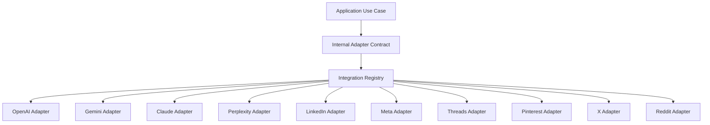

The registry selects an adapter based on provider or platform identity. It must not contain vendor-specific business rules.

### 7.2 AI Provider Integration

| Provider | Adapter | Core responsibility |
|---|---|---|
| OpenAI | `OpenAIAdapter` | Model requests and supported structured generation |
| Gemini | `GeminiAdapter` | Model requests and supported multimodal operations |
| Claude | `ClaudeAdapter` | Model requests and supported structured generation |
| Perplexity | `PerplexityAdapter` | Research-oriented requests and supported responses |

Every provider adapter should normalize:

- Request identifiers.
- Model identifiers.
- Usage metadata.
- Latency.
- Response content.
- Error categories.
- Retryability.
- Provider request identifiers.

Do not assume that token usage, pricing, model capabilities, structured output, or research features are identical across providers.

### 7.3 AI Request Flow

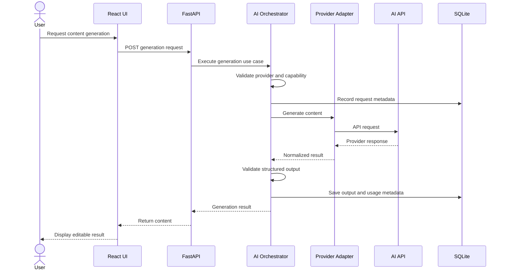

If a provider fails:

- Preserve completed results from other providers.
- Record the failed provider attempt.
- Display an actionable error.
- Do not silently switch providers.
- Use fallback only when the user has explicitly configured and authorized it.

### 7.4 Social Platform Integration

Recommended adapter responsibilities:

```python
class SocialPlatformAdapter(Protocol):

    platform_id: str

    async def get_authorization_url(self, state: str) -> str:
        ...

    async def exchange_authorization_code(
        self,
        code: str,
        redirect_uri: str
    ) -> TokenResult:
        ...

    async def get_account_profile(self, account_id: str) -> AccountProfile:
        ...

    async def get_capabilities(self, account_id: str) -> PlatformCapabilities:
        ...

    async def validate_post(
        self,
        account_id: str,
        payload: PublishPayload
    ) -> ValidationResult:
        ...

    async def upload_media(
        self,
        account_id: str,
        media: MediaReference
    ) -> MediaUploadResult:
        ...

    async def create_post(
        self,
        account_id: str,
        payload: PublishPayload,
        idempotency_key: str
    ) -> PublishResult:
        ...

    async def get_post_status(
        self,
        account_id: str,
        remote_post_id: str
    ) -> PublishStatus:
        ...

    async def get_post_metrics(
        self,
        account_id: str,
        remote_post_id: str
    ) -> MetricsResult:
        ...
```

The contract is an internal abstraction, not a claim that every social network provides equivalent endpoints.

Each adapter must expose supported capabilities and unsupported operations explicitly.

### 7.5 Platform Capability Registry

Capabilities must be determined at account and authorization level.

Example:

```json
{
  "platform": "instagram",
  "account_type": "business",
  "authorization_status": "connected",
  "capabilities": {
    "text": false,
    "image": true,
    "video": true,
    "publishing": true,
    "analytics": "permission_dependent"
  },
  "last_verified_at": "2026-11-08T00:00:00Z"
}
```

This is illustrative data, not a universal Instagram capability declaration.

The registry should track:

- Platform.
- Account type.
- Supported content formats.
- Publishing support.
- Media constraints.
- Required permissions.
- Account eligibility.
- API version.
- Verification timestamp.
- Application approval status.

### 7.6 Platform Integration Priorities

| Platform | Initial priority | Main dependency |
|---|---|---|
| LinkedIn | P0 | Community Management API permissions |
| Facebook Pages | P0 | Meta app permissions and review |
| Instagram | P0 | Eligible professional account and permissions |
| Threads | P1 | Threads API authorization |
| Pinterest | P1 | API access and board permissions |
| X | P2 | Developer access and API costs |
| Reddit | Deferred | Commercial-use permission and applicable agreement |

Do not mark an integration as production-supported until its authorization, publishing, media, failure, and recovery flows have passed live tests.

### 7.7 OAuth Architecture

OAuth should be handled by a dedicated account-authorization module.

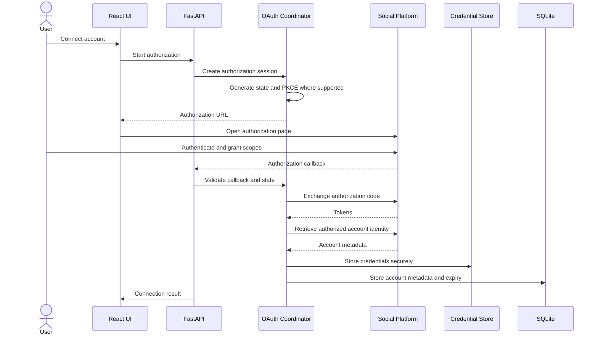

Important implementation constraints:

- A distributed desktop executable is a public client.
- Never embed confidential OAuth client secrets in the distributed executable.
- Use PKCE and public-client flows where supported.
- Use a controlled OAuth broker when a provider requires confidential client credentials.
- Validate OAuth state and exact redirect URIs.
- Use minimum necessary scopes.
- Handle refresh-token rotation where applicable.
- Revoke or remove credentials during account disconnection.

OAuth implementation must be validated independently for each platform.

---

## 8. Data Architecture

### 8.1 Persistence Strategy

| Data category | Storage | Reason |
|---|---|---|
| Workspaces | SQLite | Structured application data |
| Brand profiles | SQLite | Structured application data |
| Content and variants | SQLite | Revision and relationship management |
| Approval records | SQLite | Transactional workflow state |
| Publishing jobs | SQLite | Persistent execution state |
| Publishing attempts | SQLite | Operational history |
| Account metadata | SQLite | Searchable account information |
| OAuth tokens | Windows secure credential storage | Protect sensitive credentials |
| AI API keys | Windows secure credential storage | Protect provider secrets |
| Media originals | Local filesystem | Large binary assets |
| Thumbnails and derivatives | Local filesystem | Generated media assets |
| Application logs | Local filesystem | Operational diagnostics |
| Audit events | SQLite | Traceable security-sensitive actions |
| Backups | User-selected local storage | Recovery |

### 8.2 Logical Data Model

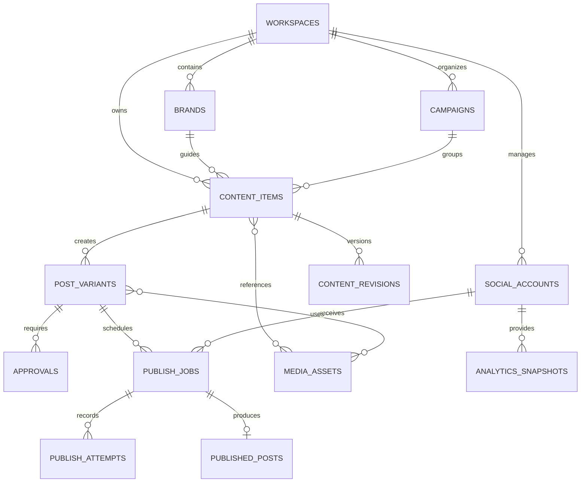

### 8.3 Core Entities

| Entity | Responsibility |
|---|---|
| `workspaces` | Workspace ownership and settings |
| `brands` | Brand voice and content configuration |
| `ai_providers` | Provider configuration metadata |
| `social_accounts` | Connected account metadata |
| `content_items` | Source content |
| `content_revisions` | Immutable or versioned source revisions |
| `post_variants` | Destination-specific content |
| `media_assets` | Media metadata and storage references |
| `approvals` | Revision-bound approval records |
| `publish_jobs` | Persistent destination-specific execution |
| `publish_attempts` | Individual execution attempts |
| `published_posts` | Confirmed remote publication records |
| `campaigns` | Campaign organization |
| `analytics_snapshots` | Retrieved performance metrics |
| `audit_logs` | Security and workflow events |
| `app_settings` | Application preferences |

Additional tables may be introduced as implementation requirements become concrete.

### 8.4 Data Integrity Rules

1. Use UUID identifiers for application entities.
2. Use UTC timestamps for stored execution times.
3. Preserve original content revisions.
4. Maintain foreign-key constraints.
5. Use database migrations for schema changes.
6. Index frequently queried relationships and job status fields.
7. Keep secrets out of ordinary database columns.
8. Use transactions for state-changing operations.
9. Avoid storing redundant copies of large media files.
10. Keep publishing attempt history immutable after completion, except for explicitly documented corrections.

### 8.5 SQLite Strategy

SQLite is the desktop system of record.

Recommended configuration:

- WAL mode where appropriate.
- Foreign-key enforcement.
- Explicit transaction boundaries.
- Bounded write concurrency.
- Busy timeout.
- Short-lived database sessions.
- Regular integrity checks.
- Consistent backup procedures.

The scheduler and workers must coordinate writes through the same database design.

Do not treat WAL mode as a solution to unlimited concurrent writes.

Backups must account for SQLite WAL files. Use SQLite's supported backup mechanisms or a coordinated shutdown/checkpoint procedure. Do not blindly copy an active database file while ignoring its WAL state.

### 8.6 Media Storage Layout

```text
PostFlowData/
├── database/
│   ├── postflow.db
│   └── backups/
│
├── media/
│   ├── originals/
│   ├── processed/
│   ├── thumbnails/
│   └── temporary/
│
├── logs/
│
├── cache/
│
└── exports/
```

The actual user-data root must be resolved through the operating system's application-data locations or a user-configured storage directory.

Never store persistent user data inside the application installation directory.

### 8.7 Media References

Store metadata and relative storage references in SQLite.

Example:

```json
{
  "id": "media-uuid",
  "filename": "campaign-image.jpg",
  "mime_type": "image/jpeg",
  "size_bytes": 2457600,
  "width": 1080,
  "height": 1080,
  "checksum": "sha256-value",
  "storage_key": "originals/media-uuid.jpg",
  "processing_status": "ready"
}
```

The example is illustrative.

Use generated storage identifiers rather than trusting user-provided filenames as filesystem paths.

---

## 9. Application Data Flows

### 9.1 Content Creation Flow

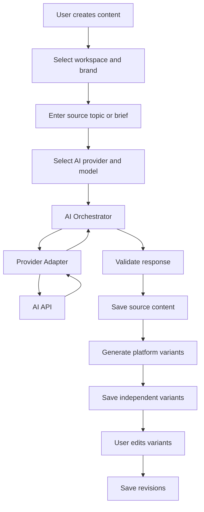

Data ownership:

- Frontend owns temporary editing state.
- Content module owns saved content.
- AI module owns provider requests and usage metadata.
- Database owns persisted revisions.

### 9.2 Media Upload and Processing Flow

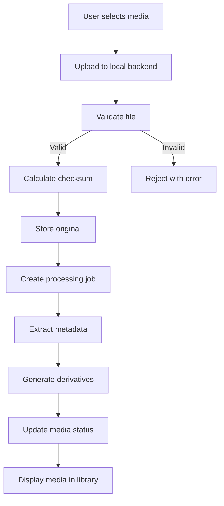

Requirements:

- Validate file contents, not only extensions.
- Enforce upload limits.
- Use safe temporary directories.
- Avoid arbitrary filesystem paths.
- Restrict media processing to approved formats.
- Protect against malformed media and resource exhaustion.
- Preserve original files.
- Clean up abandoned temporary assets.

### 9.3 Publishing Flow

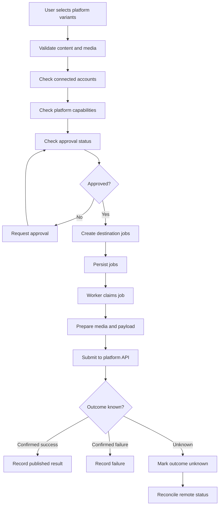

Important rules:

- One job per destination account and variant.
- Revalidate content and account status before execution.
- Recheck approval against the exact revision.
- Record every attempt.
- Preserve successful destinations when another destination fails.
- Do not automatically retry uncertain publication outcomes.
- Reconcile remote state before resubmitting an uncertain request.

### 9.4 Scheduling Flow

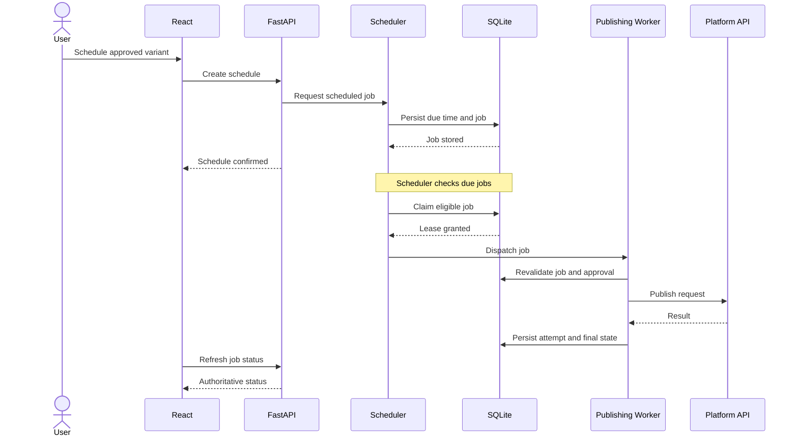

Scheduling rules:

- Store execution timestamps in UTC.
- Preserve the user's selected timezone for display and interpretation.
- Define behavior for daylight-saving transitions.
- Use a lease or equivalent ownership mechanism.
- Recover expired leases after crashes.
- Prevent multiple workers from executing the same active job.
- Detect missed schedules after downtime.
- Make missed-job behavior explicit and configurable.
- Never silently publish an old missed post without applying the configured policy.

### 9.5 Multi-Platform Publishing Isolation

Example:

```text
One Content Item
      |
      +-- LinkedIn Job
      |      |
      |      +-- Published
      |
      +-- Instagram Job
      |      |
      |      +-- Failed
      |
      +-- Facebook Job
      |      |
      |      +-- Published
      |
      +-- Threads Job
             |
             +-- Queued
```

Each destination has independent state, retry behavior, attempt history, and remote publication identity.

A global content item status may summarize destination states, but must not overwrite the individual job states.

---

## 10. Publishing State Machine and Reliability

### 10.1 Job State Model

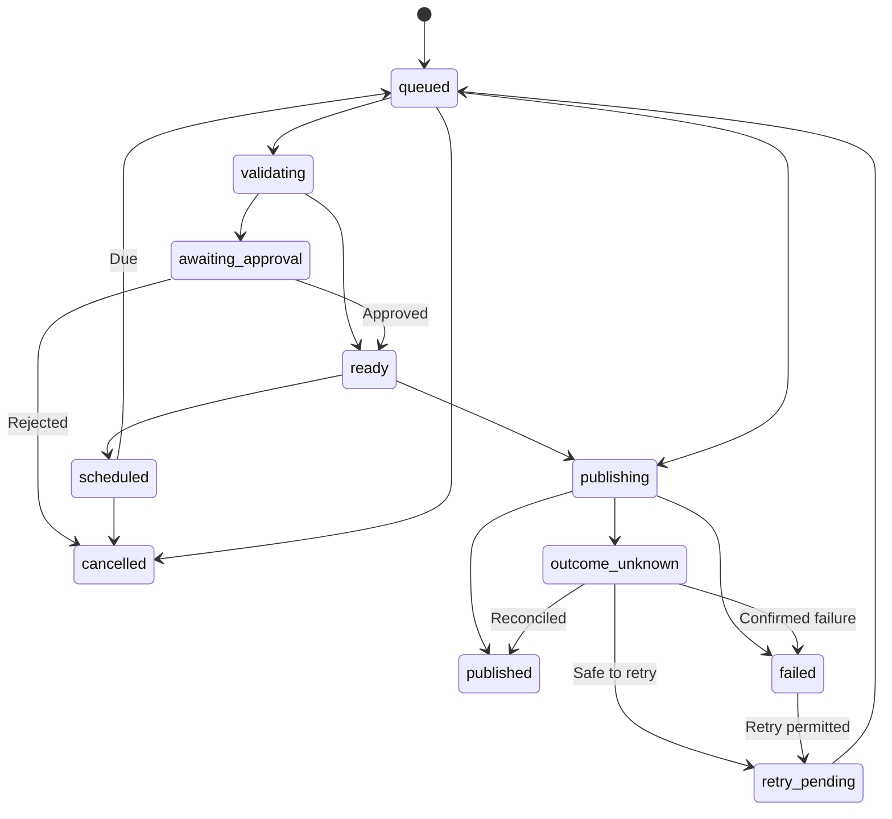

The exact persisted state set should be finalized in the database and API specification. The diagram describes logical transitions.

### 10.2 Idempotency

Every publication operation must have a stable internal idempotency key.

Recommended identity:

```text
workspace_id
+ variant_id
+ revision_id
+ social_account_id
+ publication_intent_id
```

A deliberate repost must be represented as a new publication intent.

Do not assume the external platform honors PostFlow's idempotency key. The key protects PostFlow's own execution and duplicate-claim logic.

### 10.3 Unknown Publication Outcomes

A timeout does not prove that a platform rejected the publication.

Possible sequence:

1. PostFlow sends a publication request.
2. The platform accepts the request.
3. The network response is lost.
4. PostFlow receives a timeout.

The job must enter an uncertain state.

Before retrying:

- Query the platform where supported.
- Use a remote request identifier if available.
- Check publication history when the API supports it.
- Reconcile the result.
- Require manual intervention when the result cannot be established safely.

Blind retries are prohibited.

### 10.4 Worker Ownership

Persistent jobs should support:

- Claim timestamp.
- Lease expiry.
- Worker identifier.
- Attempt count.
- Last heartbeat where needed.
- Next eligible execution time.
- Last error category.

A worker must atomically claim a job before execution.

Expired leases may be recovered, but recovery must inspect the previous execution state before repeating a non-idempotent external action.

---

## 11. API Architecture

### 11.1 API Design

Base path:

```text
/api/v1
```

Use REST-style endpoints for user-facing operations.

Use asynchronous job resources for long-running tasks.

Recommended response conventions:

- JSON request and response bodies.
- Pydantic validation.
- Stable error codes.
- Correlation IDs.
- Pagination for collections.
- Explicit resource status.
- Idempotency support for sensitive mutations.
- Versioned API contracts.

### 11.2 Logical Endpoint Groups

| Module | Endpoint group | Responsibility |
|---|---|---|
| System | `/system` | Health, readiness and application status |
| Workspaces | `/workspaces` | Workspace operations |
| Brands | `/brands` | Brand profile management |
| AI | `/ai` | Provider configuration and generation |
| Content | `/content` | Source content and revisions |
| Variants | `/variants` | Platform-specific content |
| Media | `/media` | Uploads, processing and asset management |
| Accounts | `/accounts` | Connected social accounts |
| Integrations | `/integrations` | OAuth and provider capability information |
| Approvals | `/approvals` | Approval and rejection operations |
| Publishing | `/publishing` | Immediate publishing and job management |
| Scheduling | `/schedule` | Scheduled execution |
| Calendar | `/calendar` | Calendar data |
| Analytics | `/analytics` | Available metrics and reporting |
| Settings | `/settings` | Application preferences |

### 11.3 Example Endpoint Contracts

```text
GET    /api/v1/system/health
GET    /api/v1/system/readiness

GET    /api/v1/workspaces
POST   /api/v1/workspaces

GET    /api/v1/brands
POST   /api/v1/brands
PATCH  /api/v1/brands/{brand_id}

GET    /api/v1/ai/providers
POST   /api/v1/ai/generate
POST   /api/v1/ai/compare

GET    /api/v1/content
POST   /api/v1/content
GET    /api/v1/content/{content_id}
PATCH  /api/v1/content/{content_id}

GET    /api/v1/variants/{variant_id}
PATCH  /api/v1/variants/{variant_id}
POST   /api/v1/variants/{variant_id}/revise

POST   /api/v1/media/upload
GET    /api/v1/media
GET    /api/v1/media/{media_id}
DELETE /api/v1/media/{media_id}

POST   /api/v1/accounts/connect
GET    /api/v1/accounts
POST   /api/v1/accounts/{account_id}/refresh
DELETE /api/v1/accounts/{account_id}

POST   /api/v1/approvals
POST   /api/v1/approvals/{approval_id}/reject

POST   /api/v1/publishing/validate
POST   /api/v1/publishing/jobs
GET    /api/v1/publishing/jobs
GET    /api/v1/publishing/jobs/{job_id}
POST   /api/v1/publishing/jobs/{job_id}/retry
POST   /api/v1/publishing/jobs/{job_id}/cancel

POST   /api/v1/schedule
GET    /api/v1/schedule
GET    /api/v1/calendar

GET    /api/v1/analytics/overview
GET    /api/v1/analytics/platforms
```

These are proposed API contracts. Final request and response schemas belong in `API_SPECIFICATION.md`.

### 11.4 Long-Running Operations

Operations such as:

- AI generation.
- Large media processing.
- Video encoding.
- Media upload.
- Publishing.
- Analytics synchronization.

Should support asynchronous execution when duration or failure recovery warrants it.

Recommended response:

```json
{
  "operation_id": "uuid",
  "status": "queued",
  "status_url": "/api/v1/operations/uuid"
}
```

The client polls or subscribes to a supported status channel.

Do not keep an HTTP request open for a long-running job merely to simplify frontend implementation.

### 11.5 Error Contract

Recommended error structure:

```json
{
  "error": {
    "code": "SOCIAL_PLATFORM_RATE_LIMITED",
    "message": "The platform temporarily rejected the request.",
    "details": {
      "platform": "example",
      "retryable": true
    },
    "correlation_id": "uuid"
  }
}
```

Error responses must not expose:

- Access tokens.
- API keys.
- OAuth authorization codes.
- Sensitive request headers.
- Internal filesystem paths.
- Unredacted provider responses containing secrets.

---

## 12. Background Execution Architecture

### 12.1 Desktop Runtime Model

Use a lightweight persistent worker process or controlled background runtime.

Logical components:

1. Scheduler.
2. Publishing worker.
3. Media worker.
4. Recovery coordinator.

They may initially run inside one supervised Python runtime with separate logical execution loops, provided resource usage and lifecycle behavior remain controlled.

For greater isolation, package the scheduler/worker as a separate sidecar process.

Do not run a separate heavyweight service for every module.

### 12.2 Resource Limits

For the initial desktop target:

| Resource | Default policy |
|---|---|
| FastAPI processes | One |
| Publishing workers | One initially |
| Media processing | One active video job |
| AI requests | Bounded configurable concurrency |
| Database writers | Short transactions and coordinated writes |
| Scheduler polling | Low-frequency configurable interval |
| HTTP timeouts | Explicit per integration |
| Retry policy | Bounded, classified and backoff-based |

These are initial operating policies, not benchmark results. Validate them on the actual development machine.

### 12.3 Background Lifecycle

The scheduler should support:

- Startup recovery.
- Due-job detection.
- Worker lease recovery.
- Graceful shutdown.
- Application restart.
- Missed schedule reporting.
- Worker health reporting.

**Important desktop limitation:** Scheduled publishing cannot be guaranteed while the computer is powered off, asleep, disconnected, or when the background runtime is stopped.

Windows startup integration can improve availability but cannot eliminate device and network limitations.

If reliable 24/7 publication becomes a product requirement, use a hosted scheduler and worker service in the future SaaS deployment.

---

## 13. Security Architecture

### 13.1 Security Boundaries

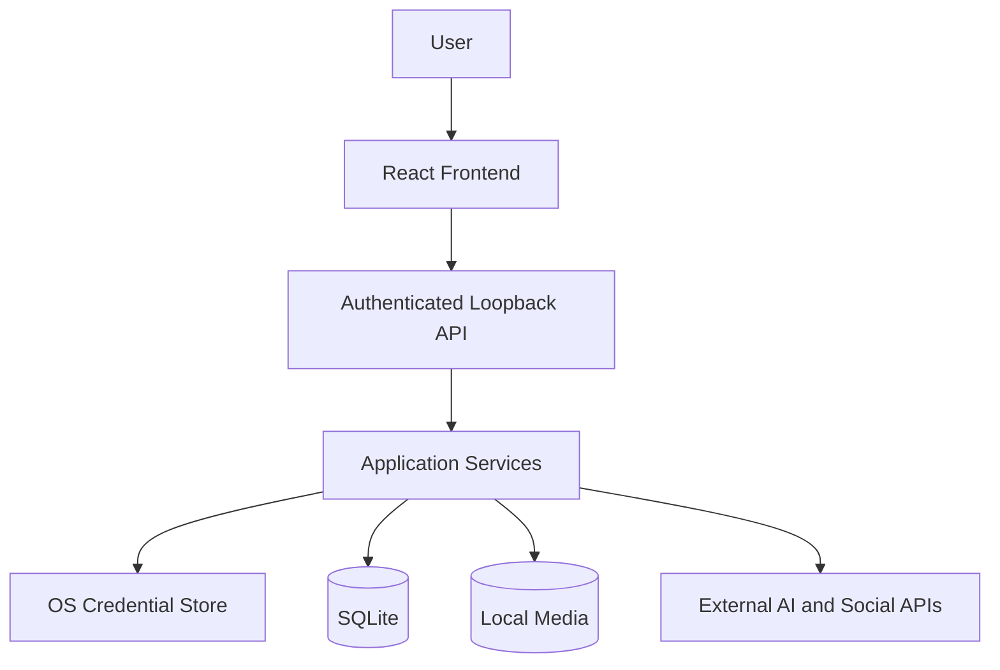

### 13.2 Credential Security

Store credentials using an operating-system-backed secure storage abstraction.

Required controls:

- Windows DPAPI or Credential Manager integration.
- No plaintext API keys in SQLite.
- No tokens in frontend local storage.
- No credentials in application logs.
- No secrets embedded in distributed binaries.
- Credential deletion on disconnect.
- Explicit credential rotation and reauthorization workflows.
- Redaction in exception reporting.

### 13.3 OAuth Security

Implement:

- Random state.
- PKCE where supported.
- Redirect URI validation.
- Minimum scopes.
- Authorization-code validation.
- Token expiry tracking.
- Refresh-token rotation handling.
- Secure token storage.
- Account identity verification.
- Revocation and disconnection support.

### 13.4 Local Application Security

- Loopback-only API binding.
- Per-installation API authentication.
- Restricted Tauri capabilities.
- Strict request validation.
- Controlled file access.
- Safe temporary storage.
- Secure inter-process communication.
- Dependency vulnerability scanning.
- Redacted structured logging.

### 13.5 AI Security

Treat AI responses and externally retrieved content as untrusted.

Controls:

- Validate structured output.
- Do not execute generated code automatically.
- Do not interpret generated links as trusted.
- Do not permit model output to bypass approval.
- Separate system instructions from user-provided content.
- Treat retrieved web content as potentially adversarial.
- Disclose data sent to providers.
- Require explicit user authorization for provider fallback.

### 13.6 Publishing Security

- Manual approval by default.
- Approval tied to exact revision.
- Validate destination account.
- Recheck capabilities before publishing.
- Verify the user has authorized the operation.
- Record publishing actions in the audit log.
- Never allow frontend-only authorization.
- Prevent duplicate job claims.
- Reconcile uncertain outcomes.

### 13.7 Data Privacy

The application must clearly disclose when data leaves the device.

Potentially transmitted data includes:

- Source content.
- Brand voice instructions.
- Captions and descriptions.
- Media or image data.
- Research prompts.
- Account metadata.
- Publication payloads.

The disclosure must identify the destination provider and relevant data categories before transmission where appropriate.

### 13.8 Threat Model

| Threat | Impact | Required mitigation |
|---|---|---|
| Local API abuse | Unauthorized operations | Loopback binding and authentication |
| Credential theft | Account compromise | OS-backed secret storage |
| OAuth callback manipulation | Unauthorized account connection | State and redirect validation |
| Prompt injection | Malicious AI-generated actions | Treat model output as untrusted |
| Malicious media upload | Resource or parser compromise | Validation and bounded processing |
| Duplicate publishing | Repeated public posts | Idempotency and reconciliation |
| Token leakage | Account compromise | Redaction and secure storage |
| Unauthorized publishing | Brand or account damage | Approval and authorization checks |
| SQLite corruption | Data loss | Backups and integrity checks |
| Tenant data leakage in SaaS | Cross-customer exposure | Explicit tenant isolation |

---

## 14. Observability and Error Management

### 14.1 Logging

Use structured logs with:

- Timestamp.
- Severity.
- Component.
- Operation.
- Correlation ID.
- Job ID where applicable.
- Provider or platform identifier.
- Error category.
- Duration.

Do not log credentials or sensitive content by default.

### 14.2 Audit Events

Record important actions:

- Account connected.
- Account disconnected.
- Provider configured.
- Credential changed.
- Content approved.
- Content rejected.
- Publishing job created.
- Publishing job retried.
- Publication completed.
- Publication cancelled.
- Backup created.
- Restore completed.

Audit records should be distinct from ordinary debug logs.

### 14.3 Health Checks

Recommended system endpoints:

```text
GET /api/v1/system/health
GET /api/v1/system/readiness
GET /api/v1/system/status
```

Health should report process availability.

Readiness should verify critical dependencies such as:

- Database connectivity.
- Database migration status.
- Required storage availability.
- Worker runtime status where applicable.

External provider availability should be reported separately. A temporary social-platform outage should not make the entire local application appear unhealthy.

### 14.4 Failure Classification

Normalize external errors into categories:

- Authentication failure.
- Permission failure.
- Rate limit.
- Invalid payload.
- Unsupported capability.
- Network timeout.
- Provider unavailable.
- Media processing failure.
- Unknown publication outcome.
- Internal application error.

Retry decisions must be based on error classification, not on a blanket retry policy.

---

## 15. Deployment Architecture

### 15.1 Initial Desktop Deployment

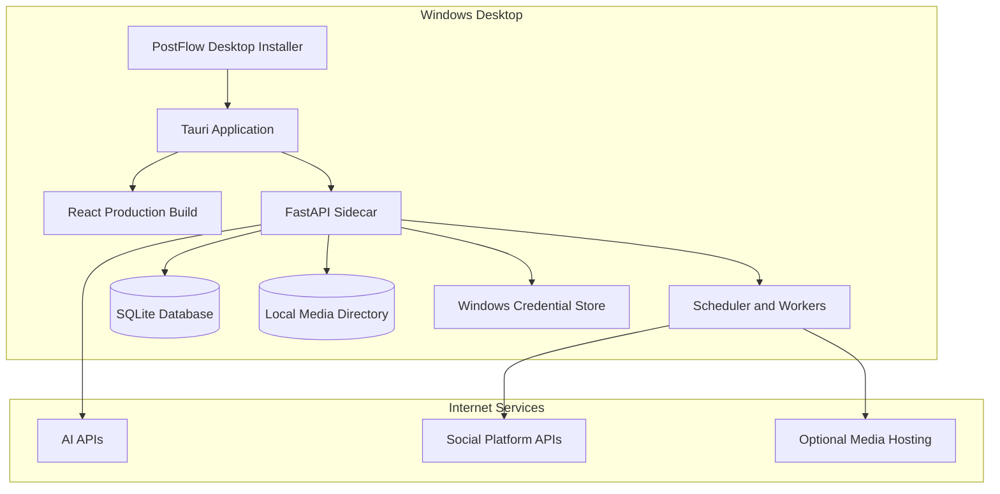

### 15.2 Packaging Layout

Logical installed application layout:

```text
PostFlow/
├── PostFlow.exe
│
└── resources/
    ├── backend/
    │   └── postflow-backend.exe
    │
    ├── workers/
    │   └── postflow-worker.exe
    │
    ├── media-tools/
    │   └── ffmpeg.exe
    │
    └── frontend/
        └── production-assets/
```

The exact packaging structure must follow the supported Tauri sidecar and resource configuration.

Persistent user data must remain outside the installation directory.

### 15.3 Startup Sequence

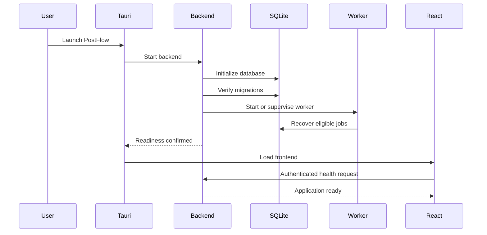

If initialization fails, display the specific subsystem failure and provide diagnostic information.

### 15.4 Updates and Migrations

Application updates must:

- Preserve user data.
- Apply versioned migrations.
- Verify migration success.
- Maintain backup and recovery procedures.
- Avoid deleting media assets.
- Detect incompatible database versions.
- Support rollback or recovery where practical.

Never assume a database migration is safe merely because the application binary updated successfully.

---

## 16. Future SaaS Architecture

### 16.1 Deployment Separation

The SaaS version is a separate deployment profile.

Reuse:

- Domain models.
- Application services.
- AI provider contracts.
- Social platform adapters.
- Content validation.
- Publishing state machine.
- API contracts where appropriate.
- Core tests.

Replace or extend:

- Authentication.
- Database.
- Credential storage.
- Media storage.
- Job queue.
- Worker deployment.
- Monitoring.
- Tenant authorization.

### 16.2 SaaS Architecture

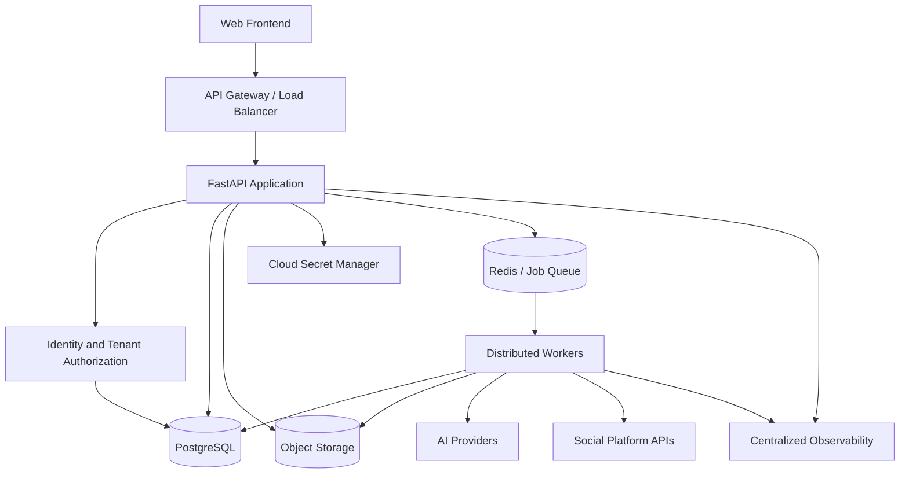

### 16.3 Deployment Comparison

| Component | Desktop | SaaS |
|---|---|---|
| Presentation | React + Tauri | React web application |
| Backend | FastAPI sidecar | FastAPI deployment |
| Database | SQLite | PostgreSQL |
| ORM | SQLAlchemy | SQLAlchemy |
| Job persistence | SQLite | PostgreSQL-backed job records |
| Queue | Local persistent scheduler | Redis-backed distributed queue |
| Workers | Local lightweight process | Distributed workers |
| Media | Local filesystem | Object storage |
| Credentials | Windows secure storage | Cloud secret manager |
| Authentication | Local application security | Central identity provider |
| Monitoring | Local logs and health checks | Centralized observability |
| Scaling | Single machine | Horizontal scaling |

### 16.4 SaaS Migration Requirements

The desktop implementation must avoid unnecessary coupling to local infrastructure.

Define interfaces for:

- Repository operations.
- Credential storage.
- Media storage.
- Job dispatch.
- Scheduling.
- Application identity.
- Audit events.

Do not put tenant-specific assumptions into global application state.

SaaS must introduce:

- Explicit tenant ownership.
- Tenant-scoped queries.
- Role-based access control.
- Tenant isolation tests.
- Cloud credential isolation.
- Centralized authentication.
- Rate limiting and quotas.
- Distributed job ownership.
- Data retention policies.

Do not build SaaS billing, multi-tenant infrastructure, and distributed services into the desktop MVP.

---

## 17. Performance and Resource Architecture

### 17.1 Initial Hardware Constraints

The initial development target has:

- 8 GB RAM.
- AMD Ryzen 5 3450U.
- Integrated Radeon Vega graphics.
- Approximately 100 GB available development storage.
- Windows desktop environment.

These constraints favor a lightweight modular architecture.

### 17.2 Resource Management Policies

1. No local LLM inference.
2. No mandatory Docker runtime.
3. No local PostgreSQL.
4. No local Redis.
5. One FastAPI process.
6. Bounded AI request concurrency.
7. One active video-processing task by default.
8. Thumbnail generation should be asynchronous.
9. Large media files should not be loaded fully into frontend memory.
10. Use pagination for large collections.
11. Limit in-memory caching.
12. Rotate logs and clean temporary files.
13. Use lazy loading for large UI modules.
14. Avoid unnecessary background polling.

### 17.3 Performance Targets

The following are proposed engineering targets, not verified benchmarks:

| Area | Initial target |
|---|---|
| Desktop cold startup | Under 5 seconds |
| Dashboard initial render | Under 3 seconds after backend readiness |
| Local API health check | Under 200 ms |
| Normal idle memory | Under 500 MB |
| Normal active memory | Under 1 GB |
| Single media-processing operation | Bounded memory, measured on target hardware |
| Job persistence | No loss of committed jobs after restart |
| Scheduler recovery | Recover all eligible persisted jobs |
| Duplicate execution | Prevented by claim and idempotency controls |

Measure these values using the packaged application, not only the development environment.

---

## 18. Architectural Decisions

| ID | Decision | Rationale |
|---|---|---|
| ADR-001 | Tauri 2 for desktop shell | Lightweight native desktop deployment |
| ADR-002 | React + TypeScript | Structured frontend development |
| ADR-003 | FastAPI backend | Python ecosystem and API integration |
| ADR-004 | Modular monolith | Low operational overhead and clear boundaries |
| ADR-005 | SQLite for desktop | Local persistence without a database server |
| ADR-006 | SQLAlchemy + Alembic | ORM and controlled schema evolution |
| ADR-007 | Filesystem media storage | Efficient local binary storage |
| ADR-008 | OS-backed credential storage | Protect API keys and OAuth tokens |
| ADR-009 | AI provider adapters | Reduce provider coupling |
| ADR-010 | Social platform adapters | Isolate API and permission differences |
| ADR-011 | Persistent publishing jobs | Restart recovery and traceability |
| ADR-012 | Revision-bound approval | Prevent unapproved edits from being published |
| ADR-013 | Reconciliation for unknown outcomes | Avoid duplicate publication |
| ADR-014 | Separate SaaS deployment profile | Avoid premature infrastructure complexity |
| ADR-015 | Manual approval by default | Preserve user control |

---

## 19. Architecture Constraints and Non-Negotiable Invariants

The following constraints are release-blocking.

### Application boundaries

- React must not access the database directly.
- React must not publish directly to social APIs.
- Tauri must not contain business workflows.
- API handlers must remain thin.
- Domain logic must not depend on external SDKs.
- External integrations must be replaceable through adapters.

### Data integrity

- Content variants must have independent revisions.
- Approval must reference an exact revision.
- Editing approved content must invalidate that approval.
- Publishing jobs must be persisted before execution.
- Each destination must have an independent job.
- Every publishing attempt must be recorded.
- Unknown publication outcomes must be reconciled.
- Intentional reposts must be distinguishable from accidental duplicate execution.

### Security

- Provider keys must not be stored in plaintext SQLite columns.
- OAuth tokens must not be exposed to the frontend.
- The local backend must not bind to public network interfaces.
- The application must not embed confidential OAuth secrets in distributed binaries.
- Sensitive logs must be redacted.
- AI-generated output must be treated as untrusted.
- Publishing must require backend-enforced authorization.

### Operational behavior

- Jobs must survive application restart.
- Workers must recover safely.
- Scheduler ownership must be coordinated.
- External API retries must be bounded.
- Rate limits must be respected.
- Background execution must have resource limits.
- Missed schedules must be visible to the user.

---

## 20. Implementation Roadmap

Implement the architecture incrementally.

### Phase 0 - Architecture and repository foundation

Deliverables:

- Establish monorepo structure.
- Define backend module boundaries.
- Define API conventions.
- Define shared data contracts.
- Establish dependency rules.
- Configure frontend, backend, and Tauri development environments.
- Establish logging and configuration standards.

Exit criteria:

- Frontend starts.
- Backend starts.
- Tauri launches.
- Frontend communicates with backend.
- Local API is authenticated.

### Phase 1 - Desktop and persistence foundation

Deliverables:

- Tauri lifecycle management.
- React application shell.
- FastAPI sidecar.
- SQLite database.
- SQLAlchemy models.
- Alembic migrations.
- Secure local API authentication.
- Application settings.
- Structured logging.

Exit criteria:

- Packaged desktop app launches.
- Database migrations work.
- Data survives restart.
- Backend lifecycle is controlled.

### Phase 2 - Workspace and content modules

Deliverables:

- Workspace service.
- Brand service.
- Content service.
- Content revisions.
- Platform variants.
- Approval model.
- Repository implementations.

Exit criteria:

- Content creation and editing work.
- Variant independence is enforced.
- Approval is revision-bound.
- Data integrity tests pass.

### Phase 3 - AI integration

Deliverables:

- AI provider registry.
- Credential storage adapter.
- OpenAI adapter.
- Gemini adapter.
- Claude adapter.
- Perplexity adapter.
- Request normalization.
- Usage tracking.
- Data transmission disclosure.

Exit criteria:

- Provider requests work.
- Unsupported capabilities are explicit.
- Provider failures are isolated.
- Secrets do not appear in logs or frontend responses.

### Phase 4 - Media management

Deliverables:

- Media upload.
- File validation.
- Local storage.
- Metadata extraction.
- Pillow integration.
- FFmpeg integration.
- Thumbnail generation.
- Background media jobs.

Exit criteria:

- Originals remain unchanged.
- Processing is bounded.
- Temporary files are cleaned up.
- Invalid media is rejected.

### Phase 5 - Social account integrations

Deliverables:

- OAuth coordinator.
- Secure token storage.
- Capability registry.
- LinkedIn adapter.
- Facebook Pages adapter.
- Instagram adapter.
- Threads adapter.
- Pinterest adapter.
- X adapter.
- Reddit integration assessment and authorization gate.

Exit criteria:

- Live account authorization works.
- Permissions are verified.
- Tokens are secure.
- Platform capability information is accurate.
- Required developer access is approved.

### Phase 6 - Publishing engine

Deliverables:

- Publishing orchestrator.
- Payload validation.
- Media upload coordination.
- Persistent job records.
- Worker ownership.
- Attempt history.
- Idempotency.
- Outcome reconciliation.
- Retry and cancellation.

Exit criteria:

- Destination failures are isolated.
- Duplicate execution is prevented.
- Unknown outcomes are handled safely.
- Publishing history is traceable.

### Phase 7 - Scheduler and calendar

Deliverables:

- Persistent scheduling.
- Background scheduler.
- Worker lifecycle.
- Startup recovery.
- Missed-job detection.
- Timezone handling.
- Calendar interface.

Exit criteria:

- Jobs survive restart.
- Multiple workers cannot claim the same active job.
- Missed schedules are handled explicitly.
- Timezone behavior is tested.

### Phase 8 - Release and packaging

Deliverables:

- Windows installer.
- Backend sidecar packaging.
- FFmpeg packaging and license review.
- Backup and restore.
- Update and migration process.
- Security testing.
- Performance testing.
- Clean-machine installation tests.

Exit criteria:

- Clean installation works.
- Data survives upgrades.
- Backup restore succeeds.
- No unresolved critical security issues.
- Publishing and recovery tests pass.

### Phase 9 - SaaS architecture

Deliverables:

- PostgreSQL deployment profile.
- Cloud object storage.
- Redis-backed job queue.
- Distributed workers.
- Tenant isolation.
- Central authentication.
- Cloud credential management.
- Monitoring and billing infrastructure.

Exit criteria:

- Tenant isolation is verified.
- Shared application logic remains reusable.
- Distributed job execution is reliable.
- SaaS-specific security and deployment tests pass.

---

## 21. Architecture Verification and Release Gates

### 21.1 Component Tests

Test each module independently:

- Workspace and brand rules.
- AI provider normalization.
- Content revision behavior.
- Variant independence.
- Media validation.
- OAuth state validation.
- Approval revision binding.
- Publishing state transitions.
- Scheduler lease handling.
- Analytics normalization.

### 21.2 Integration Tests

Test:

- FastAPI to SQLite.
- Repository implementations.
- Credential storage adapter.
- AI provider adapters with mocked external services.
- Social platform adapters with mocked responses.
- Media storage and processing.
- Worker and scheduler coordination.
- Application restart recovery.

### 21.3 End-to-End Tests

Required workflows:

1. Create workspace and brand.
2. Generate source content.
3. Create platform-specific variants.
4. Upload media.
5. Edit and approve a variant.
6. Schedule publication.
7. Execute a publishing job.
8. Verify remote publication result.
9. Recover a pending job after restart.
10. Handle a network timeout without duplicate publication.

### 21.4 Security Tests

- Local API authentication.
- Unauthorized request rejection.
- OAuth state validation.
- Token redaction.
- Credential storage inspection.
- File upload validation.
- Path traversal prevention.
- Tauri permission restrictions.
- Prompt injection handling.
- Publishing authorization.
- Audit event integrity.

### 21.5 Release Gates

A release must not proceed if:

- Secrets are exposed in logs or frontend responses.
- The local backend is publicly accessible.
- Approval can be bypassed.
- Editing a revision leaves stale approval valid.
- Jobs are lost after restart.
- Duplicate execution is possible in defined test scenarios.
- Unknown outcomes are blindly retried.
- Platform permissions are misrepresented.
- Backup and restore have not been tested.
- Critical security findings remain unresolved.

---

## 22. Risks and Architectural Mitigations

| Risk | Severity | Mitigation |
|---|---|---|
| 8 GB memory constraints | High | Bounded concurrency and cloud AI |
| Windows background lifecycle | High | Persistent jobs and startup recovery |
| Device sleep or shutdown | High | Missed-job detection and clear user disclosure |
| SQLite write contention | Medium | Short transactions and controlled writers |
| Social API restrictions | High | Capability registry and approval validation |
| OAuth desktop client limitations | High | Public-client flows or controlled OAuth broker |
| Media URL requirements | High | Explicit media-delivery adapter |
| Video processing overload | High | Single-job processing default |
| AI provider cost | High | Usage tracking and user-defined budgets |
| Duplicate publishing | Critical | Idempotency and reconciliation |
| Credential compromise | Critical | OS-backed secure storage |
| SaaS migration complexity | Medium | Infrastructure interfaces and tenant-aware data model |

---

## 23. Final Architecture Recommendation

### 23.1 Adopted Architecture

| Layer | Technology / Pattern |
|---|---|
| Desktop shell | Tauri 2 |
| Frontend | React |
| Frontend language | TypeScript |
| Frontend build | Vite |
| Backend | Python FastAPI |
| Architecture | Modular monolith |
| Design pattern | Ports and adapters |
| Database | SQLite |
| ORM | SQLAlchemy |
| Migrations | Alembic |
| Media storage | Local filesystem |
| Image processing | Pillow |
| Video processing | FFmpeg |
| AI integration | Provider adapters |
| Social integration | Platform adapters |
| Credential storage | Windows DPAPI / Credential Manager |
| Background execution | Persistent scheduler and lightweight workers |
| API | REST, versioned under `/api/v1` |
| Future SaaS database | PostgreSQL |
| Future SaaS queue | Redis-backed distributed execution |
| Future SaaS media | Object storage |

### 23.2 Recommended Implementation Strategy

Build the application as a modular monolith first.

Do not create independent deployable services for AI, media, publishing, analytics, or scheduling in the desktop MVP.

Keep these capabilities as independent modules with explicit interfaces. Extract them into separate services only when deployment, workload, reliability, or organizational requirements justify the cost.

The highest-risk areas are not React or FastAPI. They are:

1. OAuth authorization and token lifecycle.
2. Platform-specific media delivery.
3. Publishing idempotency and uncertain outcomes.
4. Persistent background scheduling.
5. Secure local credential management.
6. Platform API approval and commercial restrictions.

Prioritize these areas in architecture validation and integration testing.

### 23.3 Final Decision

**Architecture status: Recommended for implementation.**

The proposed architecture is compatible with the desktop-first PostFlow strategy and the current resource constraints.

It provides:

- A clear separation between presentation, application, domain, and infrastructure.
- Replaceable AI and social-platform integrations.
- Persistent and recoverable publishing workflows.
- Explicit data ownership and security boundaries.
- A realistic path toward future SaaS deployment.

The architecture is a design baseline, not proof of production readiness. Every critical integration, security control, resource target, and recovery mechanism must be verified through implementation and testing.

---

## 24. References and Related Documents

### Internal project documents

- `PRODUCT_VISION.md`
- `PRD.md`
- `USER_STORIES.md`
- `ACCEPTANCE_CRITERIA.md`
- `TEST_PLAN.md`
- `TRACEABILITY_MATRIX.md`
- `FEASIBILITY_REPORT.md`
- `PLATFORM_API_RESEARCH.md`
- `TECH_STACK.md`
- `SECURITY.md`
- `API_SPECIFICATION.md`

Some listed companion documents may not yet exist in the repository. Their intended responsibilities are separate:

- `TECH_STACK.md`: exact technology versions, dependencies, and tooling.
- `SECURITY.md`: detailed security controls and threat model.
- `API_SPECIFICATION.md`: concrete endpoint schemas and error contracts.
- `TEST_PLAN.md`: executable test scenarios and coverage requirements.

### Technical references

**Tauri**
- https://v2.tauri.app/
- https://v2.tauri.app/develop/sidecar/

**React**
- https://react.dev/

**FastAPI**
- https://fastapi.tiangolo.com/

**SQLAlchemy**
- https://docs.sqlalchemy.org/

**Alembic**
- https://alembic.sqlalchemy.org/

**SQLite**
- https://www.sqlite.org/docs.html
- https://www.sqlite.org/wal.html

**Pillow**
- https://pillow.readthedocs.io/

**FFmpeg**
- https://ffmpeg.org/documentation.html
- https://ffmpeg.org/legal.html

**Platform API research**
- https://learn.microsoft.com/en-us/linkedin/
- https://developers.facebook.com/docs/
- https://developers.facebook.com/docs/instagram-platform/
- https://developers.facebook.com/docs/threads/
- https://developers.pinterest.com/
- https://developer.x.com/
- https://www.reddit.com/dev/api/

---

## 25. Document Control

| Field | Value |
|---|---|
| Document | `ARCHITECTURE.md` |
| Project | PostFlow |
| Version | 1.0 |
| Status | Proposed |
| Architecture style | Modular Monolith + Ports and Adapters |
| Initial deployment | Local-first Windows desktop |
| Future deployment | Multi-tenant SaaS |
| Owner | PostFlow Product and Engineering |
| Created | 8 November 2026 |
| Next review | Before Phase 1 implementation |
| Review frequency | Major architecture or deployment changes |

**Approval condition:** This architecture is ready to guide implementation planning. Detailed API schemas, security implementation, database constraints, and executable test cases must be maintained in their respective companion documents and verified before production release.
