# PostFlow - Architecture Diagrams

**File:** `docs/ARCHITECTURE_DIAGRAMS.md`  
**Version:** 1.0  
**Status:** Proposed Architecture  
**Architecture Style:** Modular Monolith  
**Desktop Platform:** Windows  
**Future Platform:** SaaS

---

## 1. System Context Diagram

Shows PostFlow's relationship with the user, desktop environment, AI providers, social platforms, and external infrastructure.

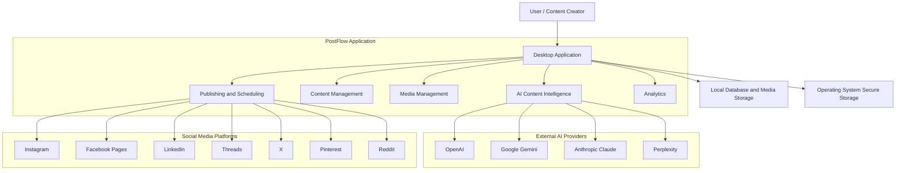

**Boundary:** PostFlow owns application logic, content records, scheduling, and local state. External providers own their APIs, account permissions, publication infrastructure, and platform-reported analytics.

---

## 2. High-Level Application Architecture

Shows the primary application layers and their dependency direction.

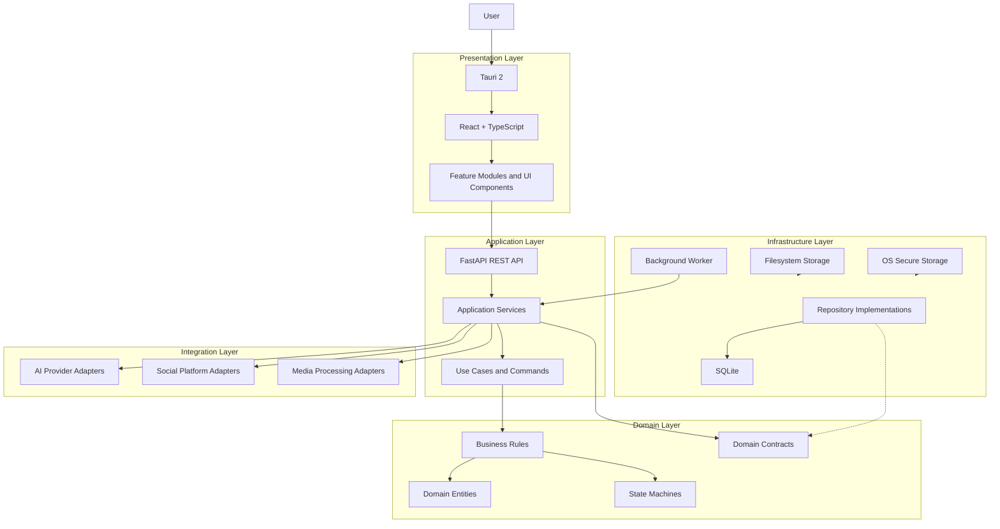

**Design rule:** Domain logic must not depend on React, FastAPI, SQLAlchemy, provider SDKs, or social platform SDKs. Infrastructure implements the interfaces required by application services.

---

## 3. Desktop Container Architecture

Shows the runtime processes and their communication boundaries.

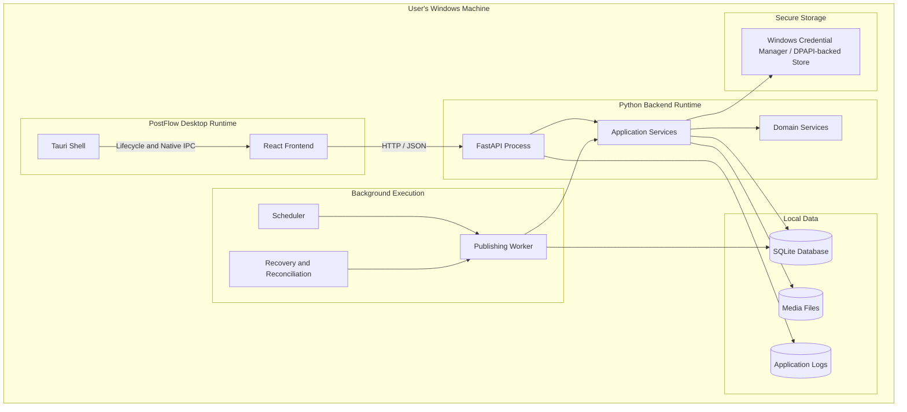

### Runtime responsibilities

| Runtime | Responsibility |
|---|---|
| Tauri | Desktop lifecycle and native capabilities |
| React | User interface and interaction |
| FastAPI | Local API and request orchestration |
| Application services | Business use cases |
| Worker | Persistent background execution |
| Scheduler | Due-job discovery |
| Recovery | Interrupted-job recovery |
| SQLite | Structured application data |
| Filesystem | Media and generated assets |
| Secure storage | API keys and OAuth credentials |

**Deployment constraint:** Start with one controlled worker and bounded concurrency. Do not introduce distributed workers into the desktop MVP.

---

## 4. Backend Module Architecture

Shows the modular monolith's bounded business modules.

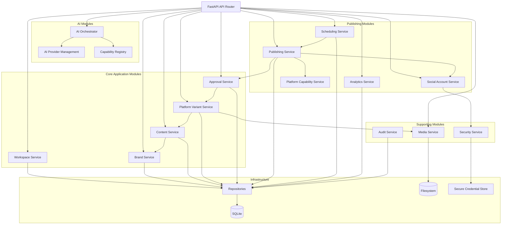

### Module ownership

| Module | Primary ownership |
|---|---|
| Workspace | Workspace identity and boundaries |
| Brand | Brand voice and guidelines |
| Content | Source content and revisions |
| Variant | Independent platform content |
| AI Provider | Provider configuration |
| AI Orchestrator | AI request coordination |
| Media | Asset processing and storage |
| Social Account | OAuth and account metadata |
| Approval | Revision-bound approval |
| Publishing | Destination-specific publication |
| Scheduling | Persistent scheduled execution |
| Analytics | Platform metrics |
| Audit | Activity and security events |
| Security | Credential and request protection |

---

## 5. AI Integration Architecture

Shows the provider-independent AI orchestration boundary.

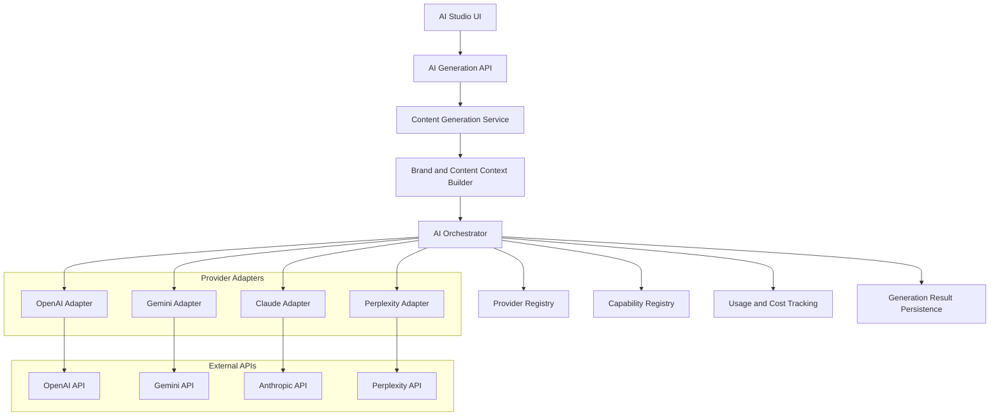

### AI request lifecycle

1. User selects an operation.
2. Backend validates the request.
3. Brand context is assembled using minimum necessary data.
4. Orchestrator selects a configured provider and model.
5. Capability registry checks feature support.
6. Adapter executes the provider request.
7. Response is normalized and validated.
8. Usage metadata is collected where available.
9. Result is persisted.
10. UI receives the result.

**Security boundary:** No silent provider fallback. Additional provider transmission requires user authorization.

---

## 6. Social Platform Integration Architecture

Shows the independent adapter model for publishing.

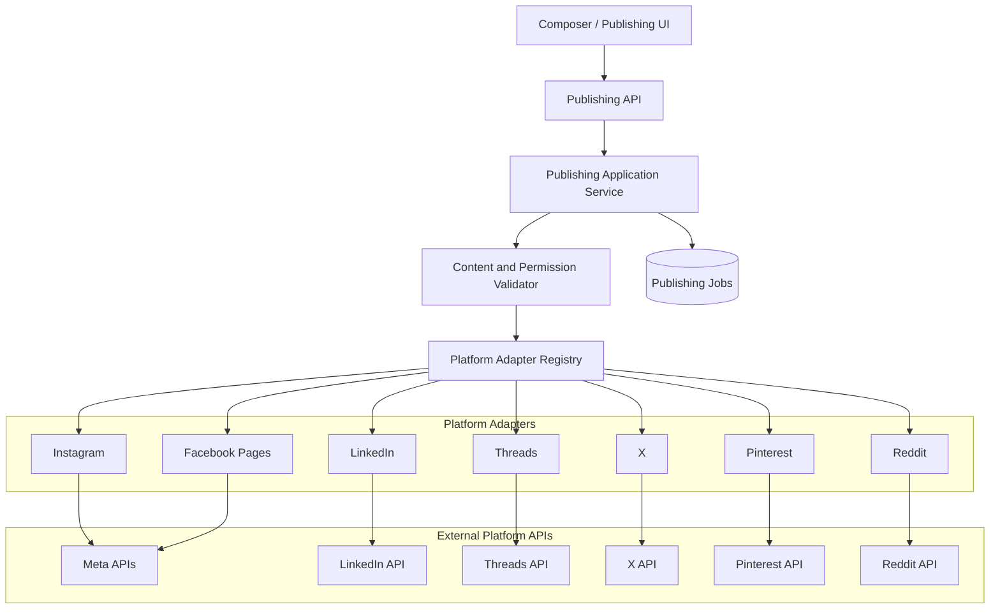

### Adapter isolation rules

- Each destination gets an independent publishing job.
- Each adapter owns its platform-specific payload.
- Each adapter owns its authorization and API errors.
- Each adapter reports supported capabilities.
- One destination's failure must not erase another destination's result.
- Platform API restrictions must be validated before release.

---

## 7. Content Creation and Adaptation Data Flow

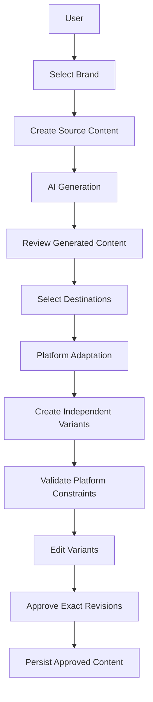

### Data ownership rules

- Source content is independent of platform variants.
- Each variant has its own revision history.
- Editing one variant does not modify other variants.
- Approval belongs to an exact revision.
- Editing an approved revision invalidates its approval.

---

## 8. Media Processing Architecture

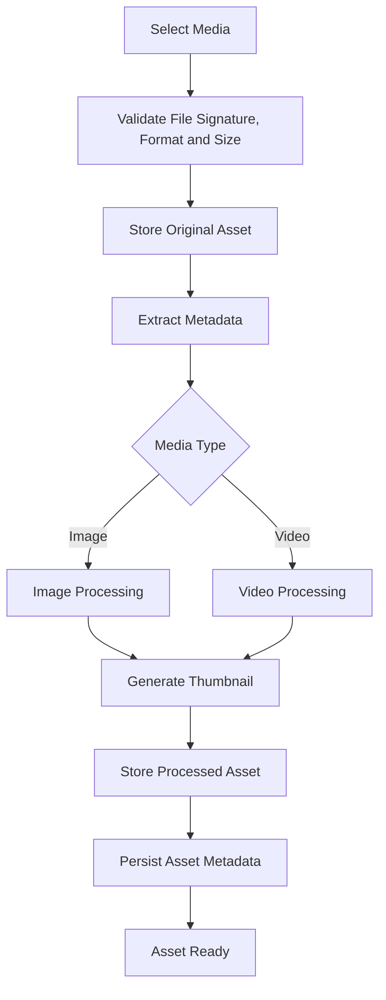

### Media storage boundary

```text
PostFlowData/
├── database/
│   └── postflow.db
├── media/
│   ├── originals/
│   ├── processed/
│   ├── thumbnails/
│   └── temporary/
├── logs/
├── cache/
└── exports/
```

Media binaries belong to the filesystem. SQLite stores metadata, ownership, file references, and transformation history.

---

## 9. Database Entity Relationship Diagram

This is the logical relationship model. It is not a substitute for validating the final physical database schema and migration files.

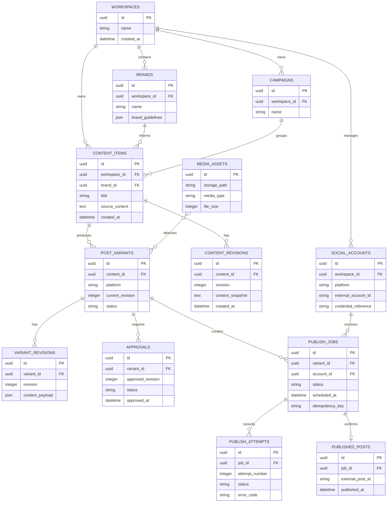

**Important:** Credential references in this diagram are identifiers pointing to OS-backed secure storage. Raw tokens must not be stored in these database records.

---

## 10. Publishing Job State Machine

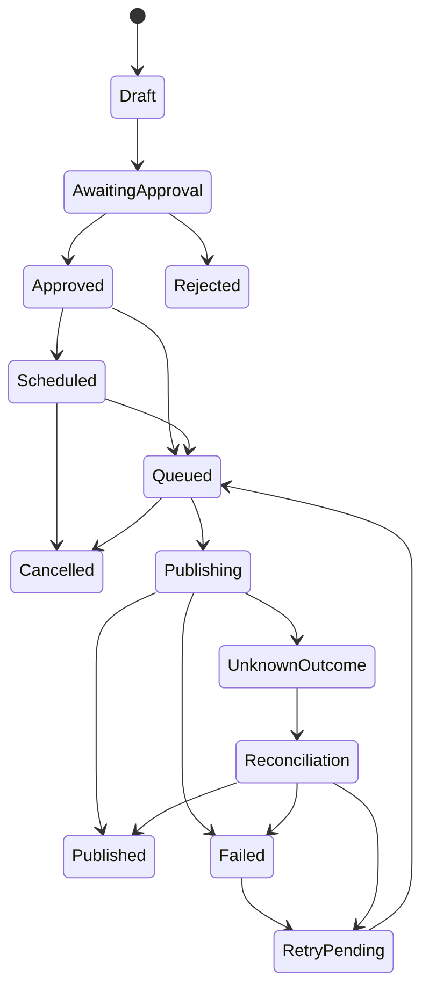

### State transition requirements

| Transition | Requirement |
|---|---|
| Draft → AwaitingApproval | Content ready for review |
| AwaitingApproval → Approved | Authorized approval |
| Approved → Scheduled | Valid schedule |
| Approved → Queued | Immediate publishing request |
| Queued → Publishing | Worker successfully claims job |
| Publishing → Published | Confirmed external publication |
| Publishing → Failed | Confirmed permanent or exhausted failure |
| Publishing → UnknownOutcome | External outcome uncertain |
| UnknownOutcome → Reconciliation | Reconciliation process initiated |
| Reconciliation → Published | Publication confirmed |
| Reconciliation → RetryPending | Safe retry established |
| Queued → Cancelled | Cancellation wins before execution |

Approval state and publishing job state should be persisted separately even though they are shown together here for conceptual readability.

---

## 11. Scheduled Publishing Execution

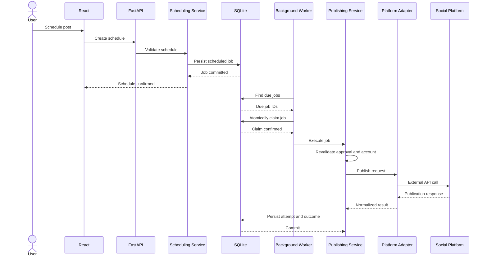

### Worker recovery

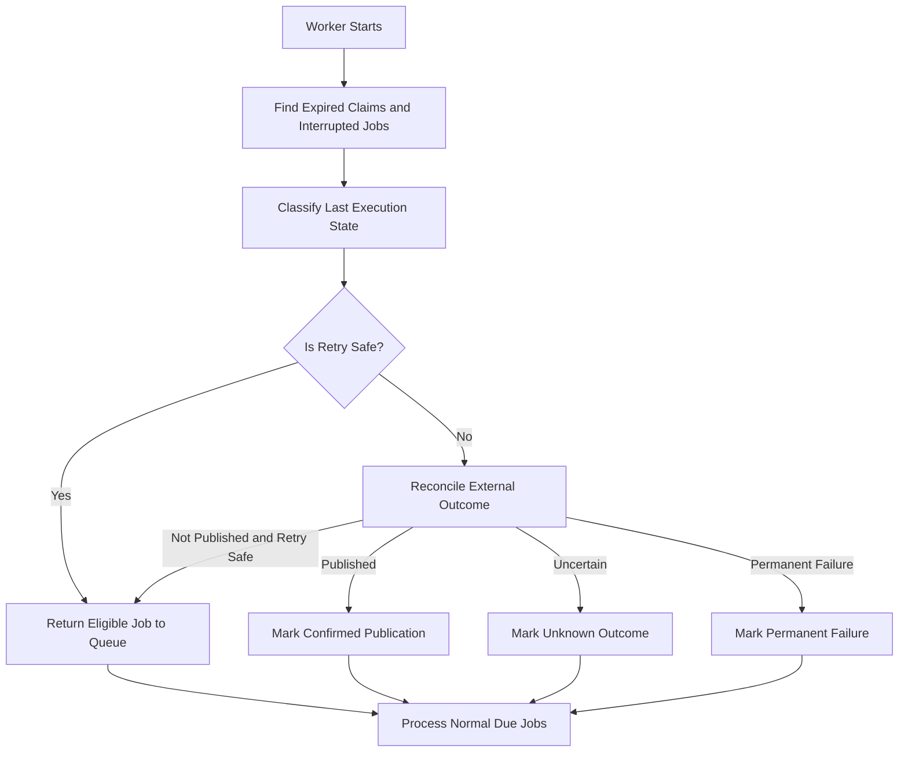

A network timeout is not evidence that publication failed. Unknown outcomes must be reconciled before retrying.

---

## 12. OAuth and Credential Security Flow

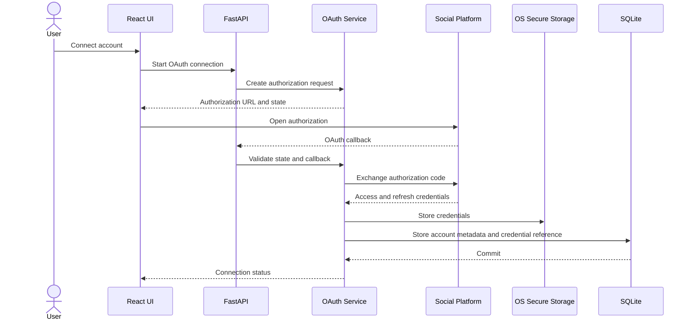

### Credential boundaries

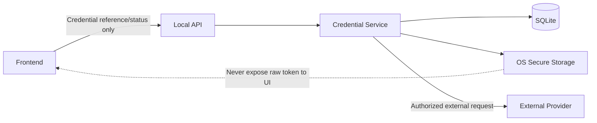

The dashed relationship represents a prohibited data path, not an actual communication channel.

---

## 13. Deployment Architecture - Desktop

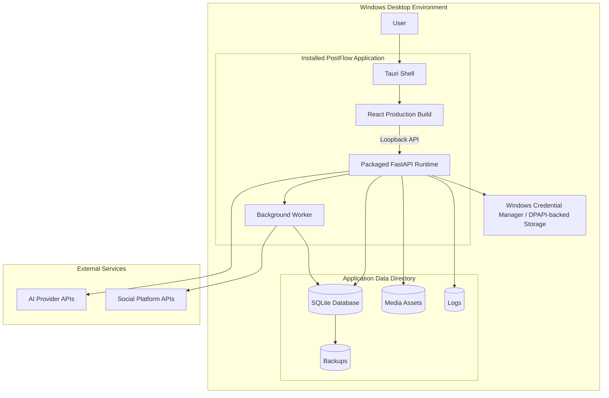

### Desktop runtime rules

- API binds to `127.0.0.1`.
- Backend authentication is required.
- User data remains outside the installation directory.
- The worker must persist and recover jobs.
- Secrets use OS-backed storage.
- Media processing is bounded.
- Application shutdown must be controlled.
- Desktop scheduled execution requires the computer and worker to remain available.

---

## 14. Deployment Architecture - Future SaaS

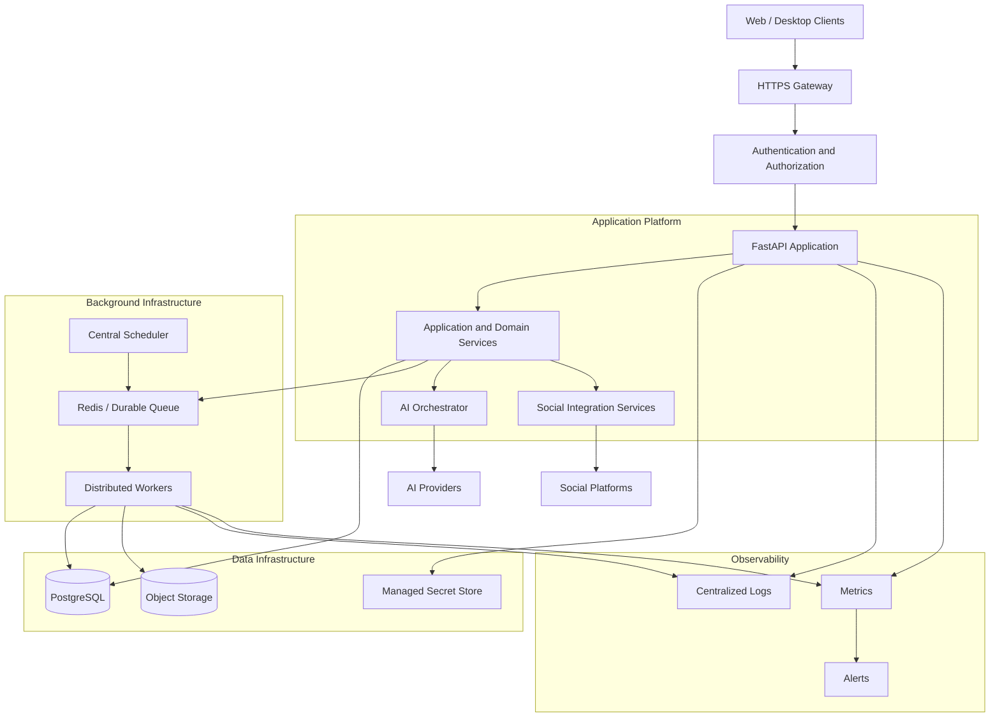

### SaaS evolution

| Desktop | SaaS |
|---|---|
| SQLite | PostgreSQL |
| Local filesystem | Object storage |
| Local scheduler | Central scheduler |
| Single worker | Distributed workers |
| OS secure storage | Managed secrets and encrypted credentials |
| Local workspace | Tenant-isolated workspace |
| Local logs | Centralized observability |

The SaaS deployment must introduce tenant isolation, role-based access control, rate limits, usage metering, centralized backups, and secure credential isolation.

---

## 15. Security Trust Boundary Diagram

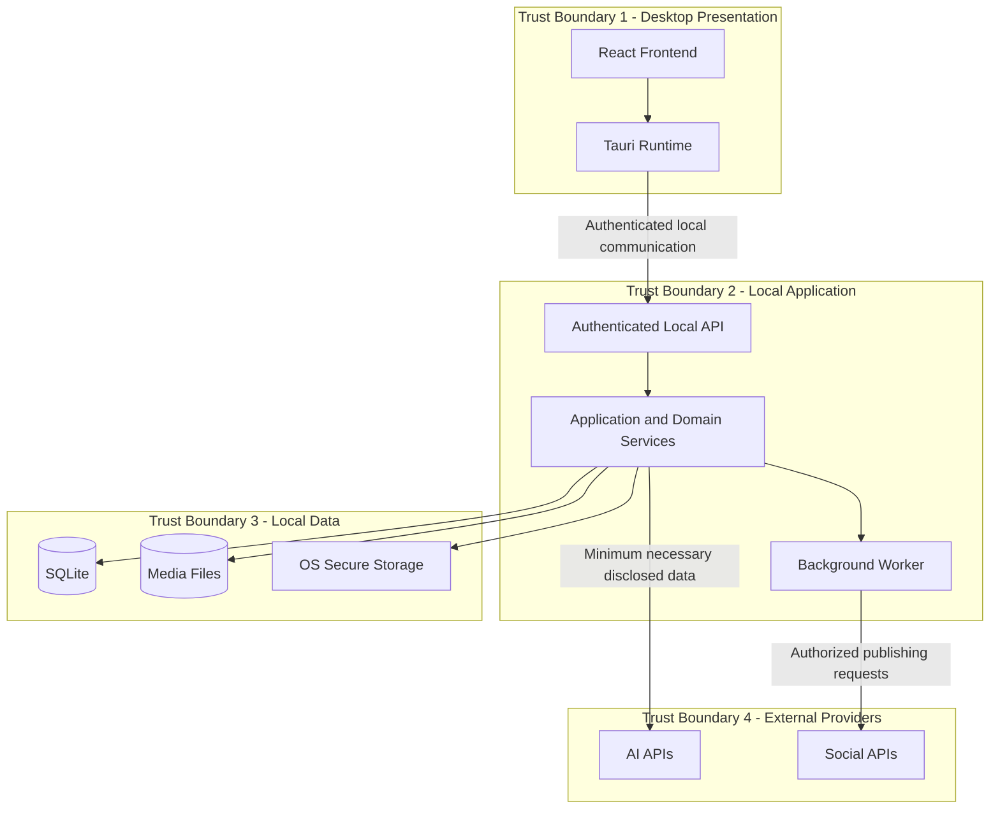

### Security controls by boundary

| Boundary | Required controls |
|---|---|
| Frontend → Local API | Authentication, origin restrictions, input validation |
| Local API → Domain | Authorization and business rule enforcement |
| Domain → Database | Transactions, scoped queries and constraints |
| Domain → Secure storage | Credential references and OS protection |
| Domain → AI providers | Data disclosure, minimum necessary context |
| Worker → Social platforms | OAuth protection, permission checks, idempotency |
| Media ingestion | File validation, path controls, bounded processing |

---

## 16. Component Dependency Diagram

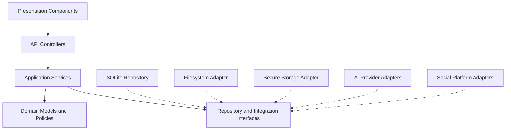

### Dependency rules

1. Frontend depends on API contracts.
2. API controllers depend on application services.
3. Application services depend on domain logic and interfaces.
4. Domain logic remains independent of infrastructure.
5. Infrastructure implements required interfaces.
6. Workers reuse application services.
7. Provider adapters do not own business workflows.
8. Platform adapters do not own approval policy.
9. Media processing does not own publishing.
10. Cross-module access must use public module interfaces.

---

## 17. Architecture Diagram Index

| Diagram | Purpose |
|---|---|
| 01. System Context | External actors and system boundaries |
| 02. Application Architecture | Application layers |
| 03. Desktop Containers | Runtime processes |
| 04. Backend Modules | Service ownership |
| 05. AI Integration | Provider abstraction |
| 06. Social Integration | Platform adapter boundaries |
| 07. Content Data Flow | Source and variant lifecycle |
| 08. Media Processing | Media ingestion and transformation |
| 09. Database ERD | Logical entity relationships |
| 10. Publishing State Machine | Publication lifecycle |
| 11. Scheduled Execution | Worker and recovery flow |
| 12. OAuth Security | Account authorization and token handling |
| 13. Desktop Deployment | Local deployment |
| 14. SaaS Deployment | Future cloud deployment |
| 15. Security Boundaries | Trust and data boundaries |
| 16. Component Dependencies | Dependency direction |

---

## 18. Architecture Invariants

The following rules apply to every diagram and implementation:

1. PostFlow desktop uses a modular monolith.
2. The frontend does not directly publish to social platforms.
3. Domain logic does not depend on external SDKs.
4. AI provider integrations are adapter-based.
5. Social integrations are independently bounded.
6. Source content and platform variants are separate.
7. Approval is tied to an exact content revision.
8. Every destination has an independent publishing job.
9. Publishing is idempotent.
10. Unknown outcomes are reconciled before retry.
11. Scheduled jobs survive application restarts.
12. Credentials never enter frontend state or logs.
13. SQLite is the desktop structured-data source of truth.
14. Media binaries are stored outside SQLite.
15. External AI transmission is disclosed and controlled.
16. Desktop scheduling limitations are communicated clearly.
17. SaaS requires tenant isolation.
18. Unsupported API capabilities must fail explicitly.

---

## 19. Document Maintenance

Update these diagrams whenever any of the following changes:

- Application layer boundaries.
- Backend service ownership.
- Frontend-to-backend contracts.
- AI provider integration contracts.
- Social platform integration contracts.
- Database relationships.
- Publishing state transitions.
- Worker execution and recovery.
- Security boundaries.
- Desktop or SaaS deployment architecture.

Every material architecture change must be reflected in the implementation and corresponding tests.

**Final architecture recommendation:** Keep PostFlow as a local-first modular monolith for the desktop MVP. Preserve explicit service contracts and infrastructure adapters so the system can evolve into SaaS without prematurely adopting microservices or distributed infrastructure.
