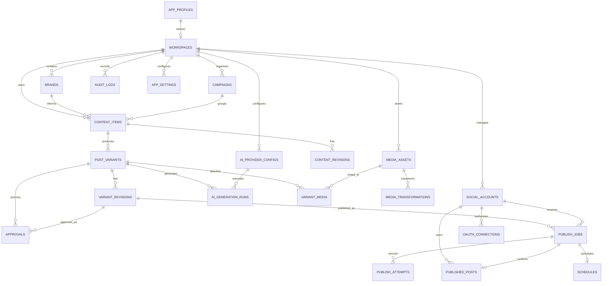

# PostFlow - Database Schema

**Document:** `DATABASE_SCHEMA.md`  
**Product:** PostFlow  
**Version:** 1.0  
**Status:** Proposed Implementation Specification  
**Initial Database:** SQLite  
**ORM:** SQLAlchemy 2.x  
**Migration Tool:** Alembic  
**Future Database:** PostgreSQL  
**Architecture:** Local-first modular monolith

---

## 1. Purpose

This document defines the logical and physical database design for PostFlow.

It specifies:

- Database entities and ownership.
- Primary keys and foreign-key relationships.
- Data types, constraints, indexes, and uniqueness rules.
- Content and platform-variant revision management.
- Social account and credential-reference storage.
- Approval and publishing state persistence.
- Scheduling and worker recovery.
- Migration strategy using Alembic.
- SQLite operational configuration.
- Data retention, backup, and integrity requirements.
- Future PostgreSQL and SaaS migration considerations.

The schema is designed around the current desktop product. Future SaaS capabilities must not introduce unnecessary infrastructure or operational complexity into the desktop MVP.

## 2. Database Design Principles

1. SQLite is the source of truth for structured desktop application data.
2. Media binaries are stored on the filesystem, not as database BLOBs.
3. All application entity identifiers use UUIDs.
4. All persisted timestamps use UTC.
5. Scheduled operations preserve an explicit IANA timezone identifier.
6. Foreign-key constraints must be enabled and enforced.
7. Critical state transitions must execute within database transactions.
8. Historical content revisions and publishing attempts must remain auditable.
9. Approval must reference an exact variant revision.
10. Every destination account receives an independent publishing job.
11. A publishing job must have a stable idempotency identity.
12. Unknown external publication outcomes must never trigger blind retries.
13. Raw API keys, OAuth access tokens, refresh tokens, and client secrets must not be stored in SQLite.
14. Credential references may be stored in SQLite; credential values belong in OS-backed secure storage.
15. Schema changes must be managed through versioned Alembic migrations.
16. Application services must access persistence through repository interfaces.

## 3. Database Technology and Configuration

### 3.1 Desktop database

| Component | Selection |
|---|---|
| Database | SQLite |
| ORM | SQLAlchemy 2.x |
| Migration | Alembic |
| Driver | `aiosqlite` for asynchronous access, if the chosen SQLAlchemy configuration requires it |
| Journal mode | WAL |
| Foreign keys | Enabled |
| Timestamp convention | UTC |
| Identifier convention | UUID |
| Media storage | Local filesystem |
| Backup | SQLite-aware backup process |

Use a single application-owned SQLite database. Do not introduce a separate local PostgreSQL server for the desktop MVP.

### 3.2 SQLite connection settings

Required connection initialization:

```sql
PRAGMA foreign_keys = ON;
PRAGMA journal_mode = WAL;
PRAGMA busy_timeout = 5000;
PRAGMA synchronous = NORMAL;
```

The application must verify that required pragmas are active for every connection where applicable.

Additional rules:

- Use short write transactions.
- Avoid holding write transactions while calling external APIs.
- Do not perform AI generation or media processing inside a database transaction.
- Use atomic conditional updates for job claiming.
- Configure WAL checkpoint behavior.
- Use SQLite's backup API or another SQLite-consistent backup mechanism.
- Do not copy only the main database file while WAL writes are active.
- Run integrity checks during restore verification.

`NORMAL` synchronous mode is a performance choice, not a guarantee against every power-loss scenario. Evaluate `FULL` if the product's durability requirements justify the performance cost.

### 3.3 Data types

| Logical type | SQLite representation | Application representation |
|---|---|---|
| UUID | `TEXT` | `uuid.UUID` |
| String | `TEXT` | `str` |
| Long text | `TEXT` | `str` |
| Integer | `INTEGER` | `int` |
| Boolean | `INTEGER` (`0` / `1`) | `bool` |
| Decimal | `NUMERIC` or integer minor units where applicable | `Decimal` |
| JSON | Validated `TEXT` | Python dictionary/list |
| UTC timestamp | ISO-8601 `TEXT` | timezone-aware `datetime` |
| Hash | `TEXT` | `str` |

Use a consistent UUID serialization format, preferably lowercase hyphenated UUID strings.

Use timezone-aware Python datetimes. Reject naive datetimes at API and service boundaries.

For financial or usage amounts, avoid binary floating-point storage. Use `NUMERIC` with explicit precision or integer minor units where appropriate.

## 4. Entity Overview

### 4.1 Core entities

| Entity | Purpose | MVP |
|---|---|---|
| `app_profiles` | Local installation/user profile | Yes |
| `workspaces` | Workspace boundaries | Yes |
| `workspace_members` | Future multi-user membership | Future |
| `brands` | Brand identity and guidelines | Yes |
| `ai_provider_configs` | AI provider configuration metadata | Yes |
| `content_items` | Source content | Yes |
| `content_revisions` | Historical source revisions | Yes |
| `post_variants` | Platform-specific content variants | Yes |
| `variant_revisions` | Historical variant revisions | Yes |
| `prompt_templates` | Reusable generation prompts | Yes |
| `ai_generation_runs` | AI request and execution metadata | Yes |
| `media_assets` | Media metadata and filesystem references | Yes |
| `media_transformations` | Media transformation history | Yes |
| `variant_media` | Variant-to-media association | Yes |
| `social_accounts` | Connected social account metadata | Yes |
| `oauth_connections` | OAuth connection metadata | Yes |
| `approvals` | Revision-bound approval records | Yes |
| `campaigns` | Content grouping | Optional MVP |
| `publish_jobs` | Destination-specific publishing operations | Yes |
| `publish_attempts` | Individual external publishing attempts | Yes |
| `published_posts` | Confirmed external publication records | Yes |
| `schedules` | Scheduling configuration and timezone | Yes |
| `analytics_snapshots` | Platform-reported metric snapshots | Later MVP |
| `audit_logs` | Security and operational audit events | Yes |
| `app_settings` | Non-secret application settings | Yes |

### 4.2 Entity ownership

- Workspace owns brands, content, media, accounts, campaigns, and workspace-level settings.
- Content item owns source revisions and platform variants.
- Platform variant owns variant revisions and approvals.
- Publishing job references one exact variant revision and one destination account.
- Publishing job owns its publishing attempts.
- A confirmed published post references the publishing job that produced it.
- Media assets are associated with variants through a many-to-many relationship.
- Credential values are external to the database.

## 5. Entity Definitions

The following definitions specify the recommended physical schema. All tables include `id` as a UUID primary key unless explicitly stated otherwise.

### 5.1 `app_profiles`

Represents the local desktop installation profile. The initial product can operate with one local profile without introducing a full cloud authentication system.

| Column | Type | Constraints | Description |
|---|---|---|---|
| `id` | UUID | PK | Profile identifier |
| `display_name` | TEXT | NOT NULL | Local profile display name |
| `active_workspace_id` | UUID | FK, NULL | Currently selected workspace |
| `created_at` | TIMESTAMP | NOT NULL | Creation time |
| `updated_at` | TIMESTAMP | NOT NULL | Last update |

Do not treat this local profile as a SaaS authentication identity. SaaS identity and authentication require a separate design.

### 5.2 `workspaces`

| Column | Type | Constraints | Description |
|---|---|---|---|
| `id` | UUID | PK | Workspace identifier |
| `name` | TEXT | NOT NULL | Workspace name |
| `description` | TEXT | NULL | Workspace description |
| `status` | TEXT | NOT NULL | `active`, `archived` |
| `created_at` | TIMESTAMP | NOT NULL | Creation time |
| `updated_at` | TIMESTAMP | NOT NULL | Last update |
| `archived_at` | TIMESTAMP | NULL | Archive time |

Indexes:

- `ix_workspaces_status`
- `ix_workspaces_name`

Workspace names should not be globally unique by default. Two independent workspaces may legitimately use the same name.

### 5.3 `workspace_members`

Future SaaS collaboration table.

| Column | Type | Constraints | Description |
|---|---|---|---|
| `id` | UUID | PK | Membership identifier |
| `workspace_id` | UUID | FK, NOT NULL | Workspace |
| `user_id` | UUID | FK, NOT NULL | SaaS user |
| `role` | TEXT | NOT NULL | `owner`, `admin`, `editor`, `viewer` |
| `status` | TEXT | NOT NULL | `invited`, `active`, `suspended` |
| `created_at` | TIMESTAMP | NOT NULL | Creation time |
| `updated_at` | TIMESTAMP | NOT NULL | Last update |

Constraints:

- Unique `(workspace_id, user_id)`.
- Role and status must use approved enum values.
- Do not implement this table as a substitute for proper SaaS authentication and authorization.

This entity is deferred until the SaaS deployment profile.

### 5.4 `brands`

| Column | Type | Constraints | Description |
|---|---|---|---|
| `id` | UUID | PK | Brand identifier |
| `workspace_id` | UUID | FK, NOT NULL | Owning workspace |
| `name` | TEXT | NOT NULL | Brand name |
| `description` | TEXT | NULL | Brand description |
| `voice` | TEXT | NULL | Brand voice description |
| `tone_guidelines` | JSON | NULL | Tone instructions |
| `audience_profile` | JSON | NULL | Target audience |
| `content_guidelines` | JSON | NULL | Content rules |
| `visual_guidelines` | JSON | NULL | Visual identity metadata |
| `default_language` | TEXT | NOT NULL | Language code |
| `created_at` | TIMESTAMP | NOT NULL | Creation time |
| `updated_at` | TIMESTAMP | NOT NULL | Last update |

Indexes:

- `ix_brands_workspace_id`
- Unique optional `(workspace_id, name)` if product behavior requires unique brand names inside a workspace.

JSON fields must be validated against application schemas before persistence.

### 5.5 `ai_provider_configs`

Stores provider configuration metadata, not raw API credentials.

| Column | Type | Constraints | Description |
|---|---|---|---|
| `id` | UUID | PK | Provider configuration |
| `workspace_id` | UUID | FK, NULL | Workspace scope; NULL for installation-level configuration |
| `provider_key` | TEXT | NOT NULL | `openai`, `gemini`, `anthropic`, `perplexity`, etc. |
| `display_name` | TEXT | NOT NULL | User-facing name |
| `model_id` | TEXT | NULL | Selected model |
| `credential_reference` | TEXT | NULL | OS secure-storage reference |
| `capabilities` | JSON | NOT NULL | Supported capabilities |
| `is_enabled` | BOOLEAN | NOT NULL | Enabled flag |
| `is_default` | BOOLEAN | NOT NULL | Default provider flag |
| `configuration` | JSON | NULL | Non-secret provider settings |
| `last_tested_at` | TIMESTAMP | NULL | Last connection test |
| `last_test_status` | TEXT | NULL | `success`, `failed`, `unknown` |
| `created_at` | TIMESTAMP | NOT NULL | Creation time |
| `updated_at` | TIMESTAMP | NOT NULL | Last update |

Constraints:

- Provider key must be supported by the adapter registry.
- Do not store API keys in `configuration`.
- Enforce at most one default provider per applicable scope using a partial unique index or transactional service rule.
- Model availability must be validated against the selected provider's capability registry.

### 5.6 `content_items`

Represents the source content from which platform variants are created.

| Column | Type | Constraints | Description |
|---|---|---|---|
| `id` | UUID | PK | Content identifier |
| `workspace_id` | UUID | FK, NOT NULL | Owning workspace |
| `brand_id` | UUID | FK, NULL | Associated brand |
| `campaign_id` | UUID | FK, NULL | Associated campaign |
| `title` | TEXT | NOT NULL | Content title |
| `source_content` | TEXT | NULL | Current source content |
| `content_type` | TEXT | NOT NULL | `text`, `article`, `image`, `video`, `mixed` |
| `language` | TEXT | NULL | Content language |
| `status` | TEXT | NOT NULL | `draft`, `active`, `archived` |
| `current_revision_number` | INTEGER | NOT NULL | Current source revision |
| `created_at` | TIMESTAMP | NOT NULL | Creation time |
| `updated_at` | TIMESTAMP | NOT NULL | Last update |
| `archived_at` | TIMESTAMP | NULL | Archive time |

Indexes:

- `ix_content_workspace_updated`
- `ix_content_brand_id`
- `ix_content_campaign_id`
- `ix_content_status`

The current source content is a convenience projection. Historical source revisions must be stored separately.

### 5.7 `content_revisions`

Immutable historical snapshots of source content.

| Column | Type | Constraints | Description |
|---|---|---|---|
| `id` | UUID | PK | Revision identifier |
| `content_item_id` | UUID | FK, NOT NULL | Parent content |
| `revision_number` | INTEGER | NOT NULL | Sequential revision |
| `title_snapshot` | TEXT | NOT NULL | Title at revision |
| `content_snapshot` | TEXT | NULL | Source content at revision |
| `metadata_snapshot` | JSON | NULL | Other source metadata |
| `change_source` | TEXT | NOT NULL | `user`, `ai`, `import`, `system` |
| `created_at` | TIMESTAMP | NOT NULL | Revision time |

Constraints:

- Unique `(content_item_id, revision_number)`.
- Revisions are immutable after creation.
- New edits create new revisions.
- Revision creation and updating `content_items.current_revision_number` must occur in one transaction.

### 5.8 `post_variants`

Represents one independent platform-specific content variant.

| Column | Type | Constraints | Description |
|---|---|---|---|
| `id` | UUID | PK | Variant identifier |
| `content_item_id` | UUID | FK, NOT NULL | Source content |
| `platform` | TEXT | NOT NULL | Platform identifier |
| `social_account_id` | UUID | FK, NULL | Optional selected destination account |
| `status` | TEXT | NOT NULL | `draft`, `ready`, `archived` |
| `current_revision_number` | INTEGER | NOT NULL | Current variant revision |
| `created_at` | TIMESTAMP | NOT NULL | Creation time |
| `updated_at` | TIMESTAMP | NOT NULL | Last update |

Indexes:

- `ix_variants_content_item_id`
- `ix_variants_platform`
- `ix_variants_status`
- `ix_variants_account_id`

A content item may have multiple variants for the same platform when distinct account-specific or campaign-specific versions are needed. Do not impose a unique `(content_item_id, platform)` constraint unless the product explicitly restricts this behavior.

### 5.9 `variant_revisions`

Stores immutable platform-specific content snapshots.

| Column | Type | Constraints | Description |
|---|---|---|---|
| `id` | UUID | PK | Revision identifier |
| `variant_id` | UUID | FK, NOT NULL | Parent variant |
| `revision_number` | INTEGER | NOT NULL | Sequential revision |
| `payload` | JSON | NOT NULL | Platform content payload |
| `validation_snapshot` | JSON | NULL | Validation result at creation |
| `change_source` | TEXT | NOT NULL | `user`, `ai`, `import`, `system` |
| `created_at` | TIMESTAMP | NOT NULL | Revision time |

Constraints:

- Unique `(variant_id, revision_number)`.
- Revision payload must pass platform-specific schema validation.
- Historical revisions are immutable.
- Editing creates a new revision.
- Approval and publishing must reference the exact revision ID, not merely the current variant.

Example payload:

```json
{
  "text": "Post caption",
  "title": null,
  "description": null,
  "hashtags": ["#technology", "#developers"],
  "call_to_action": "Read more",
  "alt_text": "A technical diagram",
  "link_url": null,
  "platform_options": {}
}
```

Do not assume all platforms support the same payload fields.

### 5.10 `prompt_templates`

| Column | Type | Constraints | Description |
|---|---|---|---|
| `id` | UUID | PK | Template identifier |
| `workspace_id` | UUID | FK, NULL | Workspace scope |
| `name` | TEXT | NOT NULL | Template name |
| `description` | TEXT | NULL | Description |
| `template_text` | TEXT | NOT NULL | Prompt template |
| `input_schema` | JSON | NULL | Required input schema |
| `provider_scope` | TEXT | NULL | Provider restriction |
| `is_system` | BOOLEAN | NOT NULL | Built-in template flag |
| `created_at` | TIMESTAMP | NOT NULL | Creation time |
| `updated_at` | TIMESTAMP | NOT NULL | Last update |

### 5.11 `ai_generation_runs`

Stores execution metadata for AI requests. Do not store secrets or unnecessarily duplicate full sensitive prompts and outputs.

| Column | Type | Constraints | Description |
|---|---|---|---|
| `id` | UUID | PK | Generation run |
| `workspace_id` | UUID | FK, NOT NULL | Workspace |
| `content_item_id` | UUID | FK, NULL | Related source content |
| `variant_id` | UUID | FK, NULL | Related variant |
| `provider_config_id` | UUID | FK, NULL | Provider configuration |
| `provider_key` | TEXT | NOT NULL | Provider identifier snapshot |
| `model_id` | TEXT | NULL | Model identifier snapshot |
| `operation` | TEXT | NOT NULL | `generate`, `revise`, `adapt`, `research`, etc. |
| `status` | TEXT | NOT NULL | `pending`, `running`, `succeeded`, `failed`, `cancelled` |
| `input_fingerprint` | TEXT | NULL | Non-reversible request fingerprint |
| `usage_metadata` | JSON | NULL | Token/usage metadata |
| `cost_amount` | NUMERIC | NULL | Estimated or reported cost |
| `cost_currency` | TEXT | NULL | Currency code |
| `error_code` | TEXT | NULL | Normalized failure code |
| `started_at` | TIMESTAMP | NULL | Start time |
| `completed_at` | TIMESTAMP | NULL | Completion time |
| `created_at` | TIMESTAMP | NOT NULL | Creation time |

Data retention rules must be defined for prompt/output payloads. Store only what the user needs for history and reproducibility.

### 5.12 `media_assets`

Stores metadata and references to files stored outside SQLite.

| Column | Type | Constraints | Description |
|---|---|---|---|
| `id` | UUID | PK | Asset identifier |
| `workspace_id` | UUID | FK, NOT NULL | Owning workspace |
| `original_filename` | TEXT | NOT NULL | Original display filename |
| `stored_filename` | TEXT | NOT NULL | Generated safe filename |
| `storage_key` | TEXT | NOT NULL | Relative managed storage path |
| `media_type` | TEXT | NOT NULL | `image`, `video`, `audio`, `document` |
| `mime_type` | TEXT | NOT NULL | Verified MIME type |
| `file_extension` | TEXT | NULL | Extension |
| `file_size_bytes` | INTEGER | NOT NULL | File size |
| `sha256` | TEXT | NOT NULL | Content hash |
| `width` | INTEGER | NULL | Image/video width |
| `height` | INTEGER | NULL | Image/video height |
| `duration_ms` | INTEGER | NULL | Video/audio duration |
| `metadata` | JSON | NULL | Extracted metadata |
| `status` | TEXT | NOT NULL | `processing`, `ready`, `failed`, `deleted` |
| `created_at` | TIMESTAMP | NOT NULL | Upload time |
| `updated_at` | TIMESTAMP | NOT NULL | Last update |

Constraints:

- `file_size_bytes > 0`.
- `storage_key` must be application-generated and relative to the managed media root.
- `sha256` must be a valid digest.
- MIME type must be verified from file content, not trusted from the upload header.
- A deleted asset must not be silently referenced by a new publishing job.

Indexes:

- `ix_media_workspace_created`
- `ix_media_status`
- `ix_media_sha256`

### 5.13 `media_transformations`

| Column | Type | Constraints | Description |
|---|---|---|---|
| `id` | UUID | PK | Transformation identifier |
| `media_asset_id` | UUID | FK, NOT NULL | Source asset |
| `operation` | TEXT | NOT NULL | `resize`, `compress`, `thumbnail`, `transcode` |
| `parameters` | JSON | NULL | Transformation parameters |
| `output_asset_id` | UUID | FK, NULL | Resulting asset |
| `status` | TEXT | NOT NULL | `pending`, `running`, `succeeded`, `failed` |
| `error_code` | TEXT | NULL | Normalized error |
| `created_at` | TIMESTAMP | NOT NULL | Creation time |
| `completed_at` | TIMESTAMP | NULL | Completion time |

### 5.14 `variant_media`

Associates media assets with platform variants.

| Column | Type | Constraints | Description |
|---|---|---|---|
| `variant_id` | UUID | FK, NOT NULL | Variant |
| `media_asset_id` | UUID | FK, NOT NULL | Media asset |
| `position` | INTEGER | NOT NULL | Display order |
| `role` | TEXT | NOT NULL | `primary`, `attachment`, `thumbnail`, `cover` |
| `created_at` | TIMESTAMP | NOT NULL | Association time |

Primary key: `(variant_id, media_asset_id)`.

Unique `(variant_id, position)`.

### 5.15 `social_accounts`

Stores connected social account metadata, never raw access tokens.

| Column | Type | Constraints | Description |
|---|---|---|---|
| `id` | UUID | PK | Local account identifier |
| `workspace_id` | UUID | FK, NOT NULL | Workspace |
| `platform` | TEXT | NOT NULL | Platform identifier |
| `external_account_id` | TEXT | NOT NULL | Platform account ID |
| `account_name` | TEXT | NOT NULL | Display name |
| `account_type` | TEXT | NULL | Platform account type |
| `profile_url` | TEXT | NULL | Profile URL |
| `status` | TEXT | NOT NULL | `connected`, `expired`, `revoked`, `disconnected`, `error` |
| `permissions` | JSON | NULL | Granted permission scopes |
| `capabilities_snapshot` | JSON | NULL | Last-known capability snapshot |
| `last_verified_at` | TIMESTAMP | NULL | Last verification |
| `created_at` | TIMESTAMP | NOT NULL | Connection time |
| `updated_at` | TIMESTAMP | NOT NULL | Last update |
| `disconnected_at` | TIMESTAMP | NULL | Disconnection time |

Constraints:

- Unique `(workspace_id, platform, external_account_id)`.
- Do not assume one platform account can only belong to one workspace unless explicitly enforced by product policy.
- Account status and capability status must be revalidated before publishing.

### 5.16 `oauth_connections`

Stores OAuth lifecycle metadata and secure-storage references.

| Column | Type | Constraints | Description |
|---|---|---|---|
| `id` | UUID | PK | OAuth connection |
| `social_account_id` | UUID | FK, NOT NULL | Connected account |
| `credential_reference` | TEXT | NOT NULL | OS secure-storage reference |
| `token_expires_at` | TIMESTAMP | NULL | Access token expiry |
| `refresh_expires_at` | TIMESTAMP | NULL | Refresh expiry, if supplied |
| `granted_scopes` | JSON | NULL | Granted scopes |
| `status` | TEXT | NOT NULL | `active`, `expired`, `revoked`, `invalid` |
| `last_refresh_at` | TIMESTAMP | NULL | Last token refresh |
| `created_at` | TIMESTAMP | NOT NULL | Creation time |
| `updated_at` | TIMESTAMP | NOT NULL | Last update |

OAuth authorization state and PKCE verifier are short-lived transaction data. Store them in a dedicated temporary mechanism with expiry; do not retain them as permanent account credentials.

### 5.17 `approvals`

Approval is tied to a specific variant revision.

| Column | Type | Constraints | Description |
|---|---|---|---|
| `id` | UUID | PK | Approval identifier |
| `variant_id` | UUID | FK, NOT NULL | Variant |
| `variant_revision_id` | UUID | FK, NOT NULL | Exact approved revision |
| `status` | TEXT | NOT NULL | `approved`, `rejected`, `revoked` |
| `decision_source` | TEXT | NOT NULL | `user`, `system` |
| `comment` | TEXT | NULL | Review comment |
| `approved_at` | TIMESTAMP | NULL | Approval time |
| `created_at` | TIMESTAMP | NOT NULL | Record creation |

Constraints:

- Approval must reference an existing variant revision.
- Approval must not be silently transferred to a newer revision.
- A newer revision requires a new approval.
- Approval decisions are historical records; do not overwrite old approval records.

### 5.18 `campaigns`

| Column | Type | Constraints | Description |
|---|---|---|---|
| `id` | UUID | PK | Campaign identifier |
| `workspace_id` | UUID | FK, NOT NULL | Workspace |
| `name` | TEXT | NOT NULL | Campaign name |
| `description` | TEXT | NULL | Description |
| `status` | TEXT | NOT NULL | `draft`, `active`, `completed`, `archived` |
| `starts_at` | TIMESTAMP | NULL | Start time |
| `ends_at` | TIMESTAMP | NULL | End time |
| `created_at` | TIMESTAMP | NOT NULL | Creation time |
| `updated_at` | TIMESTAMP | NOT NULL | Last update |

A campaign can group multiple content items. A content item may belong to zero or one campaign in the initial design.

### 5.19 `publish_jobs`

Each job represents one logical publication to one destination account using one exact variant revision.

| Column | Type | Constraints | Description |
|---|---|---|---|
| `id` | UUID | PK | Job identifier |
| `workspace_id` | UUID | FK, NOT NULL | Workspace |
| `variant_id` | UUID | FK, NOT NULL | Variant |
| `variant_revision_id` | UUID | FK, NOT NULL | Exact revision |
| `social_account_id` | UUID | FK, NOT NULL | Destination account |
| `approval_id` | UUID | FK, NULL | Required approval record |
| `operation_key` | TEXT | NOT NULL | Stable logical publication identity |
| `idempotency_key` | TEXT | NOT NULL | Request/job idempotency key |
| `status` | TEXT | NOT NULL | Publishing state |
| `scheduled_at` | TIMESTAMP | NULL | UTC execution time |
| `timezone` | TEXT | NULL | IANA timezone |
| `priority` | INTEGER | NOT NULL | Queue priority |
| `attempt_count` | INTEGER | NOT NULL | Number of attempts |
| `max_attempts` | INTEGER | NOT NULL | Maximum permitted attempts |
| `next_attempt_at` | TIMESTAMP | NULL | Retry time |
| `claimed_at` | TIMESTAMP | NULL | Worker claim time |
| `claim_expires_at` | TIMESTAMP | NULL | Claim expiry |
| `worker_id` | TEXT | NULL | Worker identifier |
| `last_error_code` | TEXT | NULL | Last normalized error |
| `last_error_message` | TEXT | NULL | Sanitized error |
| `created_at` | TIMESTAMP | NOT NULL | Creation time |
| `updated_at` | TIMESTAMP | NOT NULL | Last update |
| `completed_at` | TIMESTAMP | NULL | Completion time |
| `cancelled_at` | TIMESTAMP | NULL | Cancellation time |

Recommended states:

- `scheduled`
- `queued`
- `publishing`
- `retry_pending`
- `unknown_outcome`
- `reconciling`
- `published`
- `failed`
- `cancelled`

Constraints and rules:

- Unique `(social_account_id, operation_key)`.
- Unique `idempotency_key` within the defined idempotency scope.
- `attempt_count >= 0`.
- `max_attempts >= 1`.
- Scheduled time must be valid UTC.
- Job revision must belong to the referenced variant.
- Job account and variant must belong to the same workspace.
- Required approval must match the exact revision.
- The worker must revalidate account, permissions, approval, media and platform capability before execution.

The operation key identifies one intentional publication. A deliberate repost must create a new operation key.

### 5.20 `publish_attempts`

Each attempt represents one external execution attempt.

| Column | Type | Constraints | Description |
|---|---|---|---|
| `id` | UUID | PK | Attempt identifier |
| `publish_job_id` | UUID | FK, NOT NULL | Parent job |
| `attempt_number` | INTEGER | NOT NULL | Sequential attempt number |
| `status` | TEXT | NOT NULL | `started`, `succeeded`, `failed`, `unknown_outcome` |
| `request_fingerprint` | TEXT | NULL | Non-secret request fingerprint |
| `external_request_id` | TEXT | NULL | Platform request identifier |
| `external_post_id` | TEXT | NULL | External post identifier |
| `error_code` | TEXT | NULL | Normalized error |
| `error_category` | TEXT | NULL | Failure category |
| `error_message` | TEXT | NULL | Sanitized message |
| `started_at` | TIMESTAMP | NOT NULL | Attempt start |
| `completed_at` | TIMESTAMP | NULL | Attempt completion |
| `created_at` | TIMESTAMP | NOT NULL | Record creation |

Constraints:

- Unique `(publish_job_id, attempt_number)`.
- Attempts are append-only after completion.
- Never store authorization headers or raw token values.
- A timeout after request transmission must be classified as potentially unknown, not automatically failed.

### 5.21 `published_posts`

Stores confirmed publication results.

| Column | Type | Constraints | Description |
|---|---|---|---|
| `id` | UUID | PK | Publication record |
| `publish_job_id` | UUID | FK, UNIQUE, NOT NULL | Source job |
| `social_account_id` | UUID | FK, NOT NULL | Destination account |
| `platform` | TEXT | NOT NULL | Platform |
| `external_post_id` | TEXT | NOT NULL | Platform post ID |
| `external_url` | TEXT | NULL | Public URL if available |
| `published_at` | TIMESTAMP | NOT NULL | Confirmed publication time |
| `created_at` | TIMESTAMP | NOT NULL | Record creation |

Constraints:

- One confirmed publication record per logical job.
- External post ID uniqueness should be scoped by platform and account where platform behavior supports it.
- A record must only be created after confirmed publication or reconciliation evidence.

### 5.22 `schedules`

Represents schedule configuration independently of execution jobs.

| Column | Type | Constraints | Description |
|---|---|---|---|
| `id` | UUID | PK | Schedule identifier |
| `publish_job_id` | UUID | FK, UNIQUE, NOT NULL | Associated job |
| `scheduled_local_time` | TEXT | NOT NULL | Local wall-clock representation |
| `timezone` | TEXT | NOT NULL | IANA timezone |
| `scheduled_at_utc` | TIMESTAMP | NOT NULL | Resolved UTC execution time |
| `status` | TEXT | NOT NULL | `active`, `paused`, `completed`, `cancelled` |
| `created_at` | TIMESTAMP | NOT NULL | Creation time |
| `updated_at` | TIMESTAMP | NOT NULL | Last update |

For a one-time scheduled post, `publish_jobs.scheduled_at` may be sufficient for execution. The `schedules` table retains the user's timezone and scheduling intent. If recurring scheduling is introduced later, model recurrence rules separately rather than overloading this table.

### 5.23 `analytics_snapshots`

Deferred until platform analytics integrations are implemented.

| Column | Type | Constraints | Description |
|---|---|---|---|
| `id` | UUID | PK | Snapshot identifier |
| `workspace_id` | UUID | FK, NOT NULL | Workspace |
| `social_account_id` | UUID | FK, NOT NULL | Account |
| `published_post_id` | UUID | FK, NULL | Published post |
| `platform` | TEXT | NOT NULL | Platform |
| `metrics` | JSON | NOT NULL | Platform-reported metrics |
| `captured_at` | TIMESTAMP | NOT NULL | Collection time |
| `source` | TEXT | NOT NULL | `official_api`, `import` |

Only actual platform-returned metrics may be stored as verified analytics. Estimated values must be explicitly identified as estimates.

### 5.24 `audit_logs`

| Column | Type | Constraints | Description |
|---|---|---|---|
| `id` | UUID | PK | Audit identifier |
| `workspace_id` | UUID | FK, NULL | Related workspace |
| `actor_type` | TEXT | NOT NULL | `local_user`, `system`, `worker` |
| `actor_id` | TEXT | NULL | Actor identifier |
| `event_type` | TEXT | NOT NULL | Event name |
| `entity_type` | TEXT | NULL | Affected entity type |
| `entity_id` | UUID | NULL | Affected entity |
| `correlation_id` | TEXT | NULL | Request correlation |
| `details` | JSON | NULL | Sanitized event metadata |
| `created_at` | TIMESTAMP | NOT NULL | Event time |

Audit logs must not contain raw tokens, API keys, authorization codes, secret headers, or unredacted sensitive request bodies.

### 5.25 `app_settings`

| Column | Type | Constraints | Description |
|---|---|---|---|
| `id` | UUID | PK | Setting identifier |
| `workspace_id` | UUID | FK, NULL | Workspace scope |
| `setting_key` | TEXT | NOT NULL | Setting name |
| `setting_value` | JSON | NOT NULL | Validated value |
| `updated_at` | TIMESTAMP | NOT NULL | Last update |

Unique `(workspace_id, setting_key)` with explicit handling of installation-level `NULL` scope. SQLite treats NULL values specially in unique constraints; use a partial unique index or a normalized scope key to enforce installation-level uniqueness correctly.

Never use this table for secrets.

## 6. Entity Relationships



## 7. Critical Integrity Rules

### 7.1 Workspace isolation

Every workspace-owned record must be scoped to its workspace.

For example:

- A publish job's variant must belong to the same workspace as the job.
- A social account must belong to the same workspace as the job.
- A media asset attached to a variant must belong to the same workspace as the variant.
- A brand referenced by content must belong to the same workspace as the content.

Do not rely only on frontend filtering. Enforce these rules in application services and, where practical, with composite foreign keys or database constraints.

### 7.2 Revision integrity

- Source revisions are immutable.
- Variant revisions are immutable.
- Approval references an exact variant revision.
- Publishing references an exact variant revision.
- A new revision does not inherit previous approval.
- A publish job must not silently change its target revision after creation.

### 7.3 Publishing integrity

- One destination account per publishing job.
- One logical operation per idempotency identity.
- Each execution creates a new attempt record.
- A confirmed publication is stored separately from the job.
- Unknown outcome is a first-class state.
- No automatic retry while outcome remains uncertain.
- A cancellation must not report success if the external request is already in progress and cannot be safely stopped.

### 7.4 Credential integrity

SQLite may contain:

- Credential reference.
- Provider/account identifier.
- Token expiry timestamp.
- Granted scopes.
- Connection status.

SQLite must not contain:

- Access token.
- Refresh token.
- API key.
- OAuth client secret.
- Authorization code.
- PKCE verifier after its temporary transaction ends.

## 8. Indexing Strategy

Create indexes for frequent lookups and worker operations.

| Index | Table | Columns |
|---|---|---|
| `ix_content_workspace_updated` | `content_items` | `(workspace_id, updated_at)` |
| `ix_variants_content` | `post_variants` | `(content_item_id)` |
| `ix_variant_revisions_variant` | `variant_revisions` | `(variant_id, revision_number)` |
| `ix_media_workspace_created` | `media_assets` | `(workspace_id, created_at)` |
| `ix_accounts_workspace_platform` | `social_accounts` | `(workspace_id, platform, status)` |
| `ix_jobs_due` | `publish_jobs` | `(status, scheduled_at, next_attempt_at)` |
| `ix_jobs_claim_expiry` | `publish_jobs` | `(status, claim_expires_at)` |
| `ix_attempts_job` | `publish_attempts` | `(publish_job_id, attempt_number)` |
| `ix_approvals_revision` | `approvals` | `(variant_revision_id, status)` |
| `ix_audit_workspace_time` | `audit_logs` | `(workspace_id, created_at)` |

Use partial indexes where supported and useful, such as indexing only queued jobs.

Validate query plans with `EXPLAIN QUERY PLAN` for critical worker queries.

## 9. Alembic Migration Strategy

### 9.1 Migration requirements

- All schema changes must be versioned.
- Every migration must have a unique revision ID.
- Every migration must define `upgrade()` and `downgrade()`.
- Migrations must be tested against a clean database.
- Migrations must be tested against a representative prior-version database.
- Migrations must never silently discard user content.
- Destructive changes require a backup and explicit release procedure.
- Application startup must not run an unreviewed destructive migration.
- A failed migration must leave the database recoverable.

### 9.2 Recommended migration sequence

| Migration | Scope | Priority |
|---|---|---|
| `0001_initial_core` | Profiles, workspaces, settings | P0 |
| `0002_brands_and_ai_providers` | Brands and provider metadata | P0 |
| `0003_content_and_revisions` | Content, source revisions, variants, variant revisions | P0 |
| `0004_media_library` | Media assets, transformations, variant associations | P0 |
| `0005_social_accounts_oauth` | Social accounts and OAuth references | P0 |
| `0006_approvals` | Revision-bound approval records | P0 |
| `0007_publishing_jobs` | Jobs, attempts, published posts | P0 |
| `0008_scheduling` | Schedule metadata and worker indexes | P0 |
| `0009_ai_history_and_prompts` | Generation runs and prompt templates | P1 |
| `0010_campaigns_analytics_audit` | Campaigns, analytics, audit events | P1 |
| `0011_future_workspace_members` | SaaS membership schema | Deferred |

The actual Alembic revision IDs are generated by the repository's migration tooling. The labels above are logical migration names, not pre-existing revision identifiers.

### 9.3 Migration example

```python
"""Create initial workspace tables."""

from alembic import op
import sqlalchemy as sa

revision = "0001_initial_core"
down_revision = None
branch_labels = None
depends_on = None


def upgrade() -> None:
    op.create_table(
        "workspaces",
        sa.Column("id", sa.String(36), primary_key=True),
        sa.Column("name", sa.Text(), nullable=False),
        sa.Column("description", sa.Text(), nullable=True),
        sa.Column(
            "status",
            sa.String(20),
            nullable=False,
            server_default="active",
        ),
        sa.Column("created_at", sa.DateTime(timezone=True), nullable=False),
        sa.Column("updated_at", sa.DateTime(timezone=True), nullable=False),
        sa.Column("archived_at", sa.DateTime(timezone=True), nullable=True),
    )

    op.create_index(
        "ix_workspaces_status",
        "workspaces",
        ["status"],
    )


def downgrade() -> None:
    op.drop_index("ix_workspaces_status", table_name="workspaces")
    op.drop_table("workspaces")
```

This is an illustrative migration. The implementation must use the project's actual SQLAlchemy naming conventions, UUID type strategy, timestamp defaults, and migration configuration.

### 9.4 SQLite migration caveats

SQLite has limitations around altering constraints and column definitions.

For changes requiring table reconstruction:

1. Create the replacement table.
2. Copy and transform existing data.
3. Validate row counts and integrity.
4. Replace the old table.
5. Recreate indexes and triggers.
6. Run foreign-key checks.
7. Commit only after validation.

Use Alembic batch operations when appropriate.

Do not disable foreign-key enforcement casually. If a migration requires a special SQLite procedure, document it and test it on a copy of a real database.

### 9.5 Migration execution

Development:

```bash
alembic revision --autogenerate -m "describe_schema_change"
alembic upgrade head
alembic downgrade -1
alembic current
alembic history
```

Production desktop startup:

1. Verify application data directory.
2. Verify database file and permissions.
3. Create a consistent backup.
4. Read current Alembic revision.
5. Validate migration compatibility.
6. Apply pending migration.
7. Run integrity checks.
8. Start dependent services only after successful migration.
9. If migration fails, stop startup and show a recoverable error.

Never automatically downgrade a database after a failed migration. A downgrade may itself be destructive or incompatible with data already written.

## 10. Backup and Restore

### Backup must include

- SQLite database using a consistent backup method.
- Original media.
- Processed media required by stored content.
- Application metadata needed to restore relationships.
- Backup manifest containing application version, schema revision, creation time, and checksums.

### Restore requirements

- Validate archive paths against path traversal.
- Verify file checksums.
- Validate database integrity.
- Validate Alembic revision.
- Restore into a staging directory first.
- Never overwrite the active database before verification.
- Preserve or re-establish OS secure-storage credentials separately.
- Clearly report credentials that cannot be restored automatically.

A database backup does not automatically include Windows Credential Manager or DPAPI secrets. The restore flow must explicitly address credential reconnection.

## 11. Data Retention and Deletion

- Content revisions should be retained until the user explicitly deletes the content or invokes an approved retention policy.
- Publishing attempts should be retained for diagnostics and auditability.
- Audit logs should have a documented retention policy.
- Temporary OAuth state must expire quickly.
- Temporary media files must be cleaned up safely.
- Media deletion must check references before removing files.
- Deleting a social account must not delete historical published-post records.
- Deleting content must not erase legally or operationally required publication history without an explicit policy.

Use soft deletion where recovery or audit requirements justify it. Do not use soft deletion indiscriminately for every table.

## 12. Future PostgreSQL Migration

The desktop schema should avoid unnecessary SQLite-specific application logic.

For SaaS:

- Replace SQLite with PostgreSQL.
- Use PostgreSQL UUID types.
- Use PostgreSQL JSONB where beneficial.
- Add tenant-aware authorization and row-level isolation where appropriate.
- Add user identity, workspace membership, and RBAC.
- Move media to object storage.
- Move secrets to a managed secret store or encrypted credential service.
- Introduce a durable distributed job queue only when operational scale requires it.
- Reassess indexes and concurrency behavior.
- Add tenant isolation tests.

Do not assume SQLite-to-PostgreSQL migration is automatic. Test all data types, constraints, JSON operations, partial indexes, locking, and migration behavior.

## 13. Database Testing Requirements

### Unit tests

- UUID serialization.
- Timestamp normalization.
- JSON schema validation.
- Enum validation.
- Repository operations.
- Revision-number allocation.

### Integration tests

- Foreign-key enforcement.
- Workspace ownership validation.
- Unique constraints.
- Revision immutability.
- Approval-to-revision consistency.
- Job-to-account and job-to-variant consistency.
- Transaction rollback.
- SQLite WAL configuration.
- Concurrent job claiming.
- Migration upgrade and downgrade behavior.

### Reliability tests

- Application restart with queued jobs.
- Worker crash during job execution.
- Expired job claim recovery.
- Unknown publishing outcome persistence.
- Backup and restore.
- Database corruption detection.
- Media file missing or checksum mismatch.

## 14. Acceptance Criteria Mapping

| Acceptance criterion | Database responsibility |
|---|---|
| `AC-APP-003` | Workspace persistence and validation |
| `AC-APP-004` | Workspace-scoped data access |
| `AC-APP-005` | Durable application state and recovery |
| `AC-BRAND-001` | Brand records and constraints |
| `AC-AI-001` to `AC-AI-008` | Provider configuration metadata and generation history |
| `AC-CONTENT-001` to `AC-CONTENT-006` | Source content, revisions, generation records |
| `AC-MEDIA-001` to `AC-MEDIA-005` | Media metadata, file references, transformations |
| `AC-COMPOSER-001` to `AC-COMPOSER-005` | Variants, revisions, media associations |
| `AC-ACCOUNT-001` to `AC-ACCOUNT-005` | Account metadata, OAuth references and permission snapshots |
| `AC-APPROVAL-001` to `AC-APPROVAL-004` | Revision-bound approval records |
| `AC-PUBLISH-001` to `AC-PUBLISH-009` | Jobs, attempts, idempotency and publication records |
| `AC-SCHEDULE-001` to `AC-SCHEDULE-005` | Schedule persistence and recovery |
| `AC-ANALYTICS-001` to `AC-ANALYTICS-003` | Source-attributed metric snapshots |
| `AC-SETTINGS-002` to `AC-SETTINGS-005` | Backup, restore, export and deletion |
| `AC-SEC-002` to `AC-SEC-006` | Credential references and audit events |

## 15. Release Gates

Do not approve the database implementation unless:

- All required tables and relationships are represented in SQLAlchemy models.
- Alembic migrations create the schema from an empty database.
- Existing database upgrades pass.
- Foreign keys are enabled and verified.
- Workspace isolation tests pass.
- Revision and approval integrity tests pass.
- Job idempotency constraints pass.
- Worker job claiming is atomic.
- Unknown outcomes persist correctly.
- Backup and restore tests pass.
- No raw credentials are stored in SQLite.
- No critical migration or data-loss defect remains.

**Final recommendation:** Implement the database as a normalized SQLite schema with immutable content and variant revisions, revision-bound approvals, destination-specific publishing jobs, append-only attempt history, and filesystem-backed media. Keep SaaS-only membership and tenant infrastructure deferred until there is a validated SaaS requirement.

## M0 Reconciliation — Schema Constraints

**Authority:** `docs/IMPLEMENTATION_BASELINE.md` and `docs/BUILD_READINESS_REPORT.md`. This addendum supersedes conflicting MVP scope and priorities in this document. The target is a single-user, local-first Windows desktop MVP. Windows 11 is the production support baseline; Windows 10 is best-effort development only. P0 includes Tauri 2/Rust, React/TypeScript, supervised FastAPI, SQLite/SQLAlchemy/Alembic, local media, source content and independent revisioned variants, one AI provider, exact human approval, durable per-destination publishing jobs, idempotency/immutable attempts/unknown-outcome reconciliation, one-time local scheduling, privacy, backup and restore. At most one official social-platform integration may be enabled, and only after a documented PASS feasibility gate. Scheduling requires the app/worker active, device awake and internet available. Campaigns, team membership/roles, collaboration, billing, SaaS, cloud scheduling, public API, cloud media relay, additional AI providers/platforms, multi-provider comparison/fallback and advanced social analytics are P1/Future, not MVP requirements.

P0 persistence: local app/workspace/brand records only if needed by the accepted workflow; source content; independent variants and revision history; local media and associations; one AI provider configuration with opaque OS credential reference; optional gated social account metadata with opaque credential references; exact approval records; durable publish jobs; append-only attempts; reconciliation state; audit events. Exclude campaign, membership/role, collaboration, tenant/billing, cloud scheduler and analytics warehouse tables. The durable publish job is the canonical one-time schedule record; do not create a duplicate schedule table without an approved ADR. Store UTC instant and IANA timezone. Enforce foreign keys and idempotency uniqueness. Never store raw secrets in SQLite.
