# PostFlow - System Design

**Document:** `SYSTEM_DESIGN.md`  
**Product:** PostFlow  
**Version:** 1.0  
**Status:** Proposed Technical Design  
**Architecture Style:** Modular Monolith with Adapter-Based Integrations  
**Initial Deployment:** Local-First Windows Desktop Application  
**Future Deployment:** Multi-Tenant SaaS  
**Target Stack:** Tauri 2 + React + TypeScript + FastAPI + SQLite

---

## 1. Purpose

This document defines the system-level technical design of PostFlow, including:

- Application architecture and layers.
- Backend services and responsibilities.
- Frontend component boundaries.
- AI provider and social platform integrations.
- Data flow and communication patterns.
- Database and media storage boundaries.
- Publishing and scheduling execution.
- Desktop deployment and process lifecycle.
- Future SaaS deployment architecture.
- Security, reliability, and scalability requirements.

This document is the technical reference for implementation. It complements:

- `PRODUCT_VISION.md`
- `PRD.md`
- `USER_STORIES.md`
- `ACCEPTANCE_CRITERIA.md`
- `TEST_PLAN.md`
- `FEASIBILITY_REPORT.md`
- `TRACEABILITY_MATRIX.md`

The design must remain consistent with approved requirements. Where implementation details or platform capabilities are not yet verified, they are explicitly identified as decisions or external dependencies rather than existing functionality.

---

## 2. Architecture Decision Summary

### 2.1 Recommended architecture

PostFlow will use a **modular monolithic backend** with separate frontend, desktop shell, persistence, integration, and background execution boundaries.

The application is deployed as one desktop product, but its internal modules must have explicit ownership and contracts.

| Layer | Technology | Responsibility |
|---|---|---|
| Desktop shell | Tauri 2 | Application lifecycle, native capabilities, packaging |
| Presentation | React + TypeScript | UI, user interactions, state and previews |
| Application/API | Python + FastAPI | API endpoints, orchestration and use cases |
| Domain | Python | Business rules, state transitions and invariants |
| Integration | Python adapters | AI providers, social platforms and external services |
| Persistence | SQLAlchemy + SQLite | Structured application data |
| Media | Local filesystem + Pillow + FFmpeg | Asset storage and transformations |
| Background execution | Persistent Python worker | Scheduled jobs and publishing execution |
| Security | OS-backed secure storage | API keys, OAuth credentials and local API authentication |

### 2.2 Architecture decisions

| Decision | Selected approach | Reason |
|---|---|---|
| Application style | Modular monolith | Low operational overhead |
| Desktop shell | Tauri 2 | Lightweight desktop packaging |
| Frontend | React + TypeScript | Component-driven UI |
| Backend | FastAPI | Typed APIs and Python ecosystem |
| Database | SQLite | Local-first deployment |
| ORM | SQLAlchemy | Database abstraction |
| Schema migrations | Alembic | Controlled schema evolution |
| AI architecture | Provider adapters | Vendor independence |
| Social integration | Platform adapters | Independent platform capabilities |
| Media storage | Local filesystem | Avoid unnecessary infrastructure |
| Job execution | Persistent SQLite-backed worker | Desktop-compatible scheduling |
| Secrets | OS-backed secure storage | Avoid plaintext credential storage |
| SaaS evolution | Separate deployment profile | Avoid premature distributed infrastructure |

### 2.3 Architecture constraints

The initial desktop release must not depend on:

- Kubernetes.
- Docker-based production orchestration.
- A locally hosted PostgreSQL server.
- Redis.
- A local LLM inference engine.
- A mandatory external application server.
- A permanently running cloud service.

These technologies may be evaluated for future SaaS deployment but are unnecessary for the desktop MVP.

---

## 3. High-Level System Architecture

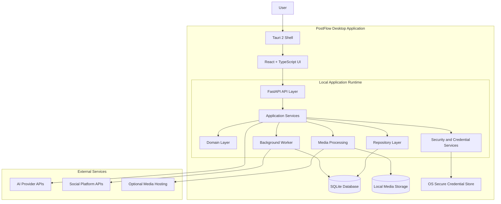

### 3.1 Architectural interpretation

The frontend communicates with the backend through a versioned local HTTP API.

The backend coordinates application operations through application services.

Domain logic remains independent of FastAPI, SQLite, React, and external platform SDKs.

Integration adapters translate internal requests into provider-specific or platform-specific requests.

The worker processes persistent jobs independently of interactive frontend requests.

SQLite remains the source of truth for structured local application state.

Local filesystem storage holds media files, while the database stores asset metadata and storage references.

### 3.2 Core architectural rule

**The UI must never own business-critical publishing logic.**

The frontend may initiate a publish request, but the backend must independently validate:

- Workspace and brand context.
- Target social account.
- Account connection status.
- Required permissions.
- Media compatibility.
- Platform-specific content constraints.
- Approval state.
- Approved content revision.
- Job idempotency.
- Scheduling eligibility.

A frontend validation result is informational. Backend validation is authoritative.

---

## 4. Application Layers

### 4.1 Layer 1 - Desktop Shell

**Technology:** Tauri 2

Responsibilities:

- Application startup and shutdown.
- Window management.
- Desktop packaging and installation.
- Native file selection.
- Application-level permissions.
- Secure interaction with native capabilities.
- Backend process lifecycle coordination.
- Desktop notifications where supported.
- Application update integration when introduced.

The Tauri shell must not contain the product's core business rules.

It should expose only the native functionality required by the frontend.

Security boundaries:

- Restrict Tauri capabilities.
- Avoid unrestricted shell execution.
- Do not expose arbitrary filesystem access.
- Do not expose backend secrets through frontend JavaScript.
- Validate IPC payloads.
- Restrict the local backend to loopback interfaces.

### 4.2 Layer 2 - Presentation Layer

**Technology:** React + TypeScript

Responsibilities:

- Render application screens.
- Manage temporary UI state.
- Display backend data.
- Submit commands through API clients.
- Display validation errors.
- Provide content editing and previews.
- Present publishing and scheduling status.
- Display integration and account health.
- Support accessible user interactions.

The frontend should not:

- Store raw AI API keys.
- Store OAuth access or refresh tokens.
- Implement independent publishing state transitions.
- Decide whether an account is authorized to publish.
- Directly call social platform APIs using stored account credentials.
- Implement database access.
- Bypass backend approval checks.

### 4.3 Layer 3 - API and Application Layer

**Technology:** FastAPI + Python

This layer exposes API contracts and orchestrates use cases.

Responsibilities:

- Request validation.
- Authentication of local application requests.
- Authorization and workspace scoping.
- Application service invocation.
- Transaction boundaries.
- Error handling.
- Response serialization.
- API versioning.
- Correlation IDs and operational logging.

Example:

```text
POST /api/v1/content/{content_id}/generate
    |
    v
ContentGenerationController
    |
    v
GenerateContentService
    |
    v
BrandContextService
    |
    v
AIOrchestrator
    |
    v
ProviderAdapter
    |
    v
PersistGenerationResult
```

Controllers must remain thin. They should not contain provider-specific request construction, complex business rules, or direct database orchestration.

### 4.4 Layer 4 - Domain Layer

**Technology:** Python

This layer owns the core business rules.

Core domain concepts:

- Workspace.
- Brand.
- AI Provider.
- Content Item.
- Content Revision.
- Platform Variant.
- Media Asset.
- Social Account.
- Approval.
- Publishing Job.
- Publishing Attempt.
- Published Post.
- Campaign.
- Schedule.

Responsibilities:

- Content lifecycle rules.
- Approval validity.
- Publishing eligibility.
- Job state transitions.
- Idempotency rules.
- Account and destination validation.
- Platform-independent business policies.
- Revision and history integrity.

The domain layer must not depend on:

- FastAPI request objects.
- React components.
- SQLAlchemy session objects.
- Provider-specific SDKs.
- Social platform SDKs.
- Tauri APIs.

### 4.5 Layer 5 - Integration Layer

Responsibilities:

- AI provider communication.
- Social platform communication.
- OAuth workflows.
- Token refresh.
- Media hosting integration.
- External API error normalization.
- Rate-limit handling.
- Provider capability detection.

All external integrations must be accessed through explicit interfaces and adapters.

### 4.6 Layer 6 - Persistence Layer

Responsibilities:

- Database queries.
- Transactions.
- Repository implementations.
- Data mapping.
- Schema migrations.
- Backup and recovery.
- Media metadata persistence.

Business services should use repository interfaces rather than embedding SQL queries throughout the application.

### 4.7 Layer 7 - Background Execution Layer

Responsibilities:

- Scheduled job discovery.
- Job claiming.
- Due-job execution.
- Publishing.
- Retry policy.
- Recovery after restart.
- Token refresh coordination.
- Job reconciliation.
- Cleanup of temporary files.

The worker must use the same application services and domain policies as interactive API requests.

Do not implement a second, independent publishing workflow inside the scheduler.

---

## 5. Backend Service Architecture

The backend should be divided into bounded business modules.

Each module owns its services, schemas, domain logic, repositories and tests.

### 5.1 Workspace Service

Responsibilities:

- Create and manage workspaces.
- Select active workspace.
- Enforce workspace boundaries.
- Manage workspace settings.
- Provide workspace context to downstream services.

Dependencies:

- Workspace repository.
- Brand service.
- Authorization service.

### 5.2 Brand Service

Responsibilities:

- Create and update brand profiles.
- Store brand voice and style guidelines.
- Manage audience descriptions.
- Store brand-specific content preferences.
- Build sanitized brand context for AI generation.

Brand context must be scoped to the selected workspace and brand.

A request for one brand must not accidentally include another brand's private context.

### 5.3 AI Provider Management Service

Responsibilities:

- Register supported providers.
- Store provider configuration.
- Retrieve credentials through secure storage.
- Manage model selection.
- Maintain provider capability metadata.
- Track provider status.
- Record usage and estimated cost where supported.
- Manage user-authorized fallback behavior.

The service must distinguish:

- Provider availability.
- Model availability.
- Feature capability.
- User configuration.
- Credential validity.
- Rate-limit state.

A provider being configured does not mean every model or capability is available.

### 5.4 AI Orchestration Service

Responsibilities:

- Select provider and model.
- Build prompts and structured request payloads.
- Attach approved brand context.
- Execute generation requests.
- Normalize responses.
- Validate structured output.
- Track usage and execution metadata.
- Persist generation results.
- Support multi-provider comparison.

Suggested internal operations:

```python
generate_text(...)
generate_structured(...)
adapt_content(...)
generate_hashtags(...)
generate_alt_text(...)
research_topic(...)
compare_providers(...)
```

These are logical operations, not a promise that every provider supports every operation.

A capability registry must determine which operations each provider adapter supports.

#### Provider adapter contract

```python
class AIProviderAdapter:
    async def generate_text(self, request):
        ...

    async def generate_structured(self, request):
        ...

    async def check_capabilities(self):
        ...

    async def health_check(self):
        ...
```

Optional capabilities should be defined through explicit interfaces or capability metadata rather than assumed to exist on every adapter.

#### Multi-provider comparison

Each provider request must be independently tracked.

If three providers are selected:

- Each request receives a separate execution identifier.
- Each response is persisted independently.
- One failure does not erase successful results.
- Usage and estimated cost are recorded separately.
- Fallback or additional transmission requires user authorization.

### 5.5 Content Management Service

Responsibilities:

- Create content items.
- Maintain source content.
- Track revisions.
- Store generation history.
- Manage content metadata.
- Associate content with brands and campaigns.
- Coordinate content variant creation.

Source content and platform-specific variants must be separate entities.

Editing one variant must not silently modify the source or other platform variants.

### 5.6 Platform Variant Service

Responsibilities:

- Create destination-specific content variants.
- Maintain independent captions and metadata.
- Associate destination-specific media.
- Store hashtags and calls to action.
- Validate platform content constraints.
- Track revision numbers.
- Invalidate approval after relevant edits.

Each variant must identify:

- Source content ID.
- Destination platform.
- Selected social account where applicable.
- Current revision.
- Content payload.
- Associated media.
- Validation result.
- Approval state.

### 5.7 Media Service

Responsibilities:

- Upload and register assets.
- Validate file type and size.
- Generate safe storage paths.
- Extract metadata.
- Generate thumbnails.
- Process images.
- Process videos.
- Track media transformations.
- Associate media with content variants.
- Delete unused assets safely.

Processing must be bounded to protect the 8 GB RAM environment.

Large video transformations should not run concurrently without an explicit resource policy.

### 5.8 Social Account Service

Responsibilities:

- Start OAuth authorization.
- Validate OAuth callbacks.
- Store account metadata.
- Manage credential references.
- Track permissions.
- Monitor token expiry.
- Refresh credentials where supported.
- Disconnect accounts.
- Detect revoked or unavailable permissions.

Tokens must not be returned through normal frontend API responses.

### 5.9 Platform Capability Service

Responsibilities:

- Maintain supported platform capabilities.
- Validate account eligibility.
- Identify supported publishing formats.
- Identify media requirements.
- Identify API restrictions.
- Report missing permissions.
- Expose integration readiness to the UI.

Example capability model:

```json
{
  "platform": "instagram",
  "capabilities": {
    "text_post": false,
    "image_post": true,
    "video_post": true,
    "scheduled_execution": true
  },
  "status": "permission_dependent"
}
```

This is an illustrative internal structure, not a statement of current Instagram API capabilities.

Actual capabilities must be populated from verified platform documentation and account authorization state.

### 5.10 Approval Service

Responsibilities:

- Submit variants for approval.
- Approve or reject content.
- Store approval metadata.
- Bind approval to a specific revision.
- Invalidate approval after content changes.
- Record approval audit events.

Approval must be evaluated by the backend before a publishing job is accepted for execution.

### 5.11 Publishing Service

Responsibilities:

- Validate publication requests.
- Create destination-specific jobs.
- Generate idempotency identities.
- Coordinate publishing adapters.
- Record publishing attempts.
- Normalize external API responses.
- Persist successful publication identifiers.
- Reconcile unknown outcomes.
- Apply retry policies.

Publishing must be isolated per destination.

If one post targets three platforms, each destination must have its own job and attempt history.

A failure on one platform must not automatically cancel successful or independent jobs for other platforms.

### 5.12 Scheduling Service

Responsibilities:

- Create scheduled jobs.
- Validate scheduled timestamps.
- Store scheduling configuration.
- Identify due jobs.
- Handle paused schedules.
- Reschedule eligible jobs.
- Detect missed executions.
- Recover jobs after application restart.

All execution timestamps must be stored in UTC.

The original timezone and intended local schedule should also be retained for display and audit purposes.

### 5.13 Analytics Service

Responsibilities:

- Retrieve available platform metrics.
- Normalize platform-specific metrics.
- Store analytics snapshots.
- Calculate derived metrics.
- Display reporting data.

Analytics must distinguish:

- Actual platform-reported metrics.
- Locally calculated metrics.
- Estimated values.
- Unavailable metrics.

Never fabricate engagement or publication statistics.

### 5.14 Audit and Activity Service

Responsibilities:

- Record important application actions.
- Record account connection and disconnection.
- Record approval events.
- Record publishing attempts.
- Record schedule changes.
- Record credential and security events without secrets.
- Provide an activity timeline.

---

## 6. Frontend Component Architecture

### 6.1 Frontend module structure

```text
frontend/src/
├── app/
│   ├── App.tsx
│   ├── router.tsx
│   ├── providers/
│   └── layouts/
│
├── components/
│   ├── ui/
│   ├── navigation/
│   ├── forms/
│   ├── feedback/
│   └── shared/
│
├── features/
│   ├── dashboard/
│   ├── workspace/
│   ├── brands/
│   ├── ai-providers/
│   ├── ai-studio/
│   ├── content/
│   ├── composer/
│   ├── media-library/
│   ├── social-accounts/
│   ├── approvals/
│   ├── publishing/
│   ├── scheduler/
│   ├── calendar/
│   ├── analytics/
│   └── settings/
│
├── services/
│   ├── api-client.ts
│   ├── auth-client.ts
│   ├── error-handler.ts
│   └── event-client.ts
│
├── hooks/
├── stores/
├── types/
├── utils/
└── styles/
```

### 6.2 Component ownership

| Frontend feature | Owns | Does not own |
|---|---|---|
| Dashboard | Aggregated status and activity presentation | Business calculations |
| Workspace | Workspace selection and configuration UI | Workspace authorization rules |
| Brands | Brand profile editing | AI prompt execution |
| AI Providers | Provider configuration and status | Secret storage implementation |
| AI Studio | Generation controls and result presentation | Provider SDK calls |
| Content | Content browsing and editing | Database persistence |
| Composer | Platform variant editing and previews | Publishing authorization |
| Media Library | Asset browsing and selection | Filesystem security |
| Social Accounts | OAuth initiation and account status | OAuth token management |
| Approvals | Approval interaction | Approval enforcement |
| Publishing | Job status and history | External publishing calls |
| Scheduler | Schedule configuration and calendar interaction | Job execution |
| Analytics | Metric visualization | Metric fabrication or platform scraping |
| Settings | User preferences and configuration | Direct system-level secret access |

### 6.3 Frontend state ownership

Use local component state for temporary interactions.

Use shared application state only for information that genuinely needs to be shared across features.

Persisted application state must be retrieved from the backend.

Do not treat browser or frontend state as the authoritative source for:

- Approval status.
- Account permissions.
- Publishing status.
- Scheduled job state.
- API credentials.
- Content revision identity.

---

## 7. Integration Architecture

PostFlow uses two distinct integration categories.

1. AI intelligence integrations.
2. Social media publishing integrations.

They must not share business logic merely because both communicate with external HTTP APIs.

### 7.1 AI integration architecture

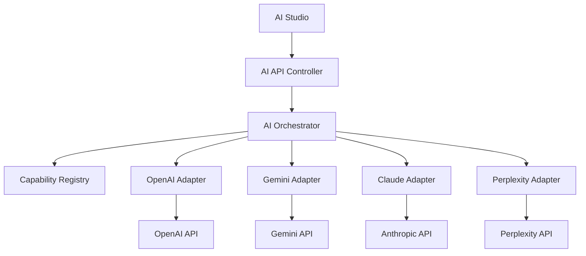

#### Adapter responsibilities

Each adapter owns:

- Authentication header construction.
- Provider-specific endpoint handling.
- Request serialization.
- Response parsing.
- Error normalization.
- Usage metadata extraction.
- Timeout handling.
- Provider-specific retry constraints.

The orchestrator owns:

- Provider selection.
- Model selection.
- Capability checks.
- Request coordination.
- Result persistence.
- Multi-provider comparison.
- User-authorized fallback.

#### AI data transmission boundary

Before transmitting user content, the system must identify:

- Provider.
- Model.
- Data categories being sent.
- Brand context being included.
- Media or document content being transmitted.
- Applicable provider data handling information where known.

Do not transmit all workspace data by default.

Use minimum necessary context.

### 7.2 Social platform integration architecture

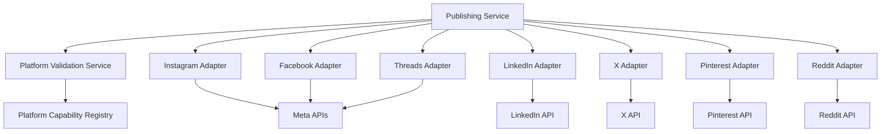

The diagram represents intended integration boundaries, not guaranteed API access.

Each platform adapter must own:

- OAuth or authorization workflow.
- Account identification.
- Permission checks.
- Platform-specific payload construction.
- Media upload or hosting workflow.
- Publication request.
- External response parsing.
- Rate-limit handling.
- Error classification.
- Publication status reconciliation.

### 7.3 Platform adapter contract

```python
class SocialPlatformAdapter:
    async def connect(self, authorization_request):
        ...

    async def refresh_credentials(self, credential_reference):
        ...

    async def get_account(self, account_reference):
        ...

    async def get_capabilities(self, account_reference):
        ...

    async def validate_post(self, post_request):
        ...

    async def publish(self, publish_request):
        ...

    async def reconcile(self, attempt_reference):
        ...
```

An adapter may explicitly report that a capability is unsupported.

Do not create fake successful implementations to make every platform appear integrated.

### 7.4 Platform integration readiness

| Platform | Integration direction | Key dependency |
|---|---|---|
| Instagram | Professional account publishing | Eligible account and Meta permissions |
| Facebook | Page publishing | Page authorization and permissions |
| LinkedIn | Member and organization publishing where authorized | Product access and scopes |
| Threads | Official Threads API | Authorization and supported capabilities |
| X | Official API | Current access tier, pricing and permissions |
| Pinterest | Pin and board management | Application access and scopes |
| Reddit | Official API integration | Developer approval and commercial-use terms |

**Important:** Reddit should remain a gated integration until commercial terms and intended use are verified. X must also be assessed against current API pricing and access restrictions before committing to a production feature.

### 7.5 Integration failure isolation

A platform adapter failure must not corrupt shared content data.

For a multi-platform publishing request:

```text
Content Item
    |
    +-- LinkedIn Job --> Published
    |
    +-- Instagram Job --> Failed
    |
    +-- Pinterest Job --> Queued
```

The overall content item must retain all destination outcomes.

---

## 8. Data Model and Persistence Boundaries

### 8.1 Database ownership

SQLite is the source of truth for structured application data.

Suggested logical entities:

| Entity | Responsibility |
|---|---|
| users | Local user profile or future SaaS identity |
| workspaces | Workspace boundaries |
| workspace_members | Future membership and authorization |
| brands | Brand configuration |
| ai_providers | Provider configuration metadata |
| content_items | Source content |
| content_revisions | Historical source revisions |
| post_variants | Platform-specific content |
| variant_revisions | Historical platform variant revisions |
| media_assets | Media metadata and file references |
| social_accounts | Connected account metadata |
| credential_references | References to secure credential storage |
| publish_jobs | Destination-specific execution jobs |
| publish_attempts | Individual external publishing attempts |
| published_posts | Confirmed external publication records |
| approvals | Revision-bound approval records |
| campaigns | Content grouping and campaign metadata |
| schedules | Scheduling configuration |
| analytics_snapshots | Platform-reported metric snapshots |
| prompt_templates | Reusable prompt templates |
| audit_logs | Security and operational audit records |
| app_settings | Non-secret application settings |

The final physical schema must be reconciled with the existing database design before migrations are created.

### 8.2 Database relationship overview

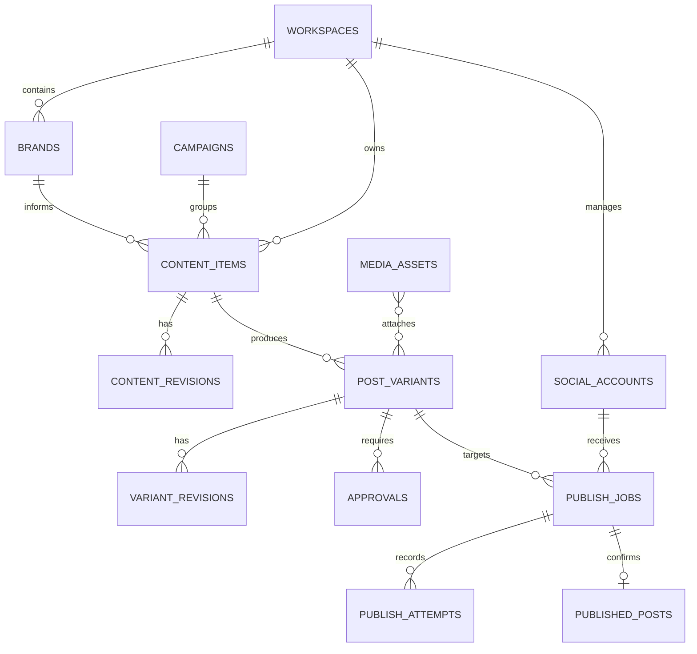

### 8.3 Persistence rules

- Use UUIDs for application entity identifiers.
- Store timestamps in UTC.
- Retain timezone information for scheduled display.
- Enforce foreign-key constraints.
- Use database transactions for critical state changes.
- Use Alembic migrations.
- Use indexes for job discovery and common lookups.
- Store large media files outside SQLite.
- Store media metadata and file references in SQLite.
- Avoid storing duplicate copies of large content payloads without a retention policy.
- Preserve publishing attempt history.

### 8.4 SQLite operational rules

Use SQLite WAL mode where appropriate.

Configure:

- Foreign keys enabled.
- Busy timeout.
- Controlled transaction duration.
- Appropriate checkpoint policy.
- Explicit backup strategy.
- Database integrity checks.

SQLite permits concurrent readers but has constrained write concurrency. The worker and API must coordinate writes through short transactions and controlled job claiming.

Do not run multiple independent processes that modify the same SQLite database without a defined concurrency strategy.

### 8.5 Repository boundary

Application services should depend on repository interfaces.

Example:

```python
class PublishJobRepository:
    async def create(self, job):
        ...

    async def get_by_id(self, job_id):
        ...

    async def claim_due_jobs(self, limit):
        ...

    async def update_status(self, job_id, status):
        ...
```

The SQLite implementation belongs in the infrastructure layer.

This allows future PostgreSQL implementations without rewriting publishing business logic.

---

## 9. Media Storage Architecture

### 9.1 Storage model

Use the local filesystem for media binaries.

Suggested structure:

```text
PostFlowData/
├── database/
│   ├── postflow.db
│   └── backups/
│
├── media/
│   ├── originals/
│   ├── processed/
│   ├── thumbnails/
│   └── temporary/
│
├── logs/
├── cache/
└── exports/
```

Production paths must be resolved through the operating system's application-data directory, not hardcoded development paths.

### 9.2 Media processing flow

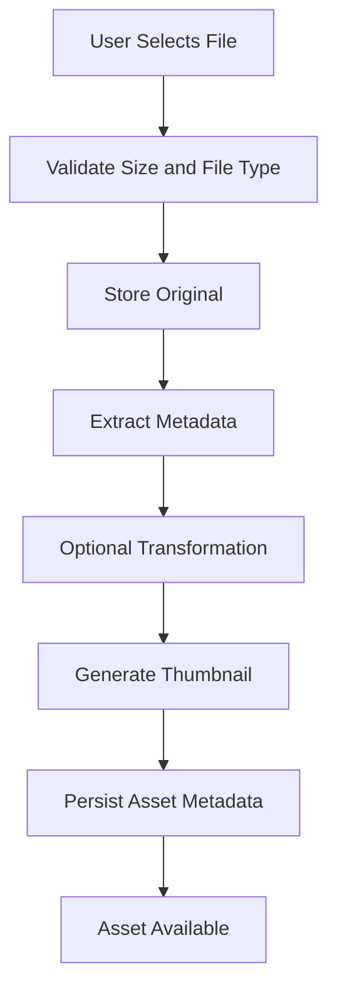

### 9.3 Media processing controls

- Validate actual file content, not only file extensions.
- Use safe generated storage names.
- Prevent path traversal.
- Enforce configurable upload limits.
- Process media in bounded workers.
- Preserve original assets.
- Track transformed asset lineage.
- Avoid loading entire large video files into memory.
- Apply timeouts and process limits to FFmpeg.
- Clean abandoned temporary files.
- Verify output files before marking transformations successful.

### 9.4 Remote media hosting

Some publishing APIs require media to be accessible through a public URL or an approved upload workflow.

The media service must support platform-specific media delivery strategies.

Do not assume local filesystem paths can be submitted directly to social platform APIs.

If remote hosting is required:

1. Identify the platform requirement.
2. Obtain user consent where data is transmitted to another service.
3. Upload the required asset.
4. Track the external asset reference.
5. Apply an appropriate retention and deletion policy.
6. Avoid exposing unrestricted local files through a public HTTP server.

---

## 10. Critical Data Flows

### 10.1 AI content generation

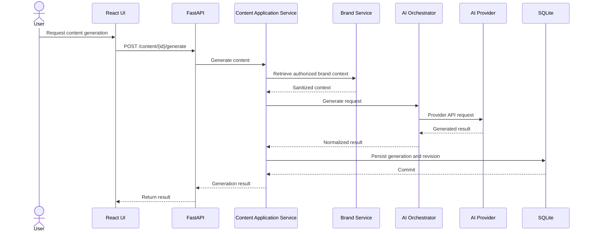

Important rules:

- Validate the request before provider execution.
- Do not transmit unrelated workspace data.
- Apply request timeouts.
- Validate generated structured data.
- Preserve provider and model metadata.
- Record usage where available.
- Persist results before reporting successful completion.

### 10.2 Platform-specific content adaptation

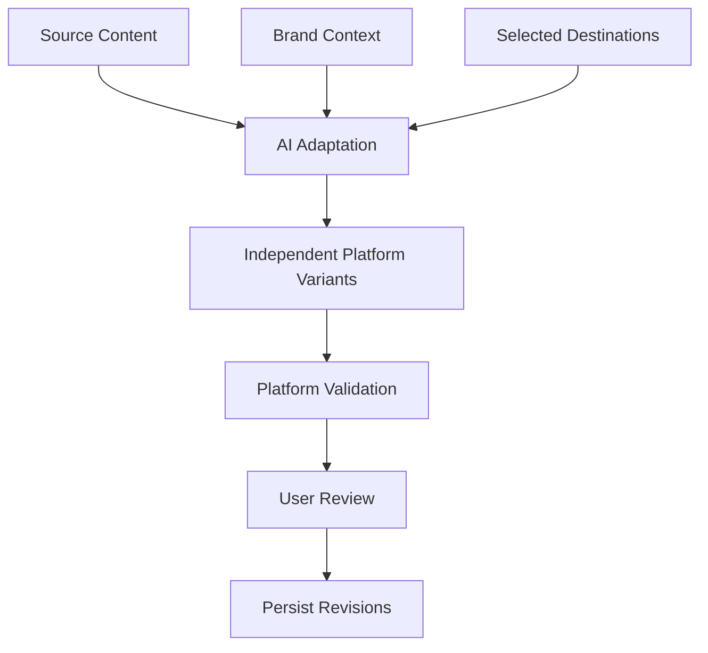

Each destination receives an independent variant.

A change to one destination must not silently change another destination.

### 10.3 OAuth connection

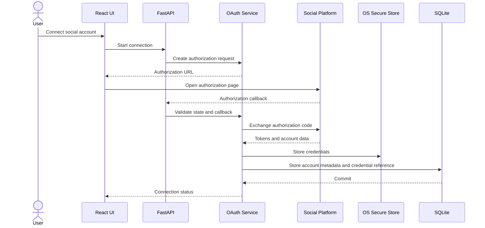

OAuth implementation must follow the authorization flow supported by the target platform.

Use state validation and PKCE where supported and applicable.

Do not persist raw access or refresh tokens in normal database columns, frontend state, application logs, or exported configuration files.

### 10.4 Publishing flow

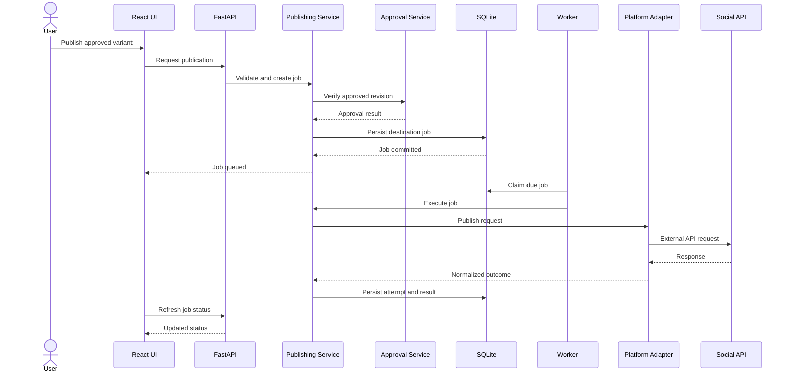

The API request must not hold an HTTP connection open while waiting for a long-running publication workflow.

Return a job identifier and allow the frontend to retrieve the execution status.

### 10.5 Scheduling flow

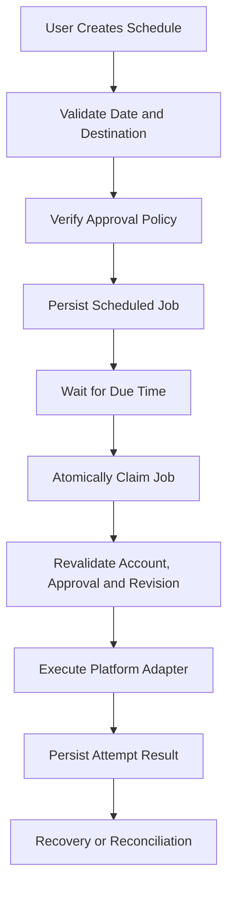

The worker must revalidate all critical conditions at execution time.

A job that was valid when scheduled may become invalid before publication because:

- Approval was revoked or invalidated.
- The content revision changed.
- The account was disconnected.
- Permissions were revoked.
- Credentials expired.
- The destination became unavailable.
- The media asset was removed.

---

## 11. Publishing State Machine and Reliability

### 11.1 Job lifecycle

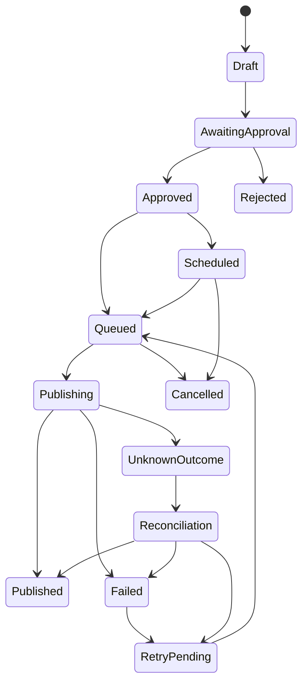

This is a logical lifecycle. Persisted job states and content approval states should be separate entities rather than one overloaded status field.

### 11.2 Idempotency

A publication operation must have a stable identity.

The identity should include:

- Content variant.
- Destination account.
- Approved revision.
- Logical publication operation.

Repeated submission of the same logical operation must not create duplicate jobs.

An intentional new publication must use a distinct operation identity.

### 11.3 Unknown external outcomes

A network timeout does not prove that a platform failed to publish.

If a platform accepts a post but the response is lost, retrying immediately may create a duplicate.

Required behavior:

1. Mark the attempt as `unknown_outcome`.
2. Do not blindly retry.
3. Query the platform or use another supported reconciliation mechanism.
4. Confirm whether publication occurred.
5. Record the external post identifier if found.
6. Retry only when the outcome is sufficiently established as not published.

If the platform does not support reliable reconciliation, expose the uncertainty and require an appropriate manual decision.

### 11.4 Retry policy

Classify failures into:

- Authentication failure.
- Authorization failure.
- Rate limit.
- Temporary platform outage.
- Network timeout.
- Invalid content.
- Unsupported media.
- Permanent API rejection.
- Unknown external outcome.

Only eligible transient failures should enter automatic retry.

Retries must use bounded attempts, backoff and jitter where appropriate.

Never retry permanent validation or authorization failures automatically.

---

## 12. Background Worker Architecture

### 12.1 Desktop execution model

The initial desktop product should use a lightweight persistent worker.

Recommended process model:

```text
PostFlow.exe
    |
    +-- Tauri Desktop Process
    |
    +-- FastAPI Backend Process
    |
    +-- Background Worker
```

The exact process packaging may evolve, but the worker and API must share the same application services and persistence rules.

### 12.2 Worker responsibilities

- Poll for due jobs.
- Claim jobs safely.
- Execute eligible work.
- Persist job state.
- Record attempts.
- Handle timeouts.
- Recover interrupted work.
- Reconcile uncertain publishing outcomes.
- Release expired job claims.

### 12.3 Worker controls

For the initial hardware target:

- Start with one worker.
- Use a bounded queue.
- Limit concurrent media transformations.
- Limit concurrent AI requests.
- Use explicit HTTP timeouts.
- Avoid unbounded in-memory job queues.
- Avoid multiple independent schedulers claiming the same job.
- Keep SQLite transactions short.

### 12.4 Job claiming

Use an atomic database operation or transaction to claim jobs.

A job claim should include:

- Worker identifier.
- Claim timestamp.
- Lease expiration.
- Current attempt.
- Execution status.

If the worker crashes, an expired lease allows recovery.

Recovery must inspect the last execution state before deciding whether the job can safely run again.

### 12.5 Desktop operational limitation

Scheduled publishing requires:

- The computer to be powered on.
- The application or supported background service to be running.
- Network connectivity.
- Valid platform authorization.
- The platform API to be available.

A desktop application cannot guarantee scheduled execution while the machine is powered off, asleep, offline, or while its worker is stopped.

The UI must communicate missed or delayed schedules accurately.

---

## 13. API Architecture

### 13.1 API conventions

Base path:

```text
/api/v1
```

API requirements:

- JSON request and response contracts.
- Pydantic validation.
- Consistent error responses.
- Pagination for collection endpoints.
- UTC timestamps.
- Correlation IDs.
- Idempotency support for critical commands.
- Explicit API versioning.
- Authorization checks.
- No secrets in responses.

### 13.2 Logical endpoint groups

| Group | Example endpoints |
|---|---|
| System | `/health`, `/system/status` |
| Workspaces | `/workspaces` |
| Brands | `/brands` |
| AI providers | `/ai/providers` |
| AI generation | `/content/{id}/generate` |
| Content | `/content` |
| Variants | `/variants` |
| Media | `/media` |
| Social accounts | `/accounts` |
| OAuth | `/integrations/{platform}/connect` |
| Approval | `/variants/{id}/approve` |
| Publishing | `/publish`, `/publish/jobs` |
| Scheduling | `/schedule` |
| Calendar | `/calendar` |
| Analytics | `/analytics` |
| Audit | `/activity` |
| Settings | `/settings` |

### 13.3 Example response

```json
{
  "success": true,
  "data": {
    "job_id": "uuid",
    "status": "queued",
    "destination": "linkedin"
  },
  "meta": {
    "correlation_id": "uuid"
  }
}
```

### 13.4 Error response

```json
{
  "success": false,
  "error": {
    "code": "APPROVAL_REQUIRED",
    "message": "The current content revision has not been approved.",
    "details": {}
  },
  "meta": {
    "correlation_id": "uuid"
  }
}
```

Error messages must not expose raw credentials, access tokens, internal secrets, or sensitive provider response bodies.

---

## 14. Local Security Architecture

### 14.1 Trust boundaries

PostFlow contains four primary trust boundaries:

1. Frontend to local backend.
2. Local backend to OS secure storage.
3. Local backend to external AI providers.
4. Local backend to external social platforms.

Each boundary must have explicit authentication, validation, and data handling rules.

### 14.2 Local API protection

- Bind FastAPI to `127.0.0.1`.
- Do not bind to `0.0.0.0` by default.
- Generate a per-installation local API secret.
- Use a secure mechanism to provision the secret to the trusted desktop runtime.
- Validate requests.
- Restrict allowed origins.
- Avoid exposing unrestricted API endpoints to other local processes.
- Do not place the secret in source code or logs.

Loopback binding alone is not a complete security boundary. A local malicious process may still attempt to communicate with the service.

### 14.3 Credential architecture

Use OS-backed secure storage, such as Windows Credential Manager or an appropriate Windows DPAPI-backed implementation.

Store only a credential reference in SQLite.

Example:

```text
SQLite:
    account_id
    platform
    credential_reference

OS Secure Store:
    access_token
    refresh_token
    client_secret
```

The actual secure-storage implementation must be tested for application upgrades, account switching, backup behavior and credential recovery.

### 14.4 OAuth protection

- Validate state.
- Use PKCE where supported.
- Validate redirect and callback handling.
- Avoid logging authorization codes.
- Protect refresh tokens.
- Handle revoked authorization.
- Revalidate permissions before publishing.
- Remove or revoke credentials when accounts are disconnected, according to platform support.

### 14.5 AI request security

AI-generated output is untrusted input.

The system must:

- Validate structured output.
- Sanitize data before rendering.
- Prevent AI output from executing application commands.
- Prevent prompt injection from overriding system-level application rules.
- Require explicit user authorization for publishing.
- Avoid silently transmitting sensitive context to external providers.

### 14.6 Media security

- Validate file signatures.
- Restrict supported formats.
- Enforce file-size limits.
- Use generated filenames.
- Prevent path traversal.
- Store files in application-controlled directories.
- Restrict FFmpeg execution.
- Never execute uploaded files.
- Avoid publicly exposing local media directories.

### 14.7 Audit logging

Record security-relevant events without recording secrets.

Examples:

- Account connected.
- Account disconnected.
- Permission failure.
- Approval granted.
- Approval invalidated.
- Publishing attempt.
- Publishing reconciliation.
- Credential refresh failure.
- Configuration changes.

---

## 15. Desktop Deployment Architecture

### 15.1 Packaging model

The production desktop application should package:

- Tauri desktop shell.
- Compiled React frontend.
- Python FastAPI backend.
- Required Python runtime dependencies.
- Media-processing dependencies where applicable.
- Database initialization and migration logic.
- Worker startup and shutdown coordination.

The Python backend should be distributed as a controlled sidecar or packaged executable rather than requiring users to install a development environment.

### 15.2 Runtime startup

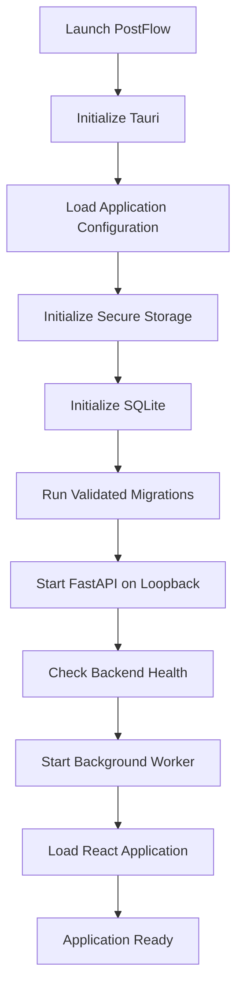

The application must not report itself as fully ready before required backend health checks pass.

### 15.3 Shutdown

On normal shutdown:

1. Stop accepting new background work.
2. Stop claiming new jobs.
3. Allow safe operations to finish within a bounded shutdown period.
4. Persist current job states.
5. Release or expire job claims safely.
6. Close database connections.
7. Shut down the backend process.
8. Close the desktop application.

An interrupted publishing operation must be recovered through the reconciliation workflow, not assumed to have failed.

### 15.4 Local data directories

Use the operating system's application-data locations.

Keep:

- Database.
- Media.
- Logs.
- Cache.
- Exports.
- Backups.

separate from the installation directory.

Application upgrades must not overwrite user data.

### 15.5 Development versus production

| Area | Development | Production |
|---|---|---|
| Frontend | Vite dev server | Compiled frontend |
| Backend | Python development process | Packaged backend |
| Database | Development SQLite file | User application-data SQLite |
| Secrets | Local test credentials | OS secure storage |
| OAuth | Test application credentials | Approved application configuration |
| Media | Development directory | Application-data media directory |
| Logging | Verbose development logs | Redacted structured logs |
| API | Local development configuration | Loopback-only protected API |

### 15.6 Update and migration strategy

An application update must:

- Verify the new package.
- Preserve user data.
- Check database compatibility.
- Run controlled migrations.
- Maintain a recovery path.
- Avoid destructive schema changes without backup.
- Report migration failure clearly.

Database migrations must be tested against a copy of a previous supported application database before release.

---

## 16. Future SaaS Deployment Architecture

The SaaS architecture should reuse domain logic, application services, schemas, provider adapters and platform adapters wherever possible.

It must not simply expose the desktop FastAPI server publicly.

### 16.1 Target SaaS architecture

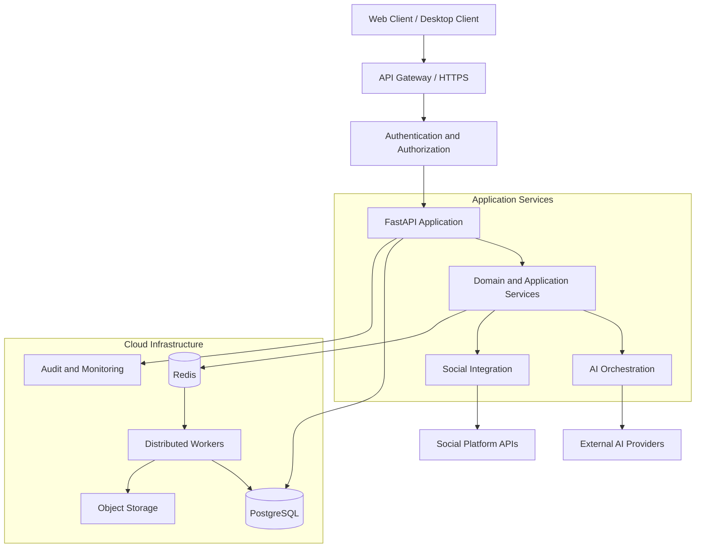

### 16.2 SaaS infrastructure

| Desktop component | SaaS replacement or extension |
|---|---|
| SQLite | PostgreSQL |
| Local media filesystem | Cloud object storage |
| Local worker | Distributed workers |
| Local scheduler | Centralized scheduler |
| OS credential store | Managed secret infrastructure and encrypted credential storage |
| Local workspace | Tenant-isolated workspace |
| Local user context | Authentication and RBAC |
| Desktop activity logs | Centralized observability |
| Local backups | Managed database and object backups |

Redis and distributed workers are future SaaS infrastructure choices, not mandatory desktop components.

### 16.3 Multi-tenancy

SaaS must introduce:

- Tenant identity.
- Tenant-scoped data access.
- Workspace membership.
- Role-based permissions.
- Tenant-aware background jobs.
- Tenant-specific usage limits.
- Tenant-specific AI configuration.
- Credential isolation.
- Audit trails.

Every tenant-owned database operation must enforce tenant scope.

Tenant isolation must be tested at the repository and API layers.

### 16.4 Deployment profiles

Keep deployment differences behind infrastructure interfaces.

Suggested profiles:

```text
deployment/
├── desktop/
│   ├── sqlite_repository.py
│   ├── local_media_storage.py
│   ├── local_scheduler.py
│   └── os_secret_store.py
│
└── saas/
    ├── postgres_repository.py
    ├── object_storage.py
    ├── distributed_scheduler.py
    └── managed_secret_store.py
```

These are conceptual boundaries. The actual implementation should avoid duplicating domain and application logic.

---

## 17. Recommended Repository Structure

```text
PostFlow/
│
├── apps/
│   ├── desktop/
│   │   ├── src-tauri/
│   │   │   ├── src/
│   │   │   ├── capabilities/
│   │   │   └── tauri.conf.json
│   │   └── README.md
│   │
│   └── frontend/
│       ├── src/
│       │   ├── app/
│       │   ├── components/
│       │   ├── features/
│       │   ├── services/
│       │   ├── hooks/
│       │   ├── stores/
│       │   ├── types/
│       │   └── styles/
│       ├── public/
│       └── package.json
│
├── backend/
│   ├── app/
│   │   ├── main.py
│   │   ├── core/
│   │   │   ├── config.py
│   │   │   ├── security.py
│   │   │   ├── logging.py
│   │   │   └── exceptions.py
│   │   │
│   │   ├── api/
│   │   │   └── v1/
│   │   │       ├── router.py
│   │   │       └── endpoints/
│   │   │
│   │   ├── modules/
│   │   │   ├── workspace/
│   │   │   ├── brands/
│   │   │   ├── ai_providers/
│   │   │   ├── ai_orchestration/
│   │   │   ├── content/
│   │   │   ├── variants/
│   │   │   ├── media/
│   │   │   ├── social_accounts/
│   │   │   ├── approvals/
│   │   │   ├── publishing/
│   │   │   ├── scheduler/
│   │   │   ├── analytics/
│   │   │   └── audit/
│   │   │
│   │   ├── integrations/
│   │   │   ├── ai/
│   │   │   │   ├── base.py
│   │   │   │   ├── registry.py
│   │   │   │   ├── openai/
│   │   │   │   ├── gemini/
│   │   │   │   ├── anthropic/
│   │   │   │   └── perplexity/
│   │   │   │
│   │   │   └── social/
│   │   │       ├── base.py
│   │   │       ├── registry.py
│   │   │       ├── instagram/
│   │   │       ├── facebook/
│   │   │       ├── linkedin/
│   │   │       ├── threads/
│   │   │       ├── x/
│   │   │       ├── pinterest/
│   │   │       └── reddit/
│   │   │
│   │   ├── infrastructure/
│   │   │   ├── database/
│   │   │   ├── repositories/
│   │   │   ├── storage/
│   │   │   ├── secrets/
│   │   │   └── http/
│   │   │
│   │   └── workers/
│   │       ├── scheduler_worker.py
│   │       ├── publishing_worker.py
│   │       └── recovery_worker.py
│   │
│   ├── migrations/
│   ├── tests/
│   └── pyproject.toml
│
├── shared/
│   └── contracts/
│
├── docs/
│
├── scripts/
│
├── tests/
│   ├── unit/
│   ├── integration/
│   ├── contract/
│   ├── security/
│   ├── e2e/
│   └── publishing/
│
├── .github/
│   └── workflows/
│
└── README.md
```

The structure is a target organization. Existing repository files should be inspected before moving or replacing anything.

---

## 18. Component Dependency Rules

These rules prevent architectural coupling.

| Component | Allowed dependencies | Prohibited dependencies |
|---|---|---|
| Frontend | API contracts, UI utilities | Database, secret store, provider SDK |
| API controllers | Application services, schemas | Direct provider SDK calls |
| Application services | Domain, repository interfaces, integration interfaces | Frontend components |
| Domain | Domain types and pure logic | FastAPI, SQLAlchemy, external SDKs |
| AI adapters | AI provider SDK or HTTP clients | Social publishing service |
| Social adapters | Social API clients | AI generation logic |
| Repositories | Database and persistence infrastructure | React, UI state |
| Worker | Application services, job infrastructure | Duplicated domain rules |
| Media service | Media storage and processing interfaces | Direct social API publishing |
| Security service | OS secure storage and cryptographic interfaces | Frontend secret exposure |

### 18.1 Dependency direction

Dependencies should point inward toward stable business logic.

```text
Presentation
     |
     v
API / Application
     |
     v
Domain
     ^
     |
Infrastructure / Adapters
```

Infrastructure implements interfaces required by the application and domain layers.

Avoid circular imports and cross-module access to private implementation details.

### 18.2 Module communication

Use direct service interfaces within the modular monolith.

Use internal events for decoupled side effects where useful.

Examples:

- `ContentCreated`
- `VariantUpdated`
- `ApprovalGranted`
- `ApprovalInvalidated`
- `PublishJobCreated`
- `PublishAttemptCompleted`
- `AccountDisconnected`

Critical business operations must not rely on an in-memory event alone.

If an event must survive a process crash, persist it or derive it from durable database state.

---

## 19. Observability and Operational Monitoring

### 19.1 Logging

Use structured logs with:

- Timestamp.
- Log level.
- Module.
- Correlation ID.
- Operation ID.
- Job ID where relevant.
- Platform or provider identifier.
- Error classification.

Never log:

- API keys.
- OAuth access tokens.
- Refresh tokens.
- Authorization codes.
- Full sensitive user content by default.
- Local API authentication secrets.

### 19.2 Operational health

The application should expose internal health information for:

- Backend process.
- Database connection.
- Database migration state.
- Worker process.
- Scheduler health.
- Media storage availability.
- AI provider configuration.
- Social account authorization state.

A provider being unavailable must not cause the entire application to be considered unhealthy.

Distinguish application health from external integration health.

### 19.3 Job monitoring

Every publishing job should expose:

- Current status.
- Destination.
- Scheduled time.
- Last attempt time.
- Attempt count.
- Last error classification.
- External post identifier where available.
- Reconciliation status.

---

## 20. Performance and Resource Strategy

The desktop baseline is an 8 GB RAM Windows machine with an AMD Ryzen 5 3450U and integrated graphics.

Performance targets are proposed engineering budgets, not measured benchmarks.

| Area | Design target |
|---|---|
| Backend | One API process and one lightweight worker initially |
| Database | SQLite with short transactions |
| AI | Cloud inference only |
| Media | Bounded processing concurrency |
| Frontend | Lazy-load heavy feature screens |
| HTTP | Explicit connection and request timeouts |
| Jobs | Persistent database-backed execution |
| Memory | Avoid unbounded queues and large in-memory media buffers |
| Storage | Separate media, cache, logs and database |
| Startup | Avoid blocking UI on non-critical external integrations |

### 20.1 Resource management

- Limit media processing concurrency.
- Limit simultaneous AI requests.
- Avoid duplicate in-memory content copies.
- Use pagination for large content lists.
- Use thumbnails for media previews.
- Clean temporary media files.
- Avoid frequent full database scans.
- Index due-job queries.
- Use incremental analytics loading.

### 20.2 Performance measurement

Measure actual:

- Application startup time.
- Backend memory use.
- Frontend memory use.
- Database query latency.
- Media processing time.
- Worker idle and active memory.
- Publishing job latency.
- Recovery time after restart.

Do not claim the product meets resource targets until measurements have been collected on the baseline hardware.

---

## 21. Failure Handling Matrix

| Failure | Required behavior |
|---|---|
| AI provider unavailable | Report failure; preserve other provider results |
| AI response malformed | Reject invalid output and preserve diagnostic metadata |
| API key invalid | Disable affected provider operation and request correction |
| Social account disconnected | Block new publishing attempts |
| Token expired | Refresh through supported mechanism or require reauthorization |
| Permission revoked | Block affected capability |
| Platform rate limited | Apply bounded backoff |
| Media processing failure | Preserve original asset and report transformation failure |
| Database unavailable | Block critical mutations and surface recovery state |
| Worker crash | Recover expired claims safely |
| Desktop shutdown | Persist jobs and recover on next startup |
| Publishing timeout | Mark unknown outcome and reconcile before retry |
| User edits approved variant | Invalidate approval |
| User cancels queued job | Prevent execution if cancellation wins the state transition |
| One platform fails | Preserve other destination outcomes |

---

## 22. Architecture Testing Strategy

Testing must validate not only individual features but also the boundaries between components.

### 22.1 Unit tests

Test:

- Domain state transitions.
- Approval revision rules.
- Idempotency key generation.
- Platform validation logic.
- Retry classification.
- Schedule conversion.
- Capability registry.
- Credential reference handling.

### 22.2 Integration tests

Test:

- API to application service.
- Application service to repository.
- Repository to SQLite.
- Worker to publishing service.
- AI orchestrator to mocked adapters.
- Publishing service to mocked social adapters.
- Media service to filesystem.
- Secure-storage integration.

### 22.3 Contract tests

Every adapter must pass contract tests for:

- Successful response normalization.
- Authentication failure.
- Rate limiting.
- Timeout.
- Invalid payload.
- Unsupported capability.
- Provider-specific error mapping.

### 22.4 End-to-end tests

Required journeys:

1. Create workspace and brand.
2. Configure AI provider.
3. Generate source content.
4. Adapt content for multiple platforms.
5. Upload and attach media.
6. Connect a test social account.
7. Approve a content revision.
8. Schedule publication.
9. Restart the application.
10. Recover and execute the due job.
11. Confirm publication result.
12. Inspect publication history.

### 22.5 Architecture quality gates

A release must not proceed if:

- Business rules are implemented only in the frontend.
- Publishing can bypass approval enforcement.
- Credentials appear in logs or frontend responses.
- Duplicate publication tests fail.
- Unknown outcomes are blindly retried.
- Worker recovery loses durable jobs.
- Cross-workspace data access is possible.
- Database migration breaks supported existing data.
- An adapter reports unsupported functionality as successful.
- Critical security issues remain unresolved.

---

## 23. Implementation Sequence

Implement the architecture incrementally.

| Phase | Scope | Main outcome |
|---|---|---|
| 0 | Repository and engineering foundation | Build, lint, test and CI baseline |
| 1 | Tauri, React and FastAPI integration | Desktop application foundation |
| 2 | Database, repositories and migrations | Persistent application foundation |
| 3 | Workspace and brand modules | Core business context |
| 4 | AI provider adapters and orchestration | AI generation |
| 5 | Content and platform variants | Multi-platform composer |
| 6 | Media service | Local media management |
| 7 | OAuth and social account services | Account integrations |
| 8 | Approval and publishing engine | Controlled publishing |
| 9 | Persistent scheduler and worker recovery | Reliable scheduled execution |
| 10 | Calendar, dashboard and activity | Operational UI |
| 11 | Analytics and reporting | Platform performance visibility |
| 12 | Packaging, security and release | Production desktop release |

### 23.1 Phase exit criteria

Each phase must have:

- Implemented functionality.
- Unit tests.
- Integration tests where relevant.
- Updated API contracts.
- Updated architecture documentation.
- Migration tests where relevant.
- Security review for sensitive functionality.
- Acceptance criteria verification.

Do not implement all seven social platform adapters before proving the adapter contract with one real, authorized integration.

---

## 24. Architectural Decisions Requiring Explicit Approval

The following decisions must be finalized during implementation:

| Decision | Recommendation | Validation required |
|---|---|---|
| Backend packaging | Packaged Python sidecar | Tauri lifecycle and installer tests |
| Local API authentication | Per-installation secret | Secure provisioning and local threat model |
| Secret storage | Windows OS-backed store | Packaging, upgrade and recovery tests |
| Scheduler | Persistent SQLite-backed worker | Restart and crash-recovery tests |
| Database concurrency | One controlled writer strategy | Stress and contention tests |
| Media delivery | Adapter-specific hosting/upload strategy | Platform API verification |
| OAuth callback | Platform-compatible callback mechanism | Desktop redirect and security tests |
| SaaS migration | PostgreSQL repository implementation | Data migration and tenant isolation |
| Reddit integration | Deferred until commercial/API access is verified | Terms and permission review |
| X integration | Verify current API plan before implementation | Cost and capability assessment |

---

## 25. Final Architecture Invariants

These rules are non-negotiable.

1. Domain logic must not depend on external provider SDKs.
2. The frontend must not own publishing authorization.
3. AI providers must be replaceable through adapters.
4. Social platforms must be isolated through independent adapters.
5. Source content and platform variants must remain separate.
6. Approval must be bound to a specific content revision.
7. Every destination must have an independent publishing job.
8. Publishing operations must be idempotent.
9. Unknown publishing outcomes must be reconciled before retry.
10. Scheduled jobs must survive normal application restarts.
11. Credentials must never be exposed through frontend responses or logs.
12. External AI data transmission must be disclosed and controlled.
13. Local media must be stored outside the installation directory.
14. SQLite must remain the source of truth for desktop structured data.
15. Desktop scheduling limitations must be visible to users.
16. SaaS deployment must enforce tenant isolation.
17. Platform capabilities must reflect verified API access, not assumptions.
18. Unsupported integration operations must fail explicitly.
19. Critical state transitions must be persisted transactionally.
20. No release may bypass the defined security and reliability gates.

---

## 26. Definition of Complete System Design

The system design is ready for implementation when:

- Application layers and dependency directions are documented.
- Backend module ownership is defined.
- Frontend component ownership is defined.
- AI and social adapter contracts are established.
- Data ownership and persistence boundaries are documented.
- Critical data flows are understood.
- Publishing state transitions and recovery behavior are specified.
- Desktop process lifecycle is defined.
- Security trust boundaries are documented.
- SaaS extension points are identified.
- Architecture-level tests are defined.
- Open decisions have owners and validation criteria.

**Final design decision:** Build PostFlow as a resource-efficient, local-first modular monolith with Tauri, React, FastAPI, SQLite, independent AI and social platform adapters, and a persistent background worker. Preserve clean domain and infrastructure boundaries so the same business capabilities can later support a separately deployed SaaS architecture without prematurely introducing distributed-system complexity.

---

**Document status:** Proposed System Design  
**Implementation authority:** Approved product requirements and acceptance criteria  
**Change policy:** Update this document when a material architecture decision, service boundary, integration contract, persistence model, or deployment model changes.

## M0 Reconciliation — Runtime and State Constraints

**Authority:** `docs/IMPLEMENTATION_BASELINE.md` and `docs/BUILD_READINESS_REPORT.md`. This addendum supersedes conflicting MVP scope and design assumptions in this document. The target is a single-user, local-first Windows desktop MVP. Windows 11 is the production support baseline; Windows 10 is best-effort development only. P0 includes Tauri 2/Rust, React/TypeScript, supervised FastAPI, SQLite/SQLAlchemy/Alembic, local media, source content and independent revisioned variants, one AI provider, exact human approval, durable per-destination publishing jobs, idempotency/immutable attempts/unknown-outcome reconciliation, one-time local scheduling, privacy, backup and restore. At most one official social-platform integration may be enabled, and only after a documented PASS feasibility gate. Scheduling requires the app/worker active, device awake and internet available. Campaigns, team membership/roles, collaboration, billing, SaaS, cloud scheduling, public API, cloud media relay, additional AI providers/platforms, multi-provider comparison/fallback and advanced social analytics are P1/Future, not MVP requirements.

Backend startup/shutdown is supervised by Tauri; failure is surfaced. FastAPI binds to 127.0.0.1 and protected requests pass through a Rust-owned authenticated proxy; React never receives the installation secret. Source content and destination variants have independent revision identities. AI calls use one configured provider without silent fallback or fan-out. Approval is server-enforced and bound to exact revision, destination, media and payload. Publishing jobs are durable, per destination and idempotent; unknown outcomes require reconciliation, not blind retry. The local scheduler persists jobs but executes only while app/worker is active, device awake and online. Campaigns, teams, advanced analytics and cloud services are outside MVP runtime behavior.
